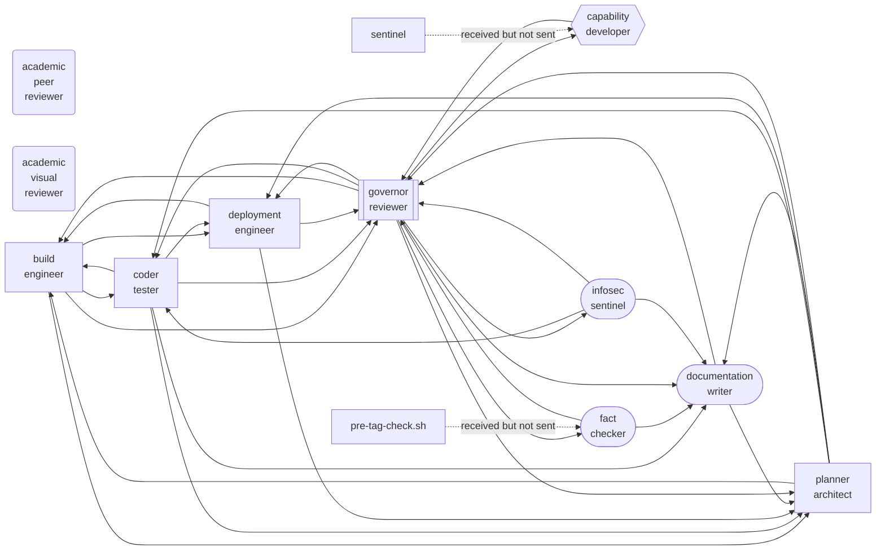

# Agent Communication Graph — v0.26.0

Generated by `pre-tag-check` at release time.

## Communication

## Validation

- **Agents:** 11
- **Communication asymmetries:** 0
- **Ownership overlaps:** 1

### Ownership overlaps

- Ownership overlap between academic-peer-reviewer and academic-visual-reviewer: shared keywords [docs/reviews/, reports, review] — review jurisdictions
