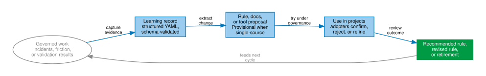

# Evidence and learnings

*Status: Provisional (v2.0 documentation). Audience: developers and
governors. After this page you know how operational incidents become
rules, who owns which records, and how anonymization protects your
project.*

## The learning loop

The framework grows from evidence, not opinion. Figure 1 shows the
learning loop: governed work creates evidence, evidence becomes a
learning record, learning records propose changes, and project use feeds
the next cycle.

Rules shipped on single-adopter evidence carry a **Provisional** header
naming the evidence and asking adopters who hit the rule to file a
learning record. That header is the honesty mechanism: you can always
tell how much evidence stands behind a constraint. The escape hatch is
irreversibility — rules preventing unrecoverable damage (anonymization
leaks, moved git tags) may ship at full strength on single-source
evidence, with the reasoning stated in the rule.

## Who owns which records

Table 1 separates upstream learning records from adopter-owned learning
records and shows what happens to each during framework upgrades.

| Record | Owner | On upgrade |
|---|---|---|
| `learnings/<framework-codenames>.yaml` | Upstream | Replaced |
| `learnings/<your-codename>.yaml` | **You** | Never touched |

The replace-on-upgrade boundary is explicit so that your operational
knowledge survives every framework release. Your file accumulates your
project's incidents; upstream files carry the corroborated evidence base
the rules cite.

## Anatomy of a learning record

A learning record states what happened, what it cost, what was changed,
and what the framework should learn — in schema-validated YAML so the
contribution-audit tooling can process it. Severity is graded; a
critical-severity learning (an incident that produced an irreversible
loss or a near-miss) gets priority in rule formation.

## Anonymization: codenames at the boundary

Inside your repository, your project's natural vocabulary is correct and
expected. At the **export boundary** — filing a learning upstream, an
issue on an external tracker, anything leaving your infrastructure — the
only project handle that may appear is your codename. Domain-revealing
schema names, file paths, and scenario names are replaced with neutral
generics. The anonymization rule treats AI-assistant prompts sent to a
provider API as external content too: the editor feels local; the prompt
is not.

This is what makes upstream contribution safe: the evidence flows, the
identity does not. Codenames in this documentation (*foundry*,
*silver-birch*, *copper-rapids*, *blue-marlin*) are exactly this
mechanism in operation.

## Why evidence discipline matters

A governance framework that invents constraints faster than it validates
them becomes ceremony. The evidence discipline is the brake: every rule
cites the incident or learning that motivated it (the verifiable-claims
rule applies to the framework's own documentation), Provisional status is
visible, and rules that fail to corroborate are candidates for
retirement, not permanence.

## Next

- The daily rhythm that produces these records:
  [day-to-day operation](../operate/day-to-day.md)
- Wiring the validators that check them:
  [contracts and validators](../advanced/contracts-and-validators.md)
