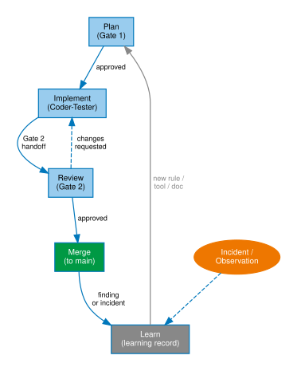
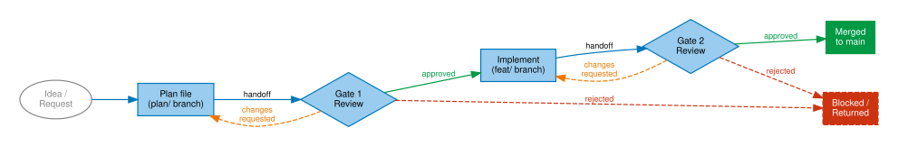
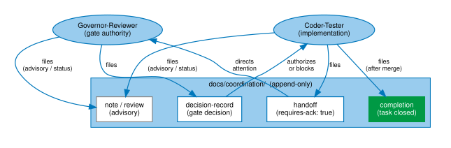
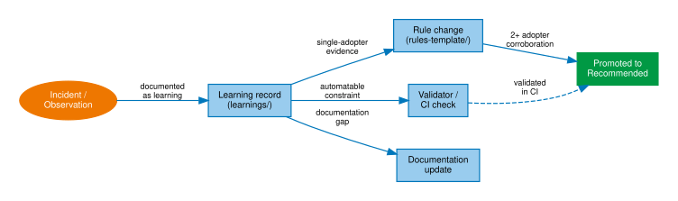
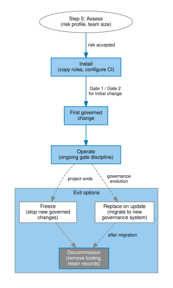

<!--
SPDX-License-Identifier: CC-BY-SA-4.0
-->
# Figures

All figures are generated from DOT source files in
`agents-govern-2.0/docs/figures/src/`. SVG outputs are committed to
`docs/site/reference/figures/` as source-of-truth artifacts.

**To regenerate all figures:**

```bash
cd agents-govern-2.0/docs/figures
for f in src/*.dot; do
  name=$(basename "$f" .dot)
  dot -Tsvg "$f" -o "../site/reference/figures/${name}.svg"
done
```

Requires Graphviz (`dot` version 2.x or later).

## Governance loop



The self-applied cycle: plan → implement → review → merge → learn →
plan. Incidents and observations feed the learning record; the learning
record feeds new rules, tools, and documentation updates.

**Source:** `docs/figures/src/governance-loop.dot`

---

## Gate 1 / Gate 2 pipeline



The two-gate quality pipeline. Gate 1 approves the plan before
implementation starts. Gate 2 approves the implementation before merge.
Both gates can return for changes or reject outright.

**Source:** `docs/figures/src/gate-pipeline.dot`

---

## Coordination channel



The append-only coordination channel. Handoffs direct attention to the
next agent; decision records gate or block; completions close tasks;
notes carry advisory or status information.

**Source:** `docs/figures/src/coordination-channel.dot`

---

## Evidence lifecycle



From incident to improvement. An observation becomes a learning record;
learning records promote to rules, validators, or documentation updates;
sufficient corroboration (2+ adopters) promotes a rule from Provisional
to Recommended.

**Source:** `docs/figures/src/evidence-lifecycle.dot`

---

## Adoption and exit flow



From assessment to decommission. Step 0 assesses risk profile; install
and first governed change establish the governance habit. Exit paths
include freeze, replace-on-update, and full decommission — all preserve
the coordination record history.

**Source:** `docs/figures/src/adoption-exit-flow.dot`

---

## Usage rules

- Embed SVG in Markdown with `` from this page,
  or with the full relative path from other pages.
- Do not hand-edit generated SVG files — edit the DOT source and regenerate.
- Use the [visual palette](palette.md) for all new figures.

## See also

- [Visual palette](palette.md) — colour tokens and usage rules
