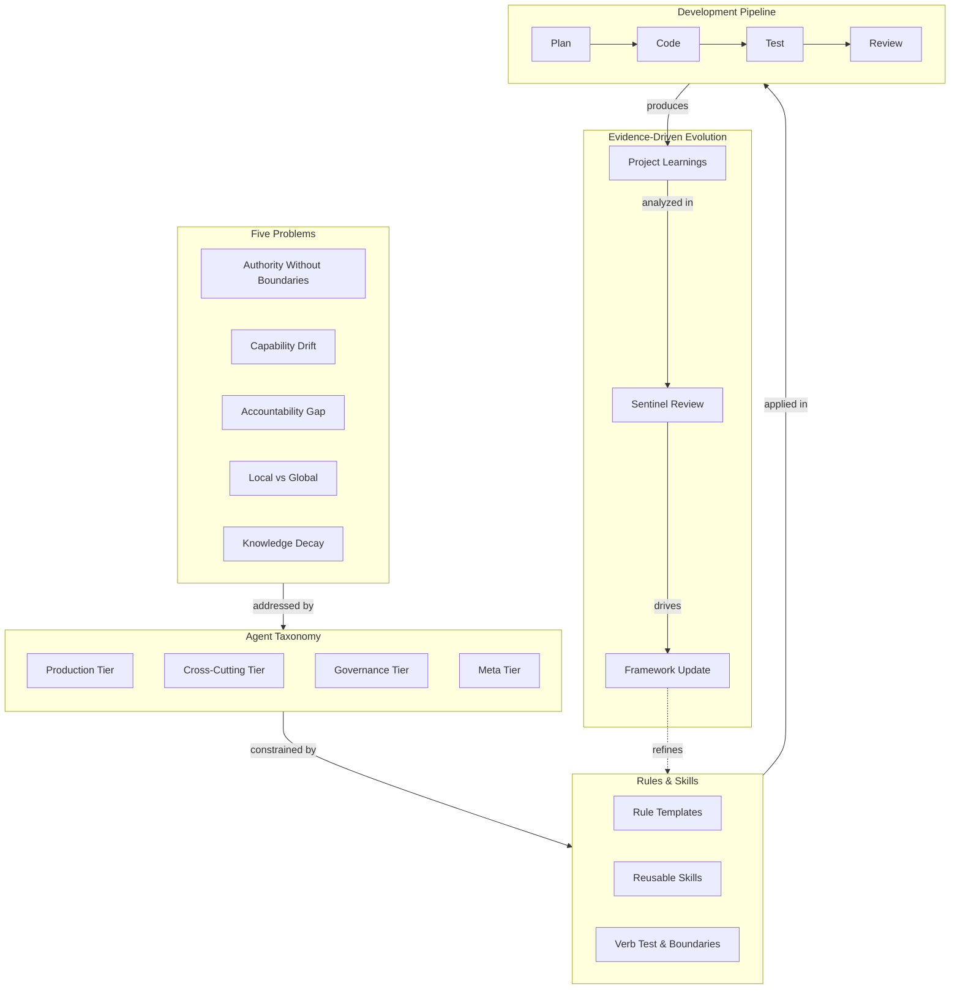

<!-- SPDX-License-Identifier: CC-BY-SA-4.0 -->
<!-- Copyright (c) 2026 Jani Päijänen -->
# Governed Agents for Software Development

**Framework ID:** `agents-govern`
**Version:** see [VERSION](VERSION)
**Last updated:** 2026-04-09

Acknowledgment: This document's first version is based on The Alignment Layer's "What 33 AI Agents Taught Me About..." (Substack, referenced 2026-04-09; see [Bibliography](bibliography.md)).

A technology-agnostic framework for designing multi-agent systems with clear boundaries, separation of concerns, and governance. This document is both a learning resource and a practical reference.

**Validation key:** Each section is tagged with its validation status.
See the [Appendix: Framework Evolution](#appendix-framework-evolution)
for definitions.

| Tag | Meaning |
|-----|---------|
| **[Validated]** | Exercised by multiple independent projects |
| **[Informed]** | Derived from one or few projects' experience |
| **[Theoretical]** | Derived from principles, not yet tested |

### Architecture Overview

The framework is organised as a **five-stage chain from observed
problems to evolved framework**, with a feedback loop that ensures
learnings shape the next iteration of the controls.

1. **Five Problems** — the failure modes that surface when multiple
   agents (AI, human, or mixed) collaborate on a codebase without
   governance: authority without boundaries, capability drift,
   accountability gaps, local-vs-global decisions, and knowledge
   decay. These are the symptoms the framework exists to address.
2. **Agent Taxonomy** — the framework's response to the problems is
   a four-tier role structure (Production, Cross-Cutting,
   Governance, Meta). Each tier has bounded jurisdiction; problems
   are addressed by the tier that owns the relevant authority.
3. **Rules and Skills** — agents alone are not enough. Rule
   templates, reusable skills, and the verb-test-and-boundaries
   discipline turn role definitions into enforceable constraints.
4. **Development Pipeline** — the controls are *applied* across the
   pipeline (plan → code → test → review). Agents and rules become
   active during real work; gates between stages are where
   governance bites.
5. **Evidence-Driven Evolution** — pipeline activity produces
   learning records. Sentinel reviews aggregate learnings across
   projects. Framework updates cite the evidence. The dashed line
   from "Framework Update" back to "Rules and Skills" represents the
   feedback loop: every revision is grounded in observed reality,
   and the controls a future adopter starts with reflect what prior
   adopters learned.

The diagram below renders the same chain top-to-bottom for
narrow-viewport readability. Solid arrows are the forward flow;
the dashed arrow is the feedback loop.



---

## 1. The Five Problems **[Validated]**

Before designing agents, understand what goes wrong without governance. These problems were identified empirically in production multi-agent systems and reframed here for software development teams.

### Problem 1: Authority Without Boundaries

Two agents both believe they own technical decisions. The Planner scopes a feature one way. The Architect redesigns it. Neither knows the other acted. The result is not a compromise — it is incoherent oscillation between competing visions.

**In software development:** A planning agent and a coding agent both decide how to structure a module. They produce conflicting approaches. The system wastes cycles reconciling work that should never have diverged.

**Root cause:** Ambiguous jurisdiction. Competence without boundaries creates conflict.

### Problem 2: Capability Drift

An agent asked to "improve the documentation" decides that means refactoring the codebase. An agent tasked with "review this PR" starts making its own commits. Without constraints, agents expand their scope to match their capabilities, not their mandate.

**In software development:** A testing agent starts fixing bugs it finds instead of reporting them. A deployment agent modifies configuration files it should only read. Each agent is being "helpful" in exactly the way you did not ask for.

**Root cause:** No explicit boundary between what an agent *can* do and what it *should* do.

### Problem 3: The Accountability Gap

Agent A delegates to Agent B, which calls Agent C, which modifies a shared resource. When something breaks, there is no trace of the delegation chain. You see the symptom but not the cause.

**In software development:** A planner delegates a task to a coder, which triggers a deployer, which pushes a broken build. Nobody authorized the full chain. The git log shows what changed but not *why* or *who decided*.

**Root cause:** Context windows expire. Natural language reasoning leaves no reliable audit trail.

### Problem 4: Local Optimization, Global Misalignment

Each agent optimizes for its local objective. The coder writes elegant code. The tester achieves high coverage. The deployer ships fast. Each agent does the right thing within its own scope. But the system-level outcome can still be wrong.

**In software development:** A coder refactors for clean architecture while a deployer is mid-release. A tester writes exhaustive tests for a feature that was already descoped. Each acted correctly from its own perspective. The failure is emergent.

**Root cause:** No agent has visibility across the whole system. Local correctness does not guarantee global coherence.

### Problem 5: Knowledge Decay

Over time, the documents agents rely on drift out of sync with reality. A decision log references a removed feature. A priority file lists completed tasks. Agents behave correctly given their inputs — but their inputs are stale.

**In software development:** An agent plans work based on a requirements doc that was updated two sprints ago. A tester validates against acceptance criteria that no longer reflect the current design. The agents are technically aligned to what they were told, but practically misaligned with what is true.

**Root cause:** Alignment is not static. It degrades as context decays.

---

## 2. Agent Taxonomy **[Validated]**

The framework defines agents across four tiers. At full maturity the system contains up to 20 agents, of which roughly 45% serve governance, cross-cutting, or meta functions. This is not overhead — it is the alignment mechanism.

| Tier | Purpose | Agents |
|------|---------|--------|
| Production | Do the work | Planner, Architect, Coder, Unit Tester, Integration Tester, E2E Tester, System Tester, Build Engineer, Deployer, Observer, Documentation Writer |
| Cross-Cutting | Enforce concerns across stages | UX-Accessibility, Localizer, Data Guardian, Privacy Guardian, Security Guardian |
| Governance | Enforce the rules | Governor, Reviewer, Auditor |
| Meta | Watch the system | Sentinel |

In early phases, many of these are combined (see Section 7). The full taxonomy is the target, not the starting point.

### Tier 1: Production Agents — do the work

These agents produce artifacts: plans, code, tests, deployments, reports.

#### Planner

- **Purpose:** Decompose requirements into scoped, sequenced work items.
- **Jurisdiction:**
  - *Owns:* implementation plans, task breakdowns, dependency graphs, effort estimates.
  - *Reads:* user stories, feature requests, bug reports, existing codebase context, production metrics from Observer.
  - *Cannot touch:* source code, test files, architectural specs, deployment configs.
- **Forbidden actions:**
  - Writing or modifying code.
  - Making architectural decisions (that is Architect's domain).
  - Deploying anything.
  - Approving its own plans.
- **Escalation triggers:**
  - Requirements are ambiguous or contradictory — escalate to human.
  - Plan depends on architectural decisions not yet made — escalate to Governor for routing to Architect.
- **Boundary in one sentence:** The Planner decides *what* to build and *in what order*. It does not decide *how* to build it.

#### Architect

- **Purpose:** Make technical design decisions. Define system structure, interfaces, patterns, and technology choices.
- **Jurisdiction:**
  - *Owns:* architecture decision records (ADRs), interface definitions, technical specifications, component structure.
  - *Reads:* approved plans from Planner, existing codebase architecture, technical constraints.
  - *Cannot touch:* implementation code, test files, plan documents, deployment configs.
- **Forbidden actions:**
  - Writing implementation code.
  - Planning project scope or priorities.
  - Deploying.
  - Overriding Planner on scope decisions.
  - Approving its own designs.
- **Escalation triggers:**
  - Design requires scope changes — escalate to Governor for routing to Planner.
  - Multiple valid approaches with significant trade-offs — escalate to human for decision.
- **Architecture Decision Record (ADR) lifecycle:** ADRs follow an immutable lifecycle: `proposed` → `accepted` → `superseded`. An accepted ADR is never modified — if circumstances change, a new ADR supersedes it, referencing the original. This is Principle 3 (Immutability Constraint) applied to design decisions.
- **ADR required fields:**

  | Field | Purpose |
  |-------|---------|
  | Status | `proposed`, `accepted`, or `superseded` (with reference to superseding ADR) |
  | Context | Forces and circumstances driving the decision |
  | Decision | The decision itself, in a few sentences |
  | Alternatives considered | Each option with pros and cons — the chosen option is not exempt from honest assessment |
  | Counter-arguments sought | Who or what was consulted for dissenting perspectives, and the substance of their input |
  | Strongest objection | The single best argument against this decision, stated honestly |
  | Consequences | Ramifications, both positive and negative |
  | Confidence and reevaluation triggers | How confident is this decision, and what conditions should cause it to be revisited |

- **Seek disagreement:** Before finalizing any design decision, the Architect actively seeks signals that contradict the proposed approach — not just confirmation. This means consulting agents or stakeholders whose concerns might conflict with the design (e.g., asking the Data Guardian about a schema change, or the Coder about implementation feasibility of a proposed interface). The goal is not consensus but honest engagement with objections. A decision made without seeking disagreement is a decision made with incomplete information.
- **Documentation gating by ADR status:** User-facing documentation (deployment guides, user guides, Application Programming Interface (API) references) must only describe implemented features. The mapping:
  - **Proposed** ADRs may have design documentation (in `docs/adr/` or `docs/design/`) but not user-facing guides.
  - **Accepted** ADRs gate user-facing documentation — write guides, tutorials, and references only after the ADR is accepted and the feature is implemented.
  - **Aspirational documentation** (describing planned but unimplemented features) must be clearly marked with a prominent "Not yet implemented" warning. The Documentation-Writer agent enforces this via `honest status labelling`.

  *Why this exists:* A Phase 1 adopter had four documentation files describing an architecture from a "proposed" ADR — including Command-Line Interface (CLI) flags, config schemas, and deployment instructions for features that did not exist in the codebase. Users attempting to follow the documentation encountered silent failures. The most confusing failure mode is documented-but-unimplemented features.
- **Boundary in one sentence:** The Architect decides *how* things are structured. It does not decide *what* gets built or *when*.

#### Coder

- **Purpose:** Write implementation code that conforms to approved plans and architectural decisions.
- **Jurisdiction:**
  - *Owns:* source code, inline documentation, local build configuration.
  - *Reads:* approved plans, architectural specs, bug reports from Tester, review feedback from Reviewer.
  - *Cannot touch:* test files, deployment configs, plan documents, architecture documents.
- **Forbidden actions:**
  - Modifying files outside the scope of the current approved task.
  - Refactoring code not covered by the current task.
  - Making architectural decisions.
  - Writing or modifying tests (Tester's jurisdiction).
  - Deploying to any environment.
  - Merging to the main branch without Reviewer approval.
- **Escalation triggers:**
  - Task requires architectural changes not in the spec — escalate to Governor for Architect.
  - Task scope appears larger than estimated — escalate to Governor for Planner.
  - Existing code has bugs unrelated to current task — file bug report for Tester, do not fix.
- **Boundary in one sentence:** The Coder implements what was specified. It can propose changes via escalation but cannot unilaterally expand scope.

#### Testing Hierarchy

The "verify" verb is shared across four specialized testers, each with a distinct scope. In early phases (1-3), these are combined as a single Tester agent. They split when testing gaps emerge — bugs escaping one level that should have been caught at another.

**Shared principles across all testers:**
- A tester never modifies the thing it is verifying.
- A tester never changes acceptance criteria.
- A tester never approves code for deployment.
- A tester that finds a bug reports it — it does not fix it.

#### Unit Tester

- **Purpose:** Verify individual functions, modules, and classes in isolation.
- **Jurisdiction:**
  - *Owns:* unit test files, unit test results, module-level coverage reports.
  - *Reads:* source code, acceptance criteria, architectural specs (for interface contracts).
  - *Cannot touch:* source code (production), integration/e2e/system tests, deployment configs, plan documents.
- **When in pipeline:** Alongside the Coder. Unit tests run on every commit.
- **Access level:** Source code and test files only. No external services, no databases, no network.
- **Boundary in one sentence:** The Unit Tester verifies that individual pieces work correctly in isolation, using mocks and stubs for all dependencies.

#### Integration Tester

- **Purpose:** Verify that components work correctly together — API contracts, data flows, service interactions.
- **Jurisdiction:**
  - *Owns:* integration test files, integration test results, API contract test reports.
  - *Reads:* source code, architectural specs (for component boundaries), unit test results.
  - *Cannot touch:* source code (production), unit tests, e2e/system tests, deployment configs.
- **When in pipeline:** After unit tests pass. Runs against assembled components.
- **Access level:** Multiple components, test databases, mock external services.
- **Boundary in one sentence:** The Integration Tester verifies that components communicate correctly across boundaries — it tests the seams, not the internals.

#### E2E Tester

- **Purpose:** Verify complete user journeys through the deployed system.
- **Jurisdiction:**
  - *Owns:* e2e test files (browser/API automation), e2e test results, user journey coverage reports.
  - *Reads:* user stories, UX specifications, deployment configuration (for staging URLs).
  - *Cannot touch:* source code, unit/integration tests, system tests, production environment.
- **When in pipeline:** After deployment to staging.
- **Access level:** Staging environment, browser automation tools, API clients.
- **Boundary in one sentence:** The E2E Tester verifies that the system behaves correctly from the user's perspective, end to end.

#### System Tester

- **Purpose:** Verify non-functional requirements — performance, security, load, resilience.
- **Jurisdiction:**
  - *Owns:* performance test suites, security scan configurations, load test results, resilience test reports.
  - *Reads:* Service Level Objective (SLO) definitions, architectural specs (for capacity planning), deployment configuration.
  - *Cannot touch:* source code, functional tests (unit/integration/e2e), production environment (without Governor approval).
- **When in pipeline:** After deployment to a production-like environment.
- **Access level:** Production-like environment, load generation tools, security scanners, chaos engineering tools.
- **Escalation triggers (all testers share these):**
  - Acceptance criteria are ambiguous or untestable — escalate to Governor for Planner.
  - Tests reveal a design flaw — escalate to Governor for Architect.
  - Test environment is unavailable or misconfigured — escalate to Governor.
- **Boundary in one sentence:** The System Tester verifies that the system meets its non-functional promises under realistic conditions.

#### Tier Selection Guidance

The testing hierarchy defines four tiers, but not every verification needs the highest tier. Empirical evidence from adopting projects shows that choosing the right tier per verification type dramatically affects test creation speed, execution speed, and coverage.

| What You're Verifying | Recommended Tier | Why |
|----------------------|-----------------|-----|
| Individual function logic | Unit | Fast, isolated, no dependencies needed |
| Create-Read-Update-Delete (CRUD) save/update/delete endpoints | **Integration** | 10-50x faster than e2e; verifies data persistence without browser/UI overhead |
| Permission/Role-Based Access Control (RBAC) gate enforcement | **Integration** | Highest coverage-per-hour; test client + policy mock finds gaps faster than e2e |
| Data model relationships and queries | Integration | Needs real database; unit mocks hide query bugs |
| API contract compliance | Integration | Real HyperText Transfer Protocol (HTTP) requests against test server; no browser needed |
| Full user journeys (login → action → result) | E2E | Only tier that tests the complete stack including auth flow |
| Session/auth plumbing (OpenID Connect (OIDC), tokens, cookies) | E2E | Requires real auth infrastructure to be meaningful |
| Performance under load | System | Requires production-like environment and load generators |
| Security scanning (Static Application Security Testing (SAST) / Dynamic Application Security Testing (DAST)) | System | Requires deployed application for dynamic analysis |

**Default to integration.** If you're unsure which tier, start with integration tests. They run in seconds, need only a test database, and catch the majority of data persistence and permission bugs. Move up to e2e only when the verification genuinely requires the full stack (auth flows, browser rendering, multi-step user journeys).

**When e2e is impractical, accept lower-tier coverage.** If an e2e test would require impractical waits (e.g., 8-hour session timeout), accept unit or integration coverage and document the decision as a conscious trade-off, not an oversight.

**Build a route-by-tier matrix.** Before writing tests, map all endpoints/routes against the four tiers. This systematic approach finds gaps that file-by-file review misses — endpoints with zero tests despite being critical to the application.

#### Build Engineer

- **Purpose:** Own the build pipeline: CI configuration, build automation, container definitions, and pipeline efficiency. Ensure that the right stages run for the right changes.
- **Jurisdiction:**
  - *Owns:* CI pipeline configuration, build automation (Makefile, scripts), container definitions (Dockerfile, compose files), pipeline trigger rules, build cache configuration, build artifact definitions.
  - *Reads:* source code structure, test structure, dependency manifests, deployment configuration.
  - *Cannot touch:* source code, test files, plan documents, deployment targets, governance rules.
- **Forbidden actions:**
  - Writing application code or test logic.
  - Deploying to any environment (that is Deployer's role).
  - Disabling or suppressing CI checks without Governor approval.
  - Making architectural decisions about application structure.
- **Escalation triggers:**
  - Pipeline change requires new infrastructure (runners, services) — escalate to Architect.
  - Build config conflicts with application code — escalate to Governor.
  - CI costs escalating beyond expected bounds — escalate to human.
- **Boundary in one sentence:** The Build Engineer decides *whether and what to build/test* based on what changed. It does not decide what the code does or what the tests verify.
- **Distinction from Deployer:** Build Engineer owns the *build* pipeline (CI stages, triggers, artifacts, caching). Deployer owns the *deployment* pipeline (environments, releases, rollbacks). When both exist, Deployer consumes Build Engineer's artifacts.
- **Distinction from Coder-Tester:** Coder-Tester asks "do the tests pass?" Build Engineer asks "should these tests have run at all?"

#### Deployer

- **Purpose:** Move approved, tested code from development to production environments.
- **Jurisdiction:**
  - *Owns:* deployment manifests, release notes, rollback records, environment configurations.
  - *Reads:* tested and approved code, build artifacts from Build Engineer.
  - *Cannot touch:* source code, test files, plan documents, monitoring configuration, CI/build pipeline configuration (owned by Build Engineer).
- **Forbidden actions:**
  - Writing application code.
  - Modifying tests.
  - Deploying without approval from Reviewer.
  - Skipping the test gate.
  - Deleting, moving, or recreating a release tag that has been pushed to a remote. A pushed tag is immutable — if the tagged release needs a fix, bump the version and tag the new commit. The cost of an extra version number is zero; the cost of a moved tag is broken CI caches, mismatched container images, and violated trust.
- **Escalation triggers:**
  - Deployment fails — escalate to Governor (route to Coder or Architect depending on failure type).
  - Environment configuration is missing or inconsistent — escalate to Governor.
- **Boundary in one sentence:** The Deployer is a logistics agent. It moves artifacts between environments according to approved procedures. It does not decide *what* gets deployed or *whether* it is ready.

#### Observer

- **Purpose:** Monitor production systems. Detect anomalies. Report on system health.
- **Jurisdiction:**
  - *Owns:* health reports, alerts, incident reports, performance analyses.
  - *Reads:* production telemetry, logs, metrics, traces, SLO definitions.
  - *Cannot touch:* source code, test files, deployment configs, plan documents.
- **Forbidden actions:**
  - Fixing production issues (it reports them).
  - Deploying code.
  - Modifying monitoring configuration without Architect approval.
  - Suppressing alerts.
- **Escalation triggers:**
  - Critical incident detected — escalate to Governor for immediate routing.
  - Performance degradation trend — report to Planner for next planning cycle.
- **Boundary in one sentence:** The Observer watches but does not intervene. An observer that can intervene in what it watches corrupts its own observations.

### Tier 2: Governance Agents — enforce the rules

These agents exist to prevent the five problems. They do not produce deliverables — they ensure the system functions coherently.

#### Governor

- **Purpose:** Enforce agent boundaries. Prevent capability drift. Arbitrate jurisdiction disputes.
- **Jurisdiction:**
  - *Owns:* boundary rulings, arbitration decisions, boundary violation reports.
  - *Reads:* agent action proposals, agent output artifacts, boundary definitions (this framework).
  - *Cannot touch:* any production artifact. Cannot do production work. Cannot override human decisions. Cannot modify its own rules.
- **Addresses:** Problem 1 (Authority Without Boundaries) and Problem 2 (Capability Drift).
- **Key principle:** The Governor is a firewall, not a supervisor. It does not tell agents *what* to do — it tells them what they *cannot* do. Its rules are defined declaratively, not ad hoc.

#### Reviewer

- **Purpose:** Quality gate between pipeline stages. Reviews outputs before they flow to the next agent.
- **Jurisdiction:**
  - *Owns:* review decisions (approve/reject with rationale), revision requests, quality assessments.
  - *Reads:* artifacts produced by any production agent that need approval to proceed.
  - *Cannot touch:* the artifacts it reviews. Cannot do production work. Cannot skip review steps.
- **Review criteria:** In addition to correctness and completeness, the Reviewer evaluates every artifact against this question: *"Is this the simplest solution that meets the requirements and allows roadmap items development?"* This prevents both over-engineering (complexity without justification) and short-sighted simplicity (solutions that meet today's requirements but block tomorrow's roadmap).
- **ADR review:** When reviewing an ADR, the Reviewer checks that the required fields (see Architect, above) are substantively filled — not merely present. In particular: the "counter-arguments sought" field must name real sources of dissent, and the "strongest objection" must be a genuine challenge, not a straw man. An ADR that lists no counter-arguments or only weak ones is returned for revision. The Reviewer asks: *"Did the Architect genuinely seek disagreement, or just confirm a pre-existing preference?"*
- **Checklist item phrasing convention:** Every item in a review checklist must be phrased as a *verification* ("verify X passed", "confirm Y is present"), never as an *action* ("run X", "check by executing Y"). The Reviewer's `denied` list prohibits most actions — an ambiguously worded checklist item can inadvertently instruct the Reviewer to violate its own boundary. This convention applies wherever review checklists are defined, including cross-cutting and domain-specific checklists.
- **Addresses:** Problem 4 (Local Optimization → Global Misalignment). The Reviewer evaluates each artifact against system-level goals, not just the producing agent's local criteria.

#### Auditor

- **Purpose:** Maintain verifiable records of all agent actions and decisions.
- **Jurisdiction:**
  - *Owns:* audit logs, accountability reports, delegation chain reconstructions.
  - *Reads:* all agent actions (passively observed, not requested).
  - *Cannot touch:* any agent's behavior. Cannot approve or reject work. Cannot do production work. Cannot modify its own logs.
- **Addresses:** Problem 3 (Accountability Gap). Every delegation, every decision, every artifact modification is recorded with provenance.
- **Key principle:** The Auditor is passive. No agent needs to explicitly call the Auditor. If agents must choose to log, they can choose not to.

### Tier 3: Cross-Cutting Agents — enforce concerns across stages

These agents do not own a pipeline stage. They apply a specific concern *across* multiple stages — advising, reviewing, and flagging issues but never blocking pipeline flow directly. They own standards and guidelines; they do not own the artifacts that must comply with those standards.

**Shared principles across all cross-cutting agents:**
- They review but do not produce. They never write code, plans, or specs.
- They flag but do not block. Issues go to the Reviewer (who decides whether to block) or the Governor (if boundary rules are violated).
- They own the *rules* for their concern, not the *artifacts* that must follow those rules.
- They are invoked at defined checkpoints, not on every action (see Section 4, Pattern 5).

#### UX-Accessibility

- **Purpose:** Evaluate user experience quality and accessibility compliance across all pipeline stages.
- **Jurisdiction:**
  - *Owns:* UX guidelines, accessibility standards and checklists, user journey maps, colour/contrast rules, interaction pattern library.
  - *Reads:* plans (for user flow evaluation), architectural specs (for interaction patterns), source code (for a11y markup, Accessible Rich Internet Applications (ARIA) attributes), test results (for accessibility audit outcomes), production metrics (for user behaviour analytics).
  - *Cannot touch:* source code, test files, plan documents, architectural specs, deployment configs.
- **Primary verb:** evaluate
- **Forbidden actions:**
  - Writing or modifying code, plans, specs, or tests.
  - Blocking pipeline flow directly (must escalate through Reviewer or Governor).
  - Making architectural decisions.
- **Escalation triggers:**
  - Accessibility violation that affects legal compliance — escalate to Governor (urgent).
  - UX issue that requires architectural change — escalate to Governor for Architect.
  - Colour/contrast failure affecting brand guidelines — flag to Reviewer with advisory report.
- **Boundary in one sentence:** The UX-Accessibility agent ensures everything the user touches is usable and accessible, but it changes nothing itself.

#### Localizer

- **Purpose:** Ensure all artifacts are translation-ready and locale-aware from day one.
- **Jurisdiction:**
  - *Owns:* i18n guidelines, string externalization rules, locale test matrices, translation glossaries, Right-to-Left (RTL) / Left-to-Right (LTR) compliance rules.
  - *Reads:* architectural specs (for string handling, date/number formatting), source code (for hardcoded strings, locale-dependent logic), documentation (for translatable structure), deployment configs (for locale-aware builds), test results (for locale-specific test outcomes).
  - *Cannot touch:* source code, test files, plan documents, architectural specs, deployment configs.
- **Primary verb:** localize
- **Forbidden actions:**
  - Writing or modifying code, plans, specs, or tests.
  - Blocking pipeline flow directly.
  - Making architectural decisions (can only advise on i18n architecture).
- **Escalation triggers:**
  - Hardcoded user-facing strings found in code — flag to Reviewer with specific locations.
  - Architecture does not support string externalization — escalate to Governor for Architect.
  - Locale-specific test coverage is missing — flag to Reviewer for Tester.
- **Boundary in one sentence:** The Localizer ensures that everything user-facing is translatable and locale-aware, catching i18n debt before it accumulates.

#### Data Guardian

- **Purpose:** Safeguard data quality, integrity, and immutability policies across the system.
- **Jurisdiction:**
  - *Owns:* data quality rules, immutability policies, data model validation criteria, migration safety checklists, data lineage documentation.
  - *Reads:* architectural specs (for data models, invariants, audit trail design), source code (for validation logic, mutation patterns, soft-delete compliance), test results (for state transition verification), deployment configs (for migration scripts), production metrics (for data integrity monitoring).
  - *Cannot touch:* source code, test files, plan documents, architectural specs, deployment configs, production data.
- **Primary verb:** safeguard
- **Forbidden actions:**
  - Writing or modifying code, plans, specs, or tests.
  - Blocking pipeline flow directly.
  - Modifying data schemas or production data directly.
  - Making architectural decisions (can only advise on data architecture).
- **Escalation triggers:**
  - Mutable operation found where immutability policy requires append-only — flag to Reviewer, escalate to Governor if architectural.
  - Migration script lacks rollback safety — escalate to Governor (blocks deployment until resolved).
  - Data validation rules in code do not match the defined data quality rules — flag to Reviewer for Coder.
  - Data lineage is broken or undocumented — escalate to Governor for Architect.
- **Recommended automation:** Schema parity check in CI — verify that every Object-Relational Mapping (ORM) model field has a matching database column (name, type, nullability). Implementation is ORM-specific but the principle is universal. Manual review consistently misses these mismatches; automation catches them at merge time.
- **Boundary in one sentence:** The Data Guardian ensures that data is treated as a first-class citizen — validated, immutable where required, and traceable throughout its lifecycle.

#### Privacy Guardian

- **Purpose:** Ensure compliance with data subject rights (access, rectification, erasure, portability, objection) and privacy regulations across the system.
- **Jurisdiction:**
  - *Owns:* consent tracking rules, data subject access request (DSAR) compliance checklists, retention policies, erasure verification criteria, data residency rules, privacy impact assessment templates.
  - *Reads:* architectural specs (for data models, subject identification, cross-border data flows), source code (for consent checks, data collection points, Personally Identifiable Information (PII) handling), test results (for Data Subject Access Request (DSAR) fulfilment verification, erasure completeness), deployment configs (for data residency compliance), production metrics (for retention policy enforcement, consent validity).
  - *Cannot touch:* source code, test files, plan documents, architectural specs, deployment configs, production data.
- **Primary verb:** protect
- **Forbidden actions:**
  - Writing or modifying code, plans, specs, or tests.
  - Blocking pipeline flow directly.
  - Accessing or modifying production data directly.
  - Making architectural decisions (can only advise on privacy architecture).
  - Performing erasure itself (it verifies that erasure was performed correctly, it does not execute it).
- **Escalation triggers:**
  - PII stored without consent tracking — escalate to Governor (urgent, potential regulatory violation).
  - Erasure request cannot be fulfilled due to immutability constraints — escalate to Governor for arbitration between Privacy Guardian and Data Guardian.
  - Data crosses jurisdictional boundaries without appropriate transfer safeguards — escalate to Governor.
  - Retention period expired but data not yet purged — flag to Reviewer, escalate to Governor if systemic.
  - No privacy impact assessment exists for a feature that handles PII — escalate to Governor for Planner.
- **Boundary in one sentence:** The Privacy Guardian ensures that data subjects' rights are respected and that the system can demonstrate compliance — but it never touches the data itself.

**The immutability-erasure tension:** The Data Guardian enforces immutability ("never silently mutate data"). The Privacy Guardian enforces erasure ("delete this person's data on request"). These are opposing forces by design. When they conflict, the Governor arbitrates — typically by ensuring the architecture supports both (e.g., cryptographic erasure, where the data remains but the decryption key is destroyed, satisfying both immutability of the record and unrecoverability of the personal data).

#### Security Guardian

- **Purpose:** Reduce attack surface and ensure information security across the entire system — from supply chain to production runtime.

  **Internal role mapping (future split reference):**

  This agent combines two distinct responsibility areas. When security workload grows, these become separate agents.

  *Administrative security responsibilities:*
  - Security policy definition and maintenance (SOC2, International Organization for Standardization (ISO) 27001, etc.)
  - Risk assessment and risk register management
  - Access control policy definition (who can access what, under what conditions)
  - Vendor and third-party security assessment criteria
  - Incident response planning and procedure definition
  - Compliance reporting and audit preparation
  - Security awareness requirements

  *Technical security responsibilities:*
  - Secure coding guideline enforcement and review
  - SAST/DAST scope definition and results review
  - Dependency Common Vulnerabilities and Exposures (CVE) auditing and supply chain integrity verification
  - Infrastructure hardening standards and verification
  - Container and runtime security review
  - Intrusion detection criteria and anomaly pattern review
  - Incident response execution support (technical analysis)

  *Future split signal:* When policy reviews are delayed by technical scanning backlog, or when technical enforcement is blocked waiting for policy decisions. Also when the administrative side needs to engage with external auditors/regulators while the technical side needs to respond to active CVEs — these are genuinely concurrent demands that a single agent cannot prioritize.

- **Jurisdiction:**
  - *Owns:* threat models, security requirements and policies, secure coding guidelines, dependency audit rules, supply chain integrity checklists (Software Bill of Materials (SBOM) requirements, artifact signing policies), infrastructure hardening standards, incident response playbooks, compliance evidence, risk register.
  - *Reads:* architectural specs (for trust boundaries, auth/authz design, secrets management, attack surface), source code (for secure coding compliance, input validation, hardcoded secrets, injection vectors), dependency manifests (for known vulnerabilities, licence risks, supply chain provenance), test results (for SAST/DAST outcomes, penetration test reports), deployment configs (for container hardening, infrastructure-as-code security, runtime environment safety), production metrics (for intrusion detection, anomaly patterns).
  - *Cannot touch:* source code, test files, plan documents, architectural specs, deployment configs, production systems.
- **Primary verb:** harden
- **Forbidden actions:**
  - Writing or modifying code, plans, specs, or tests.
  - Blocking pipeline flow directly.
  - Accessing production systems or data directly.
  - Making architectural decisions (can only advise on security architecture).
  - Performing penetration testing itself (it defines scope and reviews results — the System Tester executes).
- **Escalation triggers:**
  - Known vulnerability in a dependency with no patch available — escalate to Governor (urgent, may block deployment).
  - Hardcoded secrets or credentials found in code — escalate to Governor (urgent, immediate remediation required).
  - Trust boundary violation in architectural design — escalate to Governor for Architect.
  - Supply chain integrity check fails (unsigned artifact, unverified provenance) — escalate to Governor (blocks deployment until resolved).
  - Infrastructure configuration exposes unnecessary attack surface — flag to Reviewer, escalate to Governor if critical.
  - No threat model exists for a feature that handles sensitive operations — escalate to Governor for Planner.
  - Compliance audit deadline approaching with unresolved findings — escalate to Governor (urgent).
- **Boundary in one sentence:** The Security Guardian ensures the system is hardened against threats at every layer — code, dependencies, infrastructure, and runtime — but it changes nothing itself.

#### Contribution Auditor

- **Purpose:** Audit contributions (learning records, rule templates, agent definitions, issues, and merge requests) for adversarial steering, unsound guidance, false precedent, and subtle capability drift. Complements the InfoSec Sentinel: that agent screens for information leaks; this agent screens for guidance integrity. Together they form the two-sided trust gate for incoming contributions.
- **Jurisdiction:**
  - *Owns:* contribution audit reports, adversarial pattern findings, guidance integrity assessments.
  - *Reads:* learning records, rule templates, agent definitions, framework documentation, merge request descriptions, issue proposals. Also reads **upstream framework updates** — when adopters upgrade to a new framework version, this agent audits the upstream changes for the same red flags it applies to local contributions.
  - *Cannot touch:* any file it audits. Flags findings for human review; never modifies, approves, or rejects contributions directly.
- **Primary verb:** audit
- **Forbidden actions:**
  - Modifying any file it audits.
  - Approving or rejecting contributions directly.
  - Assessing intent or attributing malice (flags patterns, not people).
  - Overriding InfoSec Sentinel findings.
- **Audit dimensions:**
  - *Plausibility* — does the claimed pattern make technical sense?
  - *Precedent safety* — would following this guidance weaken governance for adopters?
  - *Evidence quality* — single anecdote vs. corroborated across projects?
  - *Absence bias* — "we saw no incidents" is not evidence of safety.
  - *Boundary integrity* — do proposed agent definitions enforce what they claim?
  - *Rule soundness* — do proposed rules lead to safe outcomes when followed?
- **Escalation triggers:**
  - Contribution recommends relaxing existing governance rules — escalate to human.
  - Learning relies on absence-of-incident reasoning — escalate to human.
  - Multiple contributions from same source show coordinated governance relaxation — escalate to human (urgent).
  - Contribution proposes changes to the auditor's own definition — escalate to human (urgent, self-referential).
- **Upstream scrutiny:** When a project upgrades framework versions, the Contribution Auditor reviews the diff between the old and new framework version. Upstream is not exempt from auditing. The same red flags apply: governance relaxation without evidence, boundary erosion, absence-bias reasoning. This is not distrust of upstream — it is the same standard applied uniformly.
- **Boundary in one sentence:** The Contribution Auditor ensures that guidance entering the system — from any source, including upstream — is safe to follow, but it changes nothing itself.

**Cross-cutting agent collaborations:**
- **Security Guardian + Data Guardian:** Collaborate on data-at-rest and data-in-transit encryption standards. Security Guardian owns the encryption requirements; Data Guardian verifies data integrity under those requirements.
- **Security Guardian + Privacy Guardian:** Collaborate on access controls for PII. Security Guardian owns the authentication/authorization standards; Privacy Guardian verifies that access controls enforce data subject rights.
- **Security Guardian + System Tester:** Security Guardian defines the scope and criteria for security testing (SAST/DAST, penetration tests, fuzzing). System Tester executes the tests. Security Guardian reviews the results.
- **Security Guardian + Deployer:** Security Guardian reviews supply chain integrity (SBOMs, signed artifacts, container images) and infrastructure hardening before Deployer proceeds.

### Tier 4: Meta Agent — observe the system

#### Sentinel

- **Purpose:** System-level coherence monitoring. Detects when locally correct agent actions produce globally wrong outcomes.
- **Jurisdiction:**
  - *Owns:* coherence reports, drift warnings, misalignment alerts, periodic system health assessments.
  - *Reads:* all agent outputs (read-only), project goals, system-level success criteria.
  - *Cannot touch:* any agent's work. Cannot modify artifacts. Cannot direct agents. Can only report and escalate.
- **Addresses:** Problem 4 (Global Misalignment) and Problem 5 (Knowledge Decay). The Sentinel is the "something watching the whole board."
- **Key principle:** A watcher that can intervene in what it watches corrupts its own observations. The Sentinel reports to the Governor and to humans. It never directs production agents.

---

## 3. Boundary Principles **[Validated]**

Drawing boundaries between agents is the single most important design decision. These nine principles provide concrete tests for whether boundaries are correctly defined.

### Principle 1: The Verb Test

Each agent owns a distinct *verb* in the development lifecycle. If two agents share a primary verb, their jurisdictions overlap and will conflict.

| Tier | Agent    | Primary Verb   | Secondary Verbs                   |
|------|----------|----------------|-----------------------------------|
| Production | Planner  | **plan**       | decompose, estimate, prioritize   |
| Production | Architect| **design**     | structure, define, specify        |
| Production | Coder    | **implement**  | write, modify, refactor           |
| Production | Tester*  | **verify**     | test, validate, measure           |
| Production | Build Engineer | **build** | configure, optimize, trigger      |
| Production | Deployer | **deliver**    | release, rollback, promote        |
| Production | Observer | **monitor**    | detect, alert, report             |
| Cross-Cutting | UX-Accessibility | **evaluate** | assess, audit, advise |
| Cross-Cutting | Localizer | **localize** | translate, adapt, internationalize |
| Cross-Cutting | Data Guardian | **safeguard** | validate, trace, constrain |
| Cross-Cutting | Privacy Guardian | **protect** | anonymize, erase, consent-track |
| Cross-Cutting | Security Guardian | **harden** | audit, scan, threat-model |

*\*Tester expands into Unit, Integration, E2E, and System Testers at maturity — all sharing the "verify" verb but with distinct scopes (see Section 2).*

**Rule:** No two agents share a primary verb. Secondary verbs must not overlap with another agent's primary verb. If you find overlap, you have a boundary problem.

### Principle 2: Artifact Ownership

Every artifact in the system has exactly one *owner* (the agent that creates and modifies it) and potentially multiple *consumers* (agents that read it). No artifact has two owners.

| Artifact                | Owner     | Consumers                             |
|-------------------------|-----------|---------------------------------------|
| Implementation plan     | Planner   | Architect, Coder, Reviewer, cross-cutting agents |
| ADR / design spec       | Architect | Coder, Testers, Reviewer, cross-cutting agents |
| Source code             | Coder     | Testers, Reviewer, Build Engineer, Deployer, cross-cutting agents |
| Documentation content   | Coder     | Reviewer, Planner (structure), cross-cutting agents |
| Documentation structure plans | Planner | Reviewer, Coder                 |
| Test cases and results  | Testers   | Reviewer, Coder (via bug reports)     |
| CI/build configuration  | Build Engineer | Coder, Testers, Deployer, Reviewer |
| Deployment config       | Deployer  | Observer, Architect, Build Engineer   |
| Monitoring alerts       | Observer  | Planner (feeds back into next cycle)  |
| UX/a11y guidelines      | UX-Accessibility | Planner, Architect, Coder, Testers, Reviewer |
| i18n guidelines         | Localizer | Architect, Coder, Testers, Deployer, Reviewer |
| Data quality rules      | Data Guardian | Architect, Coder, Testers, Deployer, Reviewer, Privacy Guardian |
| Privacy/DSAR policies   | Privacy Guardian | Architect, Coder, Testers, Deployer, Reviewer, Data Guardian |
| Security policies/threat models | Security Guardian | Planner, Architect, Coder, Testers, Deployer, Reviewer |
| Audit logs              | Auditor   | Sentinel, Governor, humans            |

**Rule:** If you cannot name a single owner for an artifact, the artifact is a governance gap.

**Assigning new artifact types:** When a project introduces a new artifact class (a documentation site, a CLI, a demo environment, a configuration format), check whether it appears in the ownership table. If not, assign it *before* work begins. Test whether the existing Planner/Coder boundary applies: can you separate "decide what should exist" (Planner) from "produce it" (Coder)? If yes, the existing boundary pattern works without introducing new agents. If the artifact requires its own review criteria, add a domain-specific checklist to the Reviewer rather than creating a new agent (see `review_checklists` convention in Section 6).

### Principle 3: The Immutability Constraint

An agent must not modify an artifact owned by another agent. If an agent believes a cross-boundary artifact needs changing, it files a request to the owning agent.

This is the multi-agent equivalent of a microservice not writing to another service's database.

**Examples:**
- Tester finds a bug → creates a bug report (its own artifact), does *not* fix the code (Coder's artifact).
- Architect sees a plan gap → requests a plan revision from Planner, does *not* modify the plan.
- Observer detects a deployment issue → creates an incident report, does *not* trigger a rollback (Deployer's action).

**Rule:** Cross-boundary changes always flow through a request, never through direct mutation.

**Corollary: Published artifacts are immutable.** A git tag, once pushed to a remote, must never be deleted, moved, or recreated at a different commit. A container image tag, once published to a registry, must never be overwritten. A release version, once assigned, must never be reused. If a published artifact contains an error, the correct response is to publish a new artifact with a new version — not to silently replace the old one. This applies to all agents in all circumstances. The cost of an extra version number is zero; the cost of a moved tag is broken caches, mismatched artifacts, and violated trust.

### Principle 4: Pipeline Topology

Agents interact in a directed acyclic graph (DAG), not a mesh. The default flow is:

```
Planner → Architect → Coder → Testers → Reviewer → Build Engineer → Deployer → Observer
                                  ↑          |
                                  |          | (rejection)
                                  +----------+

Cross-cutting agents (UX-Accessibility, Localizer, Data Guardian) sit alongside
the Reviewer, providing advisory reviews at defined checkpoints — see Pattern 5.
```

Feedback loops exist (Reviewer rejects back to Coder, Observer reports feed into Planner for the next cycle), but they follow defined channels.

**Rules:**
- An agent cannot bypass upstream stages. Coder cannot skip to Deployer.
- An agent cannot send work backward past more than one stage without going through the Governor.
- Feedback loops must be explicit and named, not emergent.

### Principle 5: Escalation over Improvisation

When an agent encounters a situation outside its jurisdiction, it must escalate rather than improvise. The escalation path is always:

1. Agent recognizes an out-of-scope situation.
2. Agent pauses its current task.
3. Agent sends an escalation request to the Governor with: what it encountered, why it is out of scope, what it recommends.
4. Governor routes the request to the appropriate agent or to a human.
5. Agent resumes only when the escalation is resolved.

**Rule:** An agent that "helpfully" handles things outside its scope is exhibiting capability drift (Problem 2). The correct response to an out-of-scope situation is always to stop and escalate.

### Principle 6: The Lens Principle

Not all concerns map to pipeline stages. Some concerns — accessibility, localization, data integrity — cut *across* every stage. These are handled by cross-cutting agents that apply a specific lens to artifacts at defined checkpoints.

Cross-cutting agents differ from pipeline agents in three ways:
1. **They review but do not produce.** A Localizer reviews code for hardcoded strings but does not externalize them — that is the Coder's job.
2. **They flag but do not block.** A Data Guardian flags a mutable operation that violates immutability policy but cannot reject the code — that decision belongs to the Reviewer or Governor.
3. **They own standards, not artifacts.** The UX-Accessibility agent owns the accessibility checklist, but the Coder owns the code that must comply with it.

**Rule:** If a concern affects more than two pipeline stages, it is a cross-cutting concern and needs a lens agent, not a pipeline agent. Trying to stuff a cross-cutting concern into a single pipeline stage guarantees that other stages will ignore it.

### Principle 7: Technology Neutrality

This framework describes *what* to govern and *why*, not *which tools* to use. Patterns, checklists, and agent definitions must not reference specific products, platforms, programming languages, CI systems, or locale names. They describe the shape of the check ("verify documentation CI passed"), not the tool ("run `make ci-pages`").

Product-specific implementations belong in adopting projects — in their local agent definition copies, their tool-specific rules directory, or their learning records. The framework provides the skeleton; the project fills in the specifics.

**Why this matters:** A pattern written around one project's tooling looks universal but is not. Adopters copy it, inherit irrelevant checks, and either ignore them (governance decay) or waste time adapting them (unnecessary friction). Both outcomes violate the framework's purpose.

**Rule:** Before merging a new pattern or checklist into the framework, verify it contains no product names, platform-specific commands, or locale-specific references. If it does, extract a generic skeleton for the framework and keep the specifics in the adopting project's files.

### Principle 8: User-Origin Planning

Every end-user-facing feature, change, or documentation item starts from the user's need — not the system's capability or the team's convenience. The Planner frames each work item by answering three questions before decomposing technically:

1. **Who** needs this? (role, context, skill level, cultural setting)
2. **Why** do they need it? (the problem from their perspective, not the system's)
3. **What does success look like for them?** (observable outcome in their terms)

A single feature often serves multiple user roles with different needs. A project dashboard may serve a project manager (progress tracking), a director (portfolio overview), and an administrator (configuration). The Planner answers these three questions *per role*, not once globally. Where role needs conflict, the Planner documents the tension and the Architect designs a resolution — not by picking one role's needs over another, but by finding a design that satisfies each role's core need. When that is impossible, the trade-off is escalated to the Governor for a decision, not resolved silently.

This framing propagates through the pipeline:

- **Planner** writes acceptance criteria in user-observable terms. "User can export their data in a format they can open" — not "implement Comma-Separated Values (CSV) export endpoint."
- **Architect** treats cognitive load, cultural context, and accessibility as design constraints from the start — not as compliance items bolted on at review. A technically elegant design that users cannot understand has failed.
- **Coder** implements what the user needs, which may differ from what is technically convenient. When there is tension, the user's need wins unless a technical constraint makes it impossible (in which case: escalate, do not silently substitute).
- **Tester** verifies that the implementation serves the stated user need, not just that it matches the technical spec. A feature that passes all assertions but confuses every user is a bug.
- **Reviewer** asks "does this serve the user's actual need?" alongside "is this correct and simple?"
- **Cross-cutting agents** (UX-Accessibility, Localizer) apply their lenses with the user's context in mind — accessibility is not a checklist to pass but a commitment to the user's ability to participate; localization is not string replacement but cultural adaptation.

This principle requires empathy across multiple dimensions:

| Dimension | Question the agent asks |
|-----------|------------------------|
| Technical | Can the user accomplish this with their tools and skills? |
| Cognitive | Can the user understand what is happening and what to do next? |
| Cultural  | Does this respect the user's language, conventions, and expectations? |
| Philosophical | Does this serve the user's autonomy and agency, or does it impose the system's model on them? |

**Rule:** If a work item cannot be traced back to a specific user need, it is either infrastructure (which has its own justification) or scope drift (which requires Governor review). Features without a named user need tend to be solutions looking for problems.

**Entity lifecycle scoping:** When a plan introduces a new domain entity or adds a settings/admin page for an existing entity, the Planner must explicitly list which lifecycle operations are in scope (create, read, update, delete) and which are deferred. Deferred operations require a reason (e.g., "values are immutable once created" or "managed via seed data only during early development"). If no lifecycle scope is stated, the Reviewer should request it at Gate 1. This operationalises User-Origin Planning for entity work: a plan that starts from "an admin needs to add, edit, and remove rates when pricing changes" naturally scopes the full lifecycle; a plan that starts from "the system needs this entity" defaults to the minimum the current task needs, leaving gaps invisible to per-task review.

**Plan claim verification:** When a plan references existing codebase artifacts — file paths, function names, dependency lists, counts, configurations — the Fact-Checker verifies each claim against the actual codebase before the Governor-Reviewer approves at Gate 1. This is distinct from architectural review (is the design sound?) and rule compliance (does the plan follow constraints?). It is a factual accuracy check: do the things the plan says exist actually exist, and do they have the properties the plan claims?

*Why this exists:* A Phase 1 adopter's plan made seven factual claims about existing code artifacts that were wrong — Shapes Constraint Language (SHACL) shapes path, dependency counts, CLI subparser names, a dependency listed as present that was absent. All errors originated from the plan being written from exploration summaries rather than verified against the codebase. Each claim appeared plausible in isolation, and the plan passed internal consistency checks because the errors were consistent with each other. Catching them before implementation saved at least one debugging session per error.

**Multi-perspective review for non-trivial plans:** For plans spanning more than one repository, more than three phases, or introducing new domain entities, require parallel review from at least three independent angles before Gate 1 approval:

1. **Factual verification** — do the claims match the code? (Fact-Checker)
2. **Architectural review** — are the design decisions sound? (Planner-Architect)
3. **Rule compliance** — does the plan follow project constraints? (Governor-Reviewer)

These can run in parallel as independent review passes. No single reviewer covers all three dimensions.

*Why this exists — two independent adopters corroborate the pattern:*

- **iron-gate** (L043, 2026-04-13, framework v0.30.0): three reviewers found 15 actionable findings across factual / architectural / rule-compliance angles with zero overlap between reviewers. Caught the issues in a single review iteration.
- **silver-birch** (issue #34, 2026-04-18, framework v0.33.0): twelve specialist agents (planner-architect, coder-tester, governor-reviewer, information-modeller, data-quality, migration-specialist, build-engineer, deployment-engineer, documentation-writer, infosec-sentinel, capability-developer, fact-checker) operating in parallel against the same artifact produced 22 findings — 11 significant, 3 critical — also with zero overlap between agents. Each agent's findings aligned with its defined jurisdiction.

The pattern holds across different domains, different scales (3 reviewers vs. 12), and different artifact types (single plan document vs. full codebase assessment). The empirical signal is structural — driven by jurisdiction separation — rather than incidental. **Status: recommended** (was provisional in v0.30.1 / v0.30.2; promoted v0.34.0 on second-adopter corroboration per the symmetric evidence discipline).

### Principle 9: Single Decision Point **[Theoretical]**

Every gate, approval, or boundary ruling has exactly one agent with decision authority. When multiple agents contribute to a decision — advisory reports, cross-cutting reviews, escalation input — their contributions converge on a single deciding agent that integrates the input and issues the ruling.

This principle is inspired by McKinsey's observation that effective decision-making requires minimising the number of deciders — often to exactly one (McKinsey, "The Limits of Responsible-Accountable-Consulted-Informed (RACI) and a Better Way to Make Decisions," referenced 2026-04-12; see [Bibliography](bibliography.md)). In human organisations, the pathology is: too many people believe they have a vote, meetings bloat, decisions stall. In agent systems, the equivalent pathology is: multiple agents independently approving or blocking the same transition, creating contradictory rulings or deadlocks.

**The test:** For any decision in the pipeline, you should be able to name exactly one agent that makes the call. If you cannot, or if you name two, there is a governance gap.

| Decision type | Single decision point | Contributors (voice, no vote) |
|---------------|----------------------|-------------------------------|
| Gate 1 (plan approval) | Governor-Reviewer | Fact-Checker (plan claim verification, if plan references existing code) |
| Gate 2 (implementation approval) | Governor-Reviewer | Cross-cutting agents (advisory reports) |
| Boundary dispute | Governor | Involved production agents (state their case) |
| Architecture conflict | Architect (via Governor routing) | Coder, affected agents (feasibility input) |
| Critical escalation | Governor | Cross-cutting agent that raised it |
| Rule insufficiency | Human | Governor (recommendation) |

**Corollary: advisory agents influence but do not decide.** Cross-cutting agents (Tier 3) produce advisory reports that the Reviewer integrates into a single approve/reject decision. They do not hold independent veto power — except through the escalation path (Principle 5), where a critical finding triggers Governor review, and the Governor (not the cross-cutting agent) makes the blocking decision.

**Corollary: escalation concentrates, not distributes.** When a decision is too complex or out of scope, it flows *upward* to a single higher authority (Governor → Human), never *outward* to multiple peers for a committee vote.

**Anti-pattern:** An agent that cannot act because it is waiting for approval from two different agents simultaneously. If this occurs, the governance design has created a multi-decider gate that needs to be collapsed to a single decision point.

---

## 4. Interaction Patterns **[Informed]**

How agents communicate determines whether the system behaves as a coordinated whole or a collection of competing individuals.

### Pattern 1: Request-Response (synchronous handoffs)

Used for direct stage-to-stage transitions in the pipeline.

```
Planner ──[plan artifact]──→ Reviewer ──[approved]──→ Architect
                                       ──[rejected]──→ Planner (with feedback)
```

Each handoff includes:
- The artifact being handed off
- The source agent identity
- A reference to the governing plan or task
- A summary of what was done and why

**Pre-decision consultation (Architect):** Before submitting an ADR to the Reviewer, the Architect consults agents whose jurisdiction is affected by the decision. This is distinct from the post-submission cross-cutting review (Pattern 5) — it happens *before* the ADR reaches `proposed` status, while the design is still forming. The Architect identifies who will be affected (e.g., Coder for implementation feasibility, Data Guardian for schema implications, Security Guardian for trust boundary changes) and seeks their input — especially disagreement. The consultation and its substance are recorded in the ADR's "counter-arguments sought" field. This shifts conflict detection earlier in the pipeline, where changes are cheapest.

**Rule:** Pre-decision consultation does not replace Pattern 5 (Cross-Cutting Review at the gate). It supplements it. The consultation catches design-level conflicts early; the gate review catches implementation-level violations later. Both are necessary.

### Pattern 2: Event-Driven (asynchronous observation)

Used for monitoring, alerting, and audit logging.

```
Any Agent ──[action event]──→ Event Bus ──→ Auditor (records)
                                        ──→ Sentinel (analyzes)
                                        ──→ Governor (checks boundaries)
```

Production agents emit events as a side effect of their actions. They do not wait for governance agents to respond (unless the Governor blocks an action).

### Pattern 3: Escalation (interrupt)

Used for out-of-scope situations, conflicts, and failures.

```
Coder ──[escalation: "found architecture gap"]──→ Governor
Governor ──[routes to]──→ Architect
Architect ──[resolution]──→ Governor
Governor ──[unblocks]──→ Coder
```

Escalations always flow through the Governor. Agents never contact each other directly for cross-boundary issues.

### Pattern 4: Feedback Loop (cycle)

Used for continuous improvement and post-deployment learning.

```
Observer ──[production metrics]──→ Planner (next iteration)
Tester   ──[bug report]──→ Coder (fix cycle)
Sentinel ──[coherence report]──→ Governor (rule adjustment)
```

Feedback loops are the only legitimate backward flow in the pipeline. They must be named, bounded, and visible.

### Pattern 5: Cross-Cutting Review (advisory)

Used for applying cross-cutting concerns (accessibility, localization, data integrity) at defined checkpoints in the pipeline.

```
Any Production Agent ──[artifact]──→ Reviewer
                                        ├──→ UX-Accessibility (a11y review)
                                        ├──→ Localizer (i18n review)
                                        ├──→ Data Guardian (data integrity review)
                                        ├──→ Privacy Guardian (PII/DSAR review)
                                        └──→ Security Guardian (security review)
                                    Reviewer ←── [advisory reports]
                                    Reviewer ──→ approve / reject (informed by advisories)
```

Cross-cutting reviews happen at the Reviewer gate, not at every action. The Reviewer decides which cross-cutting agents to consult based on the artifact type:

| Artifact Type | Cross-Cutting Agents Consulted |
|---------------|-------------------------------|
| Plans with user-facing features | UX-Accessibility, Privacy Guardian (if PII involved) |
| Architectural specs | Data Guardian, Localizer, Privacy Guardian (data models, flows), Security Guardian (trust boundaries, auth design) |
| Source code changes | All five (scoped to changed files) |
| Test results | UX-Accessibility (a11y audit), Data Guardian (integrity), Privacy Guardian (DSAR/erasure), Security Guardian (SAST/DAST review) |
| Deployment configs | Localizer (locale-aware builds), Data Guardian (migration safety), Privacy Guardian (data residency), Security Guardian (supply chain, hardening) |
| Dependency changes | Security Guardian (vulnerability audit, licence risk, provenance) |

**Key constraint:** Cross-cutting agents produce *advisory reports*, not *decisions*. The Reviewer aggregates their input and makes the approve/reject decision. If a cross-cutting agent identifies a critical issue (e.g., legal accessibility compliance failure, PII stored without consent), it escalates to the Governor, which can override the Reviewer.

### Two Cadences of Cross-Cutting Review

Cross-cutting reviews operate at two cadences. Both are necessary — neither alone is sufficient.

**Per-change reviews (at every Gate 2):**
Applied to individual PRs/commits. These catch violations introduced by a specific change: a new hardcoded string, a missing ARIA label, PII in a log statement, an insecure dependency.

**Per-milestone reviews (periodic holistic assessment):**
Applied to the system as a whole at defined milestones — before a release, before a demo, or at the end of a development sprint. These catch structural issues that no individual change introduced but that accumulate over time or were present from the start: scaffold boilerplate still in production UI, no app-level navigation, data export scoped to entities instead of users, no SLOs defined despite instrumentation in place.

Per-change reviews cannot catch structural issues because each individual change is correct in isolation. A PR that adds a page is not wrong for lacking navigation — that is a system-level gap. A PR that adds metrics is not wrong for lacking SLOs — that is a product-level decision. These emerge only when someone steps back and looks at the whole.

| Cadence | What It Catches | Who Triggers It | Example |
|---------|----------------|-----------------|---------|
| Per-change | Violations in a specific change | Reviewer at Gate 2 | Hardcoded string, missing alt text, PII in logs |
| Per-milestone | Structural gaps across the system | Governor or Human at milestones | No navigation, scaffold in production, no DSAR endpoint |

**Rule:** Every cross-cutting agent's checklist should have both per-change items (checked at Gate 2) and per-milestone items (checked at defined milestones). If a checklist only has per-change items, structural issues will slip through.

### Cross-Cutting Activation Modes

Cross-cutting concerns can be activated at four levels. Projects progress through these as they mature — but can start at any level that fits their context.

| Mode | Who runs it | When | Reliability | Phase |
|------|-------------|------|-------------|-------|
| `manual-review` | Human remembers | Ad-hoc | Low — evidence shows this rarely happens in practice | Phase 1 |
| `checklist-in-governor` | Governor-Reviewer applies checklist | At Gate 2 | Medium — depends on governor discipline | Phase 1 |
| `gate-triggered-review` | Automated trigger invokes checklist | At defined gate (MR creation, pre-merge hook) | High — fires automatically | Phase 1 with CI or AI tooling |
| `standalone-agent` | Dedicated agent with own jurisdiction | Continuous | Highest — own verb, boundaries, and escalation paths | Phase 2+ |

**`gate-triggered-review`** is the recommended starting point for projects with CI pipelines or AI-assisted development. It uses the same checklists as `checklist-in-governor` but attaches them to a gate event rather than relying on the governor to remember. The checklist is invoked automatically — by a CI job, a pre-merge hook, or an AI agent prompted at MR creation.

**Trigger positioning:** The trigger can fire at two points, with different trade-offs:

| Position | Effect | Visibility | Best for |
|----------|--------|------------|----------|
| MR creation | Coder-Tester sees findings early, can fix before review | Lower — fixed issues not visible to Governor | Fast feedback, developer-facing |
| Pre-merge | Governor-Reviewer sees all findings at Gate 2 | Higher — full audit trail | Compliance, audit-sensitive projects |

Both are valid. Choose based on whether you prioritize speed (MR creation) or visibility (pre-merge).

**Trigger scoping:** Not every checklist applies to every change. Scope which checklists fire based on changed files — security checklist for code changes, accessibility for UI changes, data integrity for schema changes. Unscoped triggers produce noise; scoped triggers produce signal.

**Evidence:** A Phase 1 adopter project (~700 Lines Of Code (LOC), 3 releases) had Security Guardian as `manual-review`. Two high-severity issues persisted across two version bumps because the checklist never fired. After upgrading to `gate-triggered-review` at MR creation, the same checklist caught issues before merge at no additional process cost.

### Pattern 6: Fast Track (low-risk tasks)

The full pipeline (plan → Gate 1 → implement → verify → Gate 2) is designed for tasks with meaningful scope, risk, or ambiguity. For small, well-understood tasks — typo fixes, README updates, adding a single test, configuration changes — the full ceremony adds overhead without proportional risk reduction.

The fast track allows the Governor-Reviewer to collapse the pipeline to a single gate:

```
Full pipeline:     Requirement → Plan → Gate 1 → Implement → Verify → Gate 2 → Merge
Fast track:        Requirement →        (waived)  Implement → Verify → Gate 2 → Merge
```

**Rules for fast track:**
- Only the Governor-Reviewer (or Human) can decide to use the fast track. Production agents cannot self-authorize it.
- The waiver decision must be recorded: what task, why it qualifies as low-risk, who waived Gate 1.
- Gate 2 still applies in full — cross-cutting checklists, tests passing, approval. Only Gate 1 (plan review) is waived.
- If a fast-tracked task turns out to be larger or riskier than expected, the Coder-Tester must escalate — not continue without a plan.

**Allowability criteria (ALL must hold):**

| Criterion | Threshold |
|---|---|
| Files touched | ≤ 3 files |
| Shared interface change | No |
| Data model or schema change | No |
| Security / privacy / auth boundary | No |
| Active claim conflict | No — no other agent has a live claim on any file |
| Scope uncertainty | No — intent is fully stated; no design ambiguity |

**Automatic disqualifiers (ANY triggers return to full pipeline):**

- Task touches PII, session tokens, credentials, or permissions logic
- Task modifies architecture (new service, new external dependency, new data model)
- Task affects more than one agent's declared jurisdiction
- Coder-Tester is uncertain whether the task qualifies

**Required actions when fast-track is granted:**

1. Governor-Reviewer files `kind: fast-track-waiver` naming: task identifier,
   which criteria were checked, who granted the waiver.
2. Coder-Tester checks ownership before editing (no silent claim conflicts).
3. Gate 2 still applies in full — only Gate 1 is waived (per existing Pattern 6).
   After Gate 2 approval and merge, Coder-Tester files a `kind: completion`
   to close the audit trail.
4. If the task grows beyond the criteria during implementation, Coder-Tester
   stops, files a `kind: note` to governor-reviewer, and waits for a new
   Gate 1 plan before continuing.

**Anti-pattern:** If most tasks use the fast track, the pipeline is not being used — it's being bypassed. The fast track is for exceptions, not the default. If the team reaches for fast track on more than ~30% of tasks, either the tasks are genuinely small (which is fine) or the plan step is being avoided (which is a governance decay signal the Sentinel should flag).

### Pattern 7: Documentation Review Pipeline

Documentation is a production artifact — it ships to end users via a documentation site and to developers via the repository. The same pipeline applies, with a documentation-specific review checklist at Gate 2.

**Artifact ownership:**
- **Coder** (Phase 1: Coder-Tester) owns documentation content files.
- **Planner** (Phase 1: Planner-Architect) owns documentation structure plans — page inventories, gap analyses, review prioritisation. The Planner decides *what pages should exist*; the Coder writes the words.
- **Reviewer** (Phase 1: Governor-Reviewer) reviews documentation changes against the project's codified documentation rules at Gate 2.

**Per-change pipeline** (when a commit touches documentation content files):

```
Coder-Tester writes/edits documentation content
  → self-checks: documentation CI passes, localization stubs exist (if applicable),
    feature documentation updated (if applicable)
  → submits review_request to Governor-Reviewer

Governor-Reviewer applies per-change documentation checklist:
  - Audience targeting correct for file location?
  - Tone consistency per project documentation rules?
  - Message integrity: no factual claim drift across documents?
  - Published content: no forbidden content per project rules?
  - Feature documentation completeness (if applicable)?
  - Localization parity (if applicable)?
  - CI green? (verify Coder-Tester's self-check passed — do not re-run)
  → approve / reject with specific feedback
```

**Per-milestone pipeline** (before each release):

```
Planner-Architect produces doc audit plan:
  - page inventory by priority
  - gaps: missing pages, orphan pages, stale screenshots
  → Governor-Reviewer approves the audit plan

Coder-Tester executes automated checks:
  - documentation CI (links, build)
  - screenshot placeholder detection
  - claim consistency check
  → Governor-Reviewer reviews results + manual spot-checks of key pages

Governor-Reviewer produces findings list
  → Planner-Architect plans fixes
  → normal per-change pipeline for each fix
```

**Feature documentation lifecycle:** Commits that add, modify, or remove user-visible features should trigger a documentation update as part of the per-change pipeline. The Coder-Tester self-checks whether documentation reflects the current state; the Governor-Reviewer verifies at Gate 2. For pre-customer products, documentation should show current state only — no deprecation notices or migration timelines, which signal instability to evaluating organisations. Deprecation governance is introduced when the product has production customers.

**Split signal for cross-cutting agents:** If tone violations or localization errors repeatedly escape Gate 2 review, that is the signal to introduce the Localizer as the first cross-cutting agent (see Phase 3). Until then, the Governor-Reviewer absorbs documentation review into its existing per-change and per-milestone cadences.

*See adopting project learning files for concrete checklist examples tailored to specific documentation tooling.*

### Delegation Rules

Who can delegate to whom — directed, not bidirectional:

| From      | Can Delegate To                      | Cannot Delegate To         |
|-----------|--------------------------------------|----------------------------|
| Planner   | Architect (design work)              | Coder, Tester, Deployer   |
| Architect | Coder (implementation)               | Planner, Deployer, Observer|
| Coder     | Nobody (leaf node for implementation)| —                          |
| Tester    | Nobody (leaf node for verification)  | —                          |
| Reviewer  | Coder (revision), Planner (re-plan)  | Deployer, Observer         |
| Deployer  | Nobody (executes approved deployments)| —                         |
| Observer  | Nobody (reports only)                | —                          |
| Governor  | Any agent (for arbitration)          | —                          |

**Critical constraint: delegation depth is limited to 2 hops maximum.** If A delegates to B which delegates to C, C cannot further delegate. This prevents the multi-hop delegation chains that caused Problem 3 (Accountability Gap).

### Escalation Path Reference

| Situation                     | From                | Escalates To       | Resolution                    |
|-------------------------------|---------------------|--------------------|------------------------------ |
| Scope ambiguity               | Any production agent| Governor           | Governor clarifies jurisdiction|
| Quality rejection             | Reviewer            | Coder or Planner   | Rework and resubmit           |
| Architecture conflict         | Coder or Planner    | Governor → Architect| Architect makes binding decision|
| Production incident           | Observer            | Governor → human   | Human decides response        |
| Cross-agent disagreement      | Any two agents      | Governor           | Governor arbitrates per rules |
| Rule insufficiency            | Governor            | Human              | Human updates governance rules|

---

## 5. Governance Architecture **[Validated]**

### The Oversight Stack

```
                    ┌───────────────────┐
                    │      HUMAN        │  (ultimate authority)
                    └────────┬──────────┘
                             │
                    ┌────────┴──────────┐
                    │     SENTINEL      │  (system-level observer, read-only)
                    └────────┬──────────┘
                             │
                    ┌────────┴──────────┐
                    │     GOVERNOR      │  (boundary enforcer, arbitrator)
                    └──┬─────┬──────┬───┘
                       │     │      │
                 ┌─────┴┐ ┌─┴────┐ ┌┴───────┐
                 │AUDITOR│ │REVIEW│ │SENTINEL│
                 └───┬───┘ └──┬───┘ └───┬────┘
                     │        │         │
                 [all agents] │    [all outputs]
                              │
                    ┌─────────┴─────────┐
                    │  CROSS-CUTTING     │
                    │  UX-Accessibility  │
                    │  Localizer         │
                    │  Data Guardian     │  (advisory reviews at gates)
                    │  Privacy Guardian  │
                    │  Security Guardian │
                    └─────────┬─────────┘
                              │
                    [production agents]
```

### How the Tiers Relate

**Governor → All Agents:** The Governor is a gatekeeper, not a manager. It checks every cross-boundary action against the boundary definitions and approves or blocks. Think of it as a firewall with declarative rules, not a supervisor giving instructions.

**Reviewer → Production Agents:** The Reviewer is a quality gate at defined checkpoints — not every action, only transitions between pipeline stages. Plan-to-design, design-to-implementation, implementation-to-test, test-to-deploy. Within a stage, agents operate autonomously.

**Cross-Cutting Agents → Reviewer:** Cross-cutting agents sit alongside the Reviewer and provide advisory reports at defined checkpoints. They do not approve or reject — the Reviewer makes that decision, informed by their input. If a cross-cutting agent identifies a critical issue (e.g., accessibility compliance failure), it escalates directly to the Governor.

**Auditor → All Agents:** The Auditor is passive. It observes and records. No agent needs to explicitly invoke the Auditor. The Auditor intercepts the event bus and maintains its trail independently. This separation is crucial — if agents must opt in to logging, they can opt out.

**Sentinel → The System:** The Sentinel reads everything but touches nothing. It periodically assesses:
- Are agent outputs converging toward project goals or diverging?
- Is any agent's output quality degrading over time (knowledge decay)?
- Are there emergent conflicts between agents that the Governor has not yet caught?
- Is the system adding complexity or reducing it?
- Are cross-cutting concerns being consistently addressed or slipping through?
- **ADR health:** Have any accepted ADRs hit their reevaluation triggers? Have consequences turned out differently than predicted? Are superseded ADRs accumulating in areas that suggest the original decisions were made with insufficient counter-argument? ADR drift — where the running system no longer matches its recorded decisions — is a knowledge decay signal.

The Sentinel reports to humans and to the Governor. It never directs production agents.

### Why Non-Production Agents Are the Minimum, Not the Overhead

At full maturity, 9 of 20 agents serve governance, cross-cutting, or meta functions — roughly 45%. This sounds heavy. It is the minimum viable alignment layer.

The math: with 10 production agents (including the testing hierarchy), there are 45 possible pairwise interactions among production agents alone. Each is a potential source of boundary violations, authority conflicts, or accountability gaps. Cross-cutting concerns add another dimension — each concern must be enforced at multiple pipeline stages, multiplying the surface area for governance failures.

Without governance and cross-cutting agents watching these interactions, problems compound silently until the system produces incoherent output. Governance is not overhead. It is the mechanism that allows production agents to operate autonomously within their jurisdictions without the system falling apart.

---

## 6. Agent Definition Template **[Validated]**

Every agent in the system should be defined using a consistent structure. This template is technology-agnostic — it describes *what* an agent is and *what it may do*, independent of how it is implemented.

### The Template

```yaml
agent:
  name: ""           # unique identifier
  id: ""             # fully qualified: "<framework-id>:<agent-name>:<version>"
  version: ""        # semver of this agent definition
  framework_version: ""  # version of framework.md this conforms to
  tier: ""           # production | governance | meta

identity:
  purpose: ""        # one sentence: what this agent exists to do
  design_principles: # (recommended) how and why this agent approaches its work
    - ""             # e.g., "Mechanical verification over judgment"
    - ""             # e.g., "Reproducible builds over fast builds"
  jurisdiction:
    owns:            # artifacts this agent creates and modifies
      - ""
    reads:           # artifacts this agent consumes but cannot modify
      - ""
    cannot_touch:    # artifacts explicitly outside this agent's reach
      - ""

boundaries:
  forbidden_actions: # what this agent must NEVER do
    - ""
  escalation_triggers:  # situations that require escalation
    - condition: ""     # what the agent encounters
      route_to: ""      # where the escalation goes (usually Governor)
      reason: ""        # why this is out of scope

capabilities:
  # What tools or actions this agent is allowed to use.
  # Defined conceptually — map to your stack's specifics.
  allowed:
    - ""             # e.g., "read files", "write to owned paths", "run builds"
  denied:
    - ""             # e.g., "deploy", "merge to main", "modify test files"

communication:
  receives_from:
    - agent: ""
      message_types: []   # e.g., [task_assignment, clarification]
  sends_to:
    - agent: ""
      message_types: []   # e.g., [review_request, escalation]
  cannot_contact:
    - ""             # agents this agent has no direct channel to

accountability:
  logged_actions:    # what gets recorded in the audit trail
    - ""
  log_fields:        # what each log entry must contain
    - "timestamp"
    - "agent_id"
    - "action"
    - "target"
    - "task_reference"
    - "parent_action_id"

# Optional: domain-specific review checklists (Governor-Reviewer agents)
# Add one block per domain (documentation, security, performance, etc.)
# Each checklist follows the same structure: scope, per_change, per_milestone.
# review_checklists:
#   <domain>:
#     scope: ""           # which files/artifacts trigger this checklist
#     per_change:         # items checked at every Gate 2
#       - ""
#     per_milestone:      # items checked before releases or at defined milestones
#       - ""
```

### Example: Coder Agent

```yaml
agent:
  name: "coder"
  tier: "production"

identity:
  purpose: >
    Implement approved tasks by writing code that conforms
    to the architectural specification and implementation plan.
  jurisdiction:
    owns:
      - "source code files"
      - "inline code documentation"
      - "local build configuration"
    reads:
      - "implementation plans (from Planner)"
      - "architectural specs (from Architect)"
      - "bug reports (from Tester)"
      - "review feedback (from Reviewer)"
    cannot_touch:
      - "test files (owned by Tester)"
      - "deployment configuration (owned by Deployer)"
      - "monitoring configuration (owned by Observer)"
      - "plan documents (owned by Planner)"
      - "architecture documents (owned by Architect)"

boundaries:
  forbidden_actions:
    - "Modify files outside the scope of the current approved task"
    - "Refactor code not covered by the current task"
    - "Make architectural decisions"
    - "Write or modify tests"
    - "Deploy to any environment"
    - "Merge to the main branch without Reviewer approval"
    - "Expand scope beyond the approved plan"
  escalation_triggers:
    - condition: "Task requires architectural changes not in the spec"
      route_to: "Governor → Architect"
      reason: "Architecture decisions are outside Coder jurisdiction"
    - condition: "Task scope appears larger than estimated"
      route_to: "Governor → Planner"
      reason: "Scope decisions are outside Coder jurisdiction"
    - condition: "Existing code has bugs unrelated to current task"
      route_to: "Tester (via bug report)"
      reason: "Unrelated bugs are Tester's jurisdiction to triage"

capabilities:
  allowed:
    - "Read any file in the codebase"
    - "Write to source code paths"
    - "Run builds and linters locally"
    - "Create commits on feature branches"
    - "Create branches"
  denied:
    - "Merge to main or protected branches"
    - "Push to production"
    - "Access deployment tools"
    - "Modify test files"
    - "Modify plan or architecture documents"

communication:
  receives_from:
    - agent: "architect"
      message_types: [task_assignment, design_clarification]
    - agent: "reviewer"
      message_types: [revision_request, approval]
    - agent: "governor"
      message_types: [boundary_ruling, escalation_resolution]
    - agent: "tester"
      message_types: [bug_report]
  sends_to:
    - agent: "reviewer"
      message_types: [review_request]
    - agent: "governor"
      message_types: [escalation, boundary_question]
  cannot_contact:
    - "planner"     # goes through Architect or Governor
    - "deployer"    # goes through Reviewer
    - "observer"    # no direct interaction needed

accountability:
  logged_actions:
    - "file_create"
    - "file_modify"
    - "file_delete"
    - "commit_create"
    - "escalation_sent"
    - "task_started"
    - "task_completed"
  log_fields:
    - "timestamp"
    - "agent_id"
    - "action"
    - "target_file_or_resource"
    - "task_reference"
    - "parent_action_id"
```

### Translating to a System Prompt

The Yet Another Markup Language (YAML) definition is a specification. To deploy an agent, translate it into three sections of a system prompt:

**Section 1 — Identity and Jurisdiction** (from `identity`):
> You are the Coder agent. Your purpose is to implement approved tasks by writing code that conforms to the architectural specification and implementation plan. You OWN source code files, inline documentation, and local build configuration. You may create, modify, and delete these artifacts. You READ implementation plans, architectural specs, bug reports, and review feedback. You may not modify these artifacts.

**Section 2 — Boundaries** (from `boundaries`):
> FORBIDDEN ACTIONS — you must NEVER do these: [list]. If you encounter a situation requiring any forbidden action, STOP and escalate to the Governor agent with your recommendation.

**Section 3 — Process** (from `communication`):
> WORKFLOW: 1. Receive a task assignment. 2. Verify it has an approved plan and spec. 3. Implement within scope. 4. Submit to Reviewer. 5. If rejected, revise. 6. If out of scope, escalate to Governor.

### Enforcement Beyond Prompts

System prompts are necessary but not sufficient — LLMs can and do ignore instructions. Harder enforcement comes from:

- **Tool filtering:** Each agent is instantiated with only the tools listed in its `capabilities.allowed`. The Coder agent literally does not have access to deployment tools. This is a capability restriction at the API/orchestration level, not a prompt instruction.
- **Path restrictions:** File-system tools are wrapped with access control matching the agent's `jurisdiction.owns` paths. Writes outside those paths are rejected by the orchestrator, not by the agent.
- **Message routing:** The orchestration layer enforces `communication` rules. A Coder sending a message to Deployer is blocked before delivery.

The YAML definition is the single source of truth. The system prompt, tool configuration, and routing rules are all derived from it.

### Rules and Skills

The framework defines two categories of reusable artifacts that
complement agent definitions:

**Rules** are constraints and guidelines that an AI agent follows during
work. A rule is a markdown document describing what to do, what to
avoid, and why. Rules are technology-agnostic — the content works with
any AI coding assistant that accepts natural-language instructions.

**Skills** are reusable multi-step workflows that an AI agent can
execute. A skill is a markdown document describing a procedure with
inputs, steps, gates, and outputs. Skills are also technology-agnostic
at the content level.

The framework ships both as ready-to-adopt files:
- [`rules-template/`](rules-template/) — governance rules
- [`skills/`](skills/) — automation workflows (upgrade, learning
  scaffolding, infosec screening)

**Tool mapping.** The file location and metadata format depend on the
AI coding tool:

| Concept | Claude Code | OpenAI Codex CLI | GitHub Copilot | Cursor | Windsurf |
|---------|-------------|------------------|----------------|--------|----------|
| Project instructions | `.claude/CLAUDE.md` | `AGENTS.md` | `.github/copilot-instructions.md` | `.cursorrules` | `.windsurfrules` |
| Rules directory | `.claude/rules/*.md` | (inline in `AGENTS.md`) | (inline in instructions) | `.cursor/rules/*.md` | (inline in `.windsurfrules`) |
| Skills / workflows | `.claude/skills/*/SKILL.md` | N/A | N/A | N/A | N/A |

The reference implementation targets Claude Code. Adopters using other
tools should copy the rule and skill *content* and place it where their
tool expects. The governance value is in the content, not the file path.
See [docs/tool-enforcement.md](docs/tool-enforcement.md) for detailed
setup instructions per tool.

### Rule–Principle Mappings

The framework provides ready-to-adopt rule files in [`rules-template/`](rules-template/) that translate governance principles into actionable rules. Each rule file cites the framework principle it implements.

Key mappings:

| Governance Principle | Concrete Rule Template |
|---------------------|----------------------|
| Principle 3: Immutability Constraint | `immutable-tags-rule.md` — tags immutable once pushed |
| Principle 5: Escalation over Improvisation | `uncertainty-and-scope-rule.md`, `high-risk-operations-rule.md`, `debugging-rule.md`, `agent-proactive-analysis-rule.md`, `i18n-supported-locales-rule.md` |
| Pattern 1: Pipeline (quality gates) | `tdd-rule.md`, `feature-regression-guard-rule.md`, `testing-environments-rule.md` |
| Pattern 5: Cross-Cutting Review | `systematic-code-review-rule.md` — pre-commit checklist |
| Pattern 6: Fast Track | `simplicity-rule.md` — task-size calibration |
| Pattern 7: Documentation Review | `documentation-audience-rule.md`, `marketing-tone-rule.md`, `feature-flagged-docs-rule.md` |
| Appendix: Validation Status | `implementation-honesty-rule.md` — five-level domain maturity model, `verifiable-claims-rule.md` — no unverifiable factual claims |
| Cross-Cutting: InfoSec Sentinel | `uv run agov-validate-infosec` — screens learning records for information leaks; `agents/infosec-sentinel.yaml` — agent definition |

Stack-specific examples (e.g., Python + Flask + Alembic, SaaS multi-tenant, Tailwind + DaisyUI) are in [`project-specific-examples/`](project-specific-examples/). See [ADOPTING.md](ADOPTING.md) Step 1.4 for adoption instructions.

---

## 7. Starting Small — Growth Path **[Validated]**

Do not build 20 agents on day one. Start with the minimum viable system and grow as you encounter the problems that justify more agents.

### Phase 1: Minimum Viable System (3-4 core + optional cross-cutting)

**Start here.**

**Core agents (always active):**

| Agent                     | Combines                | Purpose                                     |
|---------------------------|-------------------------|---------------------------------------------|
| **Planner-Architect**     | Planner + Architect     | Plans work and makes design decisions        |
| **Coder-Tester**          | Coder + Tester          | Implements and verifies                      |
| **Governor-Reviewer**     | Governor + Reviewer     | Enforces boundaries and approves transitions |
| **Build Engineer**        | *(standalone)*          | Owns CI pipeline, build automation, container definitions |

**Phase 1 cross-cutting agents (always active):**

| Agent                     | Tier                    | Activate when                                |
|---------------------------|-------------------------|----------------------------------------------|
| **Contribution Auditor**  | Cross-cutting           | Always — mandatory from first contribution (upstream or downstream) |
| **InfoSec Sentinel**      | Cross-cutting           | Always — mandatory from first learning record submission |

**Phase 1 cross-cutting agents (activate when needed):**

| Agent                     | Tier                    | Activate when                                |
|---------------------------|-------------------------|----------------------------------------------|
| **Fact-Checker**          | Cross-cutting           | Project has documentation that makes quantitative or existence claims |
| **Academic Peer-Reviewer**| Publication-support     | Project includes academic writing             |
| **Academic Visual-Reviewer** | Publication-support  | Project includes academic publications with visual content |

**Why these combinations:**
- Planner and Architect are combined because at small scale, the "what" and "how" are decided together. The boundary between them only matters when they conflict, and a single agent cannot conflict with itself.
- Coder and Tester are combined pragmatically. The risk (testing your own code) is accepted temporarily.
- Governor and Reviewer are combined because with only 2 production agents, there are few boundaries to enforce and few transitions to review.

**Build Engineer** is not a combined agent — it is a standalone role from Phase 1. It exists because every project with a CI pipeline needs someone to own it from day one. The alternative (Coder-Tester owns CI config) was tried and produced a specific failure mode: the full test suite (including expensive e2e tests) running on every commit regardless of what changed. A Coder-Tester does not naturally ask "should these tests have run?" — its verb is *verify*, not *build*. The Build Engineer asks that question.

**Activate Build Engineer when** the project has a CI pipeline. Projects without CI (e.g., local-only scripts, early prototypes) can defer it. When activated, CI/build files transfer from Coder-Tester to Build Engineer.

**What you learn in Phase 1:**
- How to write agent definitions (system prompts, tool permissions).
- How the pipeline flow works in practice.
- Where the combined agents start to conflict with themselves (this tells you where to split).

**Split signals:**
- When the Coder-Tester produces bugs it does not catch, or when the Planner-Architect produces plans that conflict with its own designs — you have hit the boundary where the combination fails. Move to Phase 2.
- When Build Engineer and Deployer responsibilities start overlapping (e.g., build artifacts are tightly coupled to deployment targets) — consider merging them.

### Phase 2: Core Separation (5 agents)

Split the combined agents at their natural fault lines.

| Agent          | Status      |
|----------------|-------------|
| **Planner**    | Split out   |
| **Architect**  | Split out   |
| **Coder**      | Split out   |
| **Tester**     | Split out   |
| **Governor**   | Still combines Reviewer |

**What changes:**
- Planner and Architect now have explicit, separate jurisdictions. The Governor arbitrates when they disagree.
- Tester is independent from Coder. Tests are written by a different agent, eliminating "testing your own work."
- The pipeline flow is now enforced: Planner → Architect → Coder → Tester, with Governor approvals at each gate.

**What you learn in Phase 2:**
- How boundary enforcement actually works (the Governor earns its keep).
- What escalation patterns emerge naturally.
- Where audit trails become necessary (you will start losing track of "who decided what").

### Phase 3: Full Lifecycle + First Cross-Cutting Agent (8-9 agents)

Add the operations and quality layers, and introduce the first cross-cutting agent.

| Agent          | Status                          |
|----------------|---------------------------------|
| Planner        | From Phase 2                    |
| Architect      | From Phase 2                    |
| Coder          | From Phase 2                    |
| Tester         | From Phase 2                    |
| **Reviewer**   | Split from Governor             |
| **Build Engineer** | From Phase 1 (or merges with Deployer) |
| **Deployer**   | New — handles delivery          |
| **Observer**   | New — monitors production       |
| **Governor**   | Now purely boundary enforcement |
| **First cross-cutting agent** | New — see below |

**What changes:**
- The Governor no longer reviews — it focuses entirely on boundary enforcement and arbitration.
- Deployer and Observer close the loop from development to production and back.
- Build Engineer either remains separate from Deployer (if build complexity warrants it) or merges into Deployer (if the build-vs-deploy distinction is artificial for the project).
- The pipeline is now complete end-to-end: plan → design → code → test → review → build → deploy → observe → (feed back to plan).
- **The first cross-cutting agent is introduced.** Which one depends on the project:
  - **Data Guardian first** if the project handles sensitive data, financial records, or requires audit trails.
  - **Localizer first** if the product serves multiple locales or markets.
  - **UX-Accessibility first** if the product is user-facing and must meet accessibility standards.
  - The choice is driven by where you are already seeing cross-cutting issues slip through the cracks.

**What you learn in Phase 3:**
- How the full lifecycle flows end-to-end.
- How cross-cutting review works in practice (Pattern 5).
- Whether a single Tester agent is catching bugs at all levels (this tells you when to split the testing hierarchy).

### Phase 4: Full Governance + Cross-Cutting (15-16 agents)

Add accountability, system coherence, and the remaining cross-cutting agents.

| Agent                | Status                          |
|----------------------|---------------------------------|
| All 9-10             | From Phase 3                    |
| **Auditor**          | New — accountability trail      |
| **Sentinel**         | New — system coherence          |
| **Remaining cross-cutting agents** | New — the 4 not added in Phase 3 |

**What changes:**
- Auditor and Sentinel provide the accountability and coherence monitoring that become necessary at this scale.
- All five cross-cutting agents are now active, providing advisory reviews at the Reviewer gate.
- The Privacy Guardian and Data Guardian must now coordinate on the immutability-erasure tension — the Governor arbitrates conflicts between them.
- The Security Guardian reviews supply chain integrity and runtime hardening alongside the Deployer's work.
- The system is now robust enough to start splitting the testing hierarchy.

**Split signal for testing:** When bugs escape one level that should have been caught at another — e.g., integration failures that passed unit tests, or production incidents that passed e2e tests. This tells you the single Tester agent cannot hold all four scopes effectively.

### Phase 5: Full System (18-20 agents)

Split the testing hierarchy into specialized testers.

| Agent                | Status                          |
|----------------------|---------------------------------|
| All 15-16            | From Phase 4                    |
| **Unit Tester**      | Split from Tester               |
| **Integration Tester**| Split from Tester              |
| **E2E Tester**       | Split from Tester               |
| **System Tester**    | Split from Tester               |

**What changes:**
- Each tester has its own scope, tools, and pipeline position (see Section 2).
- Unit Tester works alongside Coder (fast feedback on every commit).
- Integration Tester runs after unit tests pass (component boundaries).
- E2E Tester runs after deployment to staging (user journeys).
- System Tester runs in a production-like environment (performance, security, load).

**Note:** Not every project needs all four testers as separate agents. Split only the levels where the single Tester was failing. A project with no staging environment does not need a separate E2E Tester yet.

### The Growth Invariant

At every phase, two invariants must hold:

> **Invariant 1:** For every production agent, there exists at least one governance agent with jurisdiction over its boundaries.

> **Invariant 2:** For every cross-cutting concern relevant to the project, there exists either a cross-cutting agent or an explicit assignment of that concern to an existing agent's responsibilities.

If you add a production agent without corresponding governance coverage, you have created an ungoverned zone. If you add user-facing features without accessibility coverage, you have created a compliance gap. Both will cause problems — the first through boundary violations, the second through accumulated technical and legal debt.

### New-Agent Workflow

When creating a new agent definition, the following steps maintain consistency between agent YAML files and governance documentation:

1. Create the agent YAML file in the agents directory.
2. Update the cross-cutting concerns table in the project's governance document to reflect the new agent's responsibilities.
3. Update any review checklists that reference agent availability (e.g., "security review: handled by Security Guardian" SHOULD be present once the agent exists).

Without step 2, the cross-cutting concerns table drifts from reality — showing "No" or "Not yet" for agents that are already active. This misleads reviewers about which concerns are covered and can cause reviews to be skipped.

Consider adding a CI check that compares the agent YAML directory listing against the cross-cutting concerns table entries. *Empirically informed: iron-gate (2026-04-12, cross-cutting table stale for three agents over several days).*

### The Anti-Pattern: Premature Scaling

Do not skip phases. Each phase teaches you something that the next phase requires:
- Phase 1 teaches you how agents interact.
- Phase 2 teaches you how boundaries work.
- Phase 3 teaches you how the full lifecycle flows and how cross-cutting reviews work.
- Phase 4 teaches you how to maintain alignment and accountability at scale.
- Phase 5 teaches you how testing specialization improves quality.

A team that builds 20 agents on day one will spend more time debugging governance failures than doing productive work. Start small. Split when you feel the pain that justifies the split.

---

## 8. Environment-Aware Policies **[Informed]**

The pipeline does not operate in a single environment. Real software moves through multiple environments — development, testing/CI, customer demo/staging, and production — each with different security postures, data sensitivity, and governance requirements.

This is not an agent problem. The same agents operate across all environments. It is a **policy problem**: agent rules must tighten as artifacts move toward production.

### The Policy Gradient

| Concern | Development | Testing / CI | Demo / Staging | Production |
|---------|------------|--------------|----------------|------------|
| **Security** | Relaxed (self-signed certs, local secrets) | Moderate (CI secrets management, no hardcoded credentials) | Strict (customer-facing, Transport Layer Security (TLS) required) | Maximum (full hardening, least-privilege, audited) |
| **Privacy / PII** | Synthetic data only | Synthetic data only | Synthetic or anonymized (no real PII in demos) | Real data, full regulatory compliance |
| **Data integrity** | Mutable (rapid iteration, disposable) | Enforced (reproducible test results) | Enforced (customer-visible state) | Immutable (audit trail, append-only where required) |
| **Access control** | Developer-scoped (broad local access) | CI service accounts (scoped to pipeline) | Restricted (customer trust boundary) | Least-privilege, audited, role-based |
| **Localization** | Default locale sufficient | Locale matrix in CI (automated) | Customer-appropriate locales active | All supported locales active |
| **Accessibility** | Best-effort during development | Automated a11y checks in CI | Full a11y compliance (customer-facing) | Full compliance, monitored |

### How Agents Use the Gradient

Each cross-cutting agent's policies reference the environment. The Security Guardian does not apply the same rules to a developer's local build as to a production deployment. Instead:

1. **Agent definitions include environment-scoped rules.** For example, the Security Guardian's "hardcoded secrets" escalation is *urgent* in production-bound code but *advisory* in a local development branch.

2. **The Deployer is the environment gate.** When artifacts move from one environment to the next, the Deployer triggers the appropriate policy level. The Reviewer and cross-cutting agents evaluate against the *target* environment's policies, not the source.

3. **The Governor enforces the gradient.** If an agent applies development-level policies to production-bound artifacts, that is a boundary violation — the wrong policy level for the environment.

### Environment-Specific Considerations

**Development environment:**
- Speed over rigour. Agents should not slow down rapid iteration.
- Cross-cutting reviews can be asynchronous or deferred.
- Data must be synthetic — no real PII even in development.

**Testing / CI environment:**
- Reproducibility matters. Test results must be consistent.
- Automated cross-cutting checks run here (a11y linters, i18n string checks, SAST, dependency scans).
- Failures at this level are warnings, not deployment blockers (unless critical).

**Demo / Staging environment:**
- Customer trust boundary. This is where external perception begins.
- All cross-cutting policies must be enforced at near-production levels.
- Data must be synthetic or anonymized — never real customer PII in demos.
- Performance must be representative (System Tester validates here).

**Production environment:**
- Full policy enforcement. No exceptions without Governor + human approval.
- All cross-cutting agents review at maximum rigour.
- Observer monitors compliance continuously, not just at deployment.
- Any policy violation is an incident, not a warning.

### The Environment Invariant

> **Policies never loosen as artifacts move toward production.** Each environment transition must apply equal or stricter policies than the previous one.

If a policy is enforced in staging, it must be enforced in production. If a policy is relaxed in production relative to staging, someone made a mistake or granted an explicit exception (which the Auditor must record and the Sentinel must flag for review).

### Lifecycle Gates

Environment gates control code moving between environments. Lifecycle gates are a separate concept: they control the **project** moving between stages (early-development → beta → production). A project can deploy to staging while still in early-development, but it should not accept external users or paying customers until lifecycle gates pass.

Lifecycle gates are enforced by the Governor (or Human). They require:

- **All critical security gaps resolved** before any external users. Risk acceptance is not sufficient for critical findings — they must be fixed.
- **All significant security gaps either resolved or formally risk-accepted** before beta. Formal risk acceptance means a dated record with the human who accepted, the rationale, and a deadline for resolution.
- **All significant gaps resolved** before production with paying customers. Risk acceptances that were acceptable at beta must be re-evaluated — they expire at the next lifecycle transition.

**The key principle:** Documentation is not enforcement. A design decision record that says "we chose not to add auth" describes a choice. A risk acceptance that says "admin endpoints are unauthenticated, accepted by [name] on [date], must be resolved before beta" creates accountability. The difference is a name, a date, and a deadline.

---

## 9. Mapping to the Five Problems **[Validated]**

A summary of how each mechanism in this framework addresses the alignment problems from Section 1.

| Problem | Root Cause | Mechanism | Where Enforced |
|---------|-----------|-----------|----------------|
| 1. Authority Without Boundaries | Ambiguous jurisdiction | Verb test, artifact ownership, explicit jurisdiction in agent definitions | Governor, agent definitions |
| 2. Capability Drift | No boundary between can and should | Forbidden actions list, tool-level restrictions, escalation triggers | Governor, tool filtering, orchestration layer |
| 3. Accountability Gap | No audit trail for delegation chains | Action logging with parent_action tracking, hash-chained audit records | Auditor, event bus |
| 4. Local Optimization → Global Misalignment | No system-level visibility | Sentinel system-level observation, Reviewer cross-concern checks at stage gates | Sentinel, Reviewer |
| 5. Knowledge Decay | Stale context producing misaligned outputs | Sentinel periodic coherence checks, feedback loops from Observer to Planner | Sentinel, Observer → Planner feedback loop |

### Key Insight

No single mechanism solves all five problems. Each problem requires its own countermeasure, and the countermeasures reinforce each other:
- The **Governor** prevents Problems 1 and 2 (boundary violations).
- The **Auditor** prevents Problem 3 (accountability gaps).
- The **Reviewer**, **Sentinel**, and **cross-cutting agents** prevent Problem 4 (local vs. global misalignment).
- The **Sentinel** and **Observer → Planner feedback loop** prevent Problem 5 (knowledge decay).
- **Cross-cutting agents** add a dimension the pipeline alone cannot cover: concerns like accessibility, localization, and data integrity that span every stage. Without them, these concerns fall through the cracks between locally-correct agents.
- The **testing hierarchy** ensures that verification happens at the right granularity: unit isolation, component integration, end-to-end journeys, and system-level non-functional requirements. A single tester trying to cover all four levels will inevitably miss bugs at the level it is least equipped for.

This layered approach — multiple independent mechanisms, each addressing a specific failure mode — is itself a governance pattern borrowed from constitutional systems: checks and balances.

---

## Appendix: AI-Assisted Development **[Informed]**

When adopter projects use AI coding assistants, the governance pipeline does not change — but the enforcement mechanism must account for an agent that executes faster than it deliberates.

### The Problem

AI coding assistants follow explicit instructions in their context window but do not proactively consult governance documents unless configured to do so. An assistant with access to agent YAML files will not read them before editing a schema file. It optimises for task completion, not governance compliance. This is not a shortcoming of the assistant — it reveals which governance rules lack mechanical enforcement.

### Recommended Adaptations

1. **Surface governance rules in assistant context.** Add critical rules to the project's AI assistant configuration file or rules directory so the assistant sees them before every task. Rules-template files (see Section 5) are designed for this purpose.

2. **Pair every rule with mechanical enforcement.** AI assistants bypass documentation-only rules more consistently than humans. CI gates and git hooks are essential — not optional — when AI assistants are part of the workflow. See "Enforcement Beyond Prompts" in Section 5.

3. **Require explicit governance check before schema changes.** The assistant SHOULD ask before editing governance-controlled files (schemas, agent definitions, framework documents). This can be enforced via path restrictions in the orchestration layer or via assistant-specific rules that name the protected paths.

4. **Record AI-introduced governance violations as learnings.** These violations reveal which rules lack enforcement, not assistant shortcomings. Each violation is evidence for strengthening mechanical enforcement.

*Empirically informed: iron-gate (2026-04-12, AI assistant bypassed schema governance three times before CI gate was added; zero violations after enforcement).*

---

## Appendix: AI Consumption of Framework Artifacts **[Provisional]**

A distinct concern from AI-Assisted Development: AI agents reading framework artifacts directly -- to reason about governance, propose changes, or integrate the framework into multi-agent systems. The framework's artifacts are designed to be human-readable, but predictable structure also makes them machine-consumable.

### Stable surfaces

An AI consumer can rely on the following surfaces remaining stable across releases:

- **Agent definitions**: `agents/*.yaml`. Stable schema; each agent has `agent.id` of the form `agents-govern:<agent-name>:<agent-version>` and a `framework_version` field. The `identity`, `boundaries`, `capabilities`, `communication`, and `accountability` keys are top-level and predictable.
- **Learning records**: `learnings/<codename>.yaml`. Codename mandatory per docs/governance/learning-system.md anonymization policy. Append-only `learnings:` array with stable per-entry fields (`date`, `category`, `scope`, `title`, `description`, `agents_involved`, `framework_section`, `business_impact`, `recommendation`, `severity`).
- **Manifest**: `agents/MANIFEST.yaml`. Active/suspended/skipped agent declarations.
- **Architecture Decision Records (ADRs)**: `docs/adr/*.md`. Status, decision, rationale, consequences. Accepted ADRs are never modified; superseding ADRs link forward.
- **Version**: the `VERSION` file is canonical for the framework content version.

### Codename discipline

AI consumers MUST NOT assume that names appearing in learning records are real project, organisation, or product names. Per the framework's anonymization policy, codenames (`blue-heron`, `iron-gate`, `linked-data-probe`, etc.) are pseudonyms. An AI agent that re-identifies a codename or attempts to map it to a real entity violates the framework's privacy posture.

### Per-gate admissibility

When an AI agent acts as a reviewer or commentator on framework artifacts, the same gate-specific admissibility rule applies as to human reviewers: an artifact (review, commentary, evidence) can be admissible at one gate (e.g., Test-Fly evidence) and inadmissible at another (e.g., Promotion-by-Review with Corroboration). Blanket classifications ("this is admissible" / "this is not") collapse per-gate analysis and produce category drift. AI consumers should evaluate evidence per gate, not per artifact.

### What an AI consumer should NOT assume

- That YAML Ain't Markup Language linked-data (YAML-LD) `@context`/`@id` fields are present. The framework is YAML; YAML-LD-compatible YAML is a Provisional artifact-shape direction, not yet adopted.
- That filled-in learning records carry Creative Commons Attribution-ShareAlike 4.0 International (CC-BY-SA-4.0) ShareAlike. Filled-in records are adopter content and governed by the adopter's terms.
- That the framework grants runtime permissions. The framework defines design-time boundaries (Verb Test, Artifact Ownership) and review gates; it does not authorize tool calls or grant Access Control List (ACL)-style permissions at runtime.

*Provisional, single-conversation evidence: see `learnings/linked-data-probe.yaml` (multi-agent manifesto consensus thread, 2026-05-04 to 2026-05-05). Promotion above Provisional requires independent corroboration per the framework's evidence cycle.*

---

## Appendix: Glossary **[Theoretical]**

| Term | Definition |
|------|-----------|
| **ADR drift** | When the running system no longer matches its recorded architectural decisions — a form of knowledge decay detectable by the Sentinel. |
| **ADR lifecycle** | The immutable progression of an Architecture Decision Record through `proposed` → `accepted` → `superseded`. Accepted ADRs are never modified; changed circumstances produce a new ADR that supersedes the original. |
| **Artifact** | Any output produced by an agent: code, plans, specs, test results, logs, reports. |
| **Boundary** | The explicit limit of an agent's jurisdiction — what it owns, reads, and cannot touch. |
| **Capability drift** | When an agent expands its scope to match its capabilities rather than its mandate. |
| **Cross-cutting agent** | An agent that enforces a concern (accessibility, localization, data integrity) across multiple pipeline stages rather than owning a single stage. It reviews but does not produce; it flags but does not block. |
| **Cross-cutting concern** | A quality attribute or constraint that affects more than two pipeline stages and cannot be effectively owned by any single pipeline agent. |
| **Delegation chain** | The sequence of agents involved in completing a task, from initiator to executor. |
| **Epistemic decay** | The gradual divergence between the system's model of itself and its actual state. |
| **Escalation** | The act of pausing work and routing an out-of-scope situation to the Governor or a human. |
| **Governance agent** | An agent that exists to enforce rules, review quality, or maintain accountability — not to produce deliverables. |
| **Jurisdiction** | The defined scope within which an agent has authority to act. |
| **Lens principle** | The principle that cross-cutting concerns are handled by advisory agents that apply a specific lens across stages, rather than being stuffed into a single pipeline agent. |
| **Pipeline topology** | The directed acyclic graph that defines the flow of work between agents. |
| **Pre-decision consultation** | The Architect's practice of consulting affected agents before finalizing an ADR, distinct from the post-submission cross-cutting review at gates. Shifts conflict detection earlier in the pipeline. |
| **Privacy Guardian** | A cross-cutting agent that ensures data subject rights (access, rectification, erasure, portability, objection) are respected. Exists in deliberate tension with the Data Guardian over immutability vs. erasure. |
| **Production agent** | An agent that produces artifacts: code, plans, tests, deployments. |
| **Security Guardian** | A cross-cutting agent that reduces attack surface and ensures information security across the system — from supply chain provenance and dependency auditing to secure coding practices and runtime hardening. |
| **Seek disagreement** | The Architect's behavioral norm of actively seeking signals that contradict a proposed design — consulting those who might object, not just those who will confirm. A decision without sought disagreement is a decision with incomplete information. |
| **Testing hierarchy** | The specialization of verification into distinct scopes: unit (isolation), integration (component boundaries), e2e (user journeys), and system (non-functional requirements). |
| **Verb test** | The principle that each agent should own a unique primary verb (plan, design, implement, verify, deliver, monitor, evaluate, localize, safeguard, protect, harden). |

---

## Appendix: Framework Evolution

This framework is a living document, not a specification. It changes based on evidence from projects that adopt it.

### Versioning and Identifiers

The framework and every agent definition carry version identifiers for auditability. When a project adopts the framework, it pins to a specific version. When an incident or learning is recorded, the version in effect is traceable.

**Framework ID format:** `agents-govern` (the repository/project identifier)
**Framework version:** semver (`MAJOR.MINOR.PATCH`)
- `MAJOR`: breaking changes (agent removed, principle changed incompatibly, section renumbered)
- `MINOR`: additions (new agent, new principle, new section)
- `PATCH`: fixes (typos, clarifications, consistency fixes)

**Agent definition ID format:** `<framework-id>:<agent-name>:<version>`
- Example: `agents-govern:planner-architect:0.2.0`
- The framework-id prefix ties the definition to its source
- The version tracks changes to that specific agent definition

**Agent definition `framework_version` field:** records which version of framework.md the definition conforms to. If the framework updates but an agent definition does not, the mismatch is visible.

**Adopting projects record:**
- Which framework version they adopted (in `learnings/<project>.yaml`)
- Which agent definition IDs they copied
- Whether they customized any definitions (and what changed)
- Upgrade history when they move to a newer framework version

This traceability ensures that:
- Learnings can be interpreted in context ("this gap existed in v0.3.0, fixed in v0.4.0")
- Incidents can be traced to the governance rules that were in effect
- Drift between upstream framework and local copies is visible

### Evidence-Driven Changes

Every framework revision should cite what triggered it:

- **Empirical trigger:** "Project X reported that the Data Guardian and Privacy Guardian conflicted on erasure policy with no arbitration path. Added the immutability-erasure tension section." (This is good.)
- **Theoretical trigger:** "We think there should be a Documentation Agent." (This is suspect. Where is the evidence that its absence caused a problem?)

The anti-pattern is **theoretical accretion** — adding agents, principles, or rules because they seem like good ideas, without evidence that their absence caused real problems. Theoretical additions make the framework bigger. Empirical additions make it better.

### Validation Status

Framework content falls into three categories:

1. **Empirically validated** — exercised by multiple independent projects with consistent results. These are the framework's strongest claims.
2. **Empirically informed** — derived from one project's experience or from related domains. Plausible but not yet corroborated.
3. **Theoretical** — derived from principles without direct evidence. May be correct, but carries the risk of theoretical accretion.

As projects adopt the framework and record learnings (see docs/governance/learning-system.md), content moves between categories. Content that remains theoretical after 5+ project records should be reviewed for removal.

**Domain maturity levels for adopting projects:** The three categories above classify *framework content*. When adopting projects describe the maturity of their own domains, features, or capabilities, a finer-grained five-level model applies: (5) Deployable, (4) Validated, (3) Instantiated, (2) Schema-defined, (1) Planned. Binary yes/no capability claims are insufficient — they conflate "types exist" with "fully operational." See `rules-template/docs/implementation-honesty-rule.md` for the full model, rules, and adaptation guidance. *Corroborated by: frost-quill (2026-04-06, critical), iron-gate (schema breadth vs deployment depth tension) — both single-developer.*

### The Framework's Own Governance

The framework applies its own principles to itself:

- **Artifact ownership:** framework.md is owned by the Planner-Architect, governed by the Governor-Reviewer (see docs/governance/governance.md).
- **Pipeline flow:** changes follow plan → approve → implement → verify → commit.
- **Accountability:** git history serves as the audit trail; commit messages cite the evidence.
- **Feedback loops:** learnings from adopting projects feed back into revisions (see docs/governance/learning-system.md).
- **Meta-observation:** the Human periodically acts as Sentinel, asking whether the framework is improving or just growing.

The framework that cannot govern itself has no business governing anything else.
