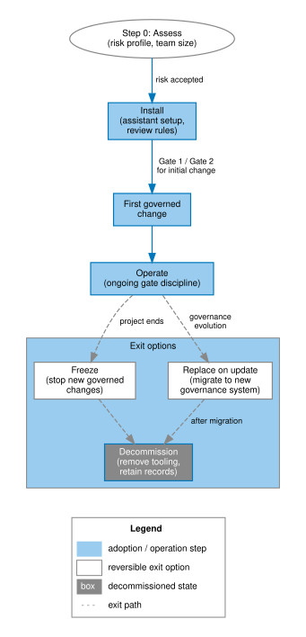

# Downstream impact: what adoption changes in your project

*Status: Released (v2.1 documentation). Audience: evaluators and
administrators. Read this page **before** adopting. After it you can
itemise every artifact, obligation, and cost adoption introduces.*

Adoption is a deliberate trade: structure and auditability in exchange for
files in your repository, jobs in your CI, and discipline in your workflow.
This page lists the full price. The way back out is documented on the
[exit and decommission](exit-and-decommission.md) page.

Figure 1 shows the adoption and exit flow at a high level: evaluate the cost,
install deliberately, operate with gates, and leave by removing the framework
artifacts and hooks if the trade no longer pays.

## Files added to your repository

Table 1 lists the repository artifacts adoption adds or expects you to
maintain.

| Artifact | Location | Purpose |
|---|---|---|
| Framework directory | `agf/` | Single upstream-owned boundary for AGF content |
| Agent definitions | `agf/agents/*.yaml` | Role contracts: jurisdiction, authority, escalation |
| Governance rules | `agf/rules/**/*.md` | Constraints your AI assistant loads every session |
| Optional assistant loader | Tool-specific root file | Points your assistant at `agf/rules/`; not a copied rule tree |
| Learning records | `agf/learnings/<your-codename>.yaml` | Your project's incident and pattern evidence |
| Working plans | `docs/plans/` | Gate 1 plan files for project work |
| Coordination channel | `docs/coordination/` | Append-only message files, one per decision/handoff |
| Governance docs | `agf/docs/governance/`, ADRs | Who decides what; recorded decisions |
| Schemas | `agf/schemas/` | Machine-checkable contracts for records and definitions |
| Starter templates | `agf/templates/` | Copyable first-run plan, coordination, and learning files |

AGF v2.0 confines framework-owned content to `agf/`. If an assistant needs a
root-level configuration file, keep it small and local: it should tell the tool
to read `agf/rules/`, not duplicate the framework rule files. Working plans
and coordination entries are adopter-owned project evidence and default to
root `docs/` so current `agov` validators can run without extra path
configuration.

## CI jobs added

- **Validator jobs** — schema checks on agent definitions and learning
  records where tooling exists. Current shipped `agov` commands validate
  coordination messages and Gate 1 plans. Agent and learning validators remain
  contract targets until their validator commands ship.
- **Optional gates** — pre-tag version checks, secrets detection,
  anonymization scanning, depending on which rules you adopt.

Long-running suites are *not* part of the framework; the CI-scoping rule in
the rule library exists to keep governance jobs from inflating your pipeline.

## Workflow obligations per change

Table 2 shows the workflow cost by change size. The boundary between small
and non-trivial work is intentionally conservative: when risk or ownership is
unclear, use the full gate path.

| Change size | What the framework asks |
|---|---|
| Trivial (typo, comment) | Nothing beyond your normal commit |
| Small, low-risk | Fast-track waiver noted in the commit message |
| Non-trivial | Plan file → Gate 1 approval → implementation → Gate 2 review → merge via MR |
| High-risk (auth, audit, schema) | Stop-and-plan; explicit human approval; security tests |

The two-gate cycle is the core cost. For a solo project with an engaged
governor, a gate is minutes, not days — but it is never zero, and it is
per change.

For planning, expect a non-trivial first-trial change to need roughly
5-15 minutes of governor attention across Gate 1 and Gate 2 after the agent
has prepared the plan, evidence, and test results. This range is a
maintainer-informed planning estimate, not an independently validated
benchmark. A fast-track waiver may take only a minute or two to confirm.
High-risk changes do not have a useful fixed estimate: the governor should
spend whatever the risk review needs.

## Ongoing obligations

- **Learning records** when incidents or reusable patterns occur — structured
  YAML, validated. Do not record every ordinary bugfix; do record first
  commissioning evidence, repeated friction, rule catches, rule workarounds,
  and near-misses.
  Who drafts them, what triggers one, and how to submit upstream:
  [When should we write a learning record?](../start/adopter-faq.md#when-should-we-write-a-learning-record)
  and [How do we draft a learning?](../start/adopter-faq.md#how-do-we-draft-a-learning)
- **Coordination entries** for actions other agents or humans must see.
  Any active agent — AI or human — files one when taking an action
  whose result others must reconstruct. Rules for when and how:
  [Coordination hygiene](../operate/day-to-day.md#coordination-hygiene)
- **Upgrade hygiene** — new framework releases replace upstream-owned files;
  your own files (codename learnings, customized rules) are preserved.
  The boundary between upstream-owned and adopter-owned is explicit in the
  distribution manifest.
- **Governor attention** — gates without an engaged governor become ceremony.
  Someone must own approvals, audits, and the decision to revoke any
  delegation. Plan for this role explicitly: a named maintainer is enough for
  a solo project, while a team may need a primary governor, backup, or rotation
  so review capacity does not disappear when work gets busy.

## What adoption does *not* change

- Your build system, test framework, and deployment pipeline remain yours.
- Your data and code never leave your infrastructure; the anonymization
  rule governs the one outbound path (learnings shared upstream).
- No runtime, no daemon, no service dependency. Removing the framework is
  removal of `agf/`, any small assistant loader you added, and any CI hooks —
  see [exit](exit-and-decommission.md).

## Honest summary

In our assessment, the framework pays for itself where AI assistants
produce a significant share of changes and the project lives long enough
for reconstructible decisions to matter. Where those conditions do not
hold, the obligations above are overhead without return — the
[should you adopt?](../start/should-you-adopt.md) page is the honest
filter.
