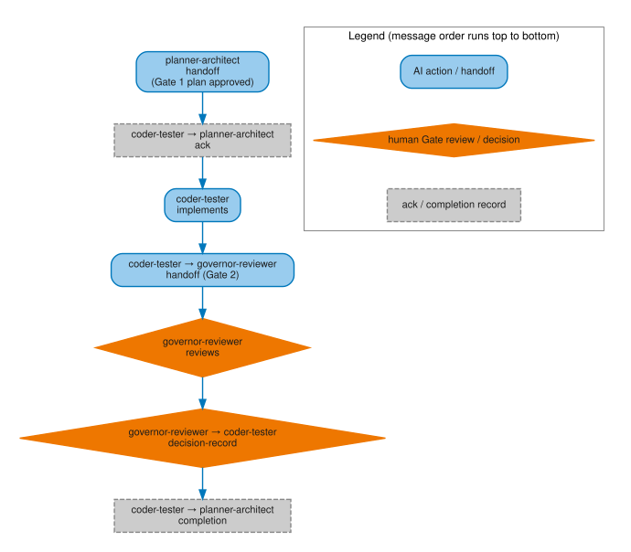
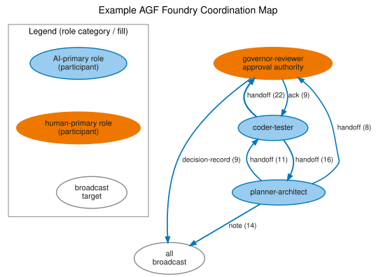
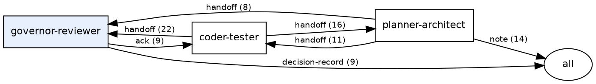

# Coordination protocol

*Status: Deployable. Audience: developers and governors who want
to understand how agents communicate. After this page you can read a
coordination thread, run the graph command, and explain the message kinds.*

## What the coordination channel is

The coordination channel is a directory of append-only YAML-frontmatter
Markdown files — one file per message — in `docs/coordination/`. Every
message carries these fields:

| Field | Purpose |
|---|---|
| `from:` | Role that authored the message |
| `to:` | Recipient role, or `all` for broadcast |
| `kind:` | Message type (see table below) |
| `topic:` | Short slug identifying the work thread |
| `id:` | Unique identifier derived from timestamp and sender |
| `timestamp:` | UTC timestamp |
| `immutable: true` | Filed messages are never edited |
| `references-to:` | List of earlier message IDs this entry responds to |

No server, no database, no shared state: the channel is the directory.
Any agent, CI job, or human can read it with `ls` and a text editor.
`agov coord status` renders a structured summary.

## Writing messages

Use the Rust `agov` CLI as the normal write path. `agov coord post` generates
a readable ID, writes one Markdown file, validates it immediately, and removes
the file if validation fails.

```bash
agov coord post --from coder-tester --to governor-reviewer \
  --kind note --topic implementation-status
```

For handoff workflow state, prefer the handoff helpers so the new record carries
the correct `references-to:` edge:

```bash
agov handoff take <handoff-id> --from coder-tester
agov handoff complete <handoff-id> --from coder-tester
```

`agov coord list --since <message-id-or-rfc3339-timestamp>` lists valid messages
after a known cursor using `(timestamp, filename)` order. It exits `2` when no
new messages match, so polling scripts can distinguish "nothing new" from an
error. Adapters such as a local MCP server may expose these commands to an
assistant surface, but the durable coordination protocol remains append-only
files plus validation.

## Publication is independent of Gate 2, but mechanically verified

A coordination record — a claim, note, review, or ready handoff — is expected
to publish (merge to the protected branch) **independently of, and often
ahead of**, the Gate 2 approval of the implementation artifact it describes.
Gating a handoff's visibility behind its own artifact's review latency
defeats the point of a coordination channel: another agent needs to see
"there is a pending obligation here" while it is still pending, not only
after it is resolved.

That independence is only safe because the fast path is **mechanically
verified**, not merely title-claimed. A branch or merge request that adds
only coordination Markdown records may use a commit title beginning with
`coordination:`. CI does not skip validation for that title — it runs
`agov coord publication-check`, which inspects the **full commit range**
against the target branch (not only the tip diff) and confirms every commit
in the range is a pure addition under `docs/coordination/`, with no merge or
imported history. See `agf/rules/workflow/coordination-publication-rule.md`
for the complete rule.

This exists because a commit title alone is an unverified claim about the
branch. One incident (tracked as issue #72, MR !692) showed exactly how that
goes wrong: a branch titled and described as coordination-only was rooted on
an implementation branch's tip rather than the target branch, so merging it
silently carried seven non-coordination files (three Rust implementation
files and four documentation/configuration files) onto the protected branch
even though its tip diff looked coordination-only.

Practical implications:

- **Branch coordination-only commits from the target branch**, not from an
  implementation branch's tip. Branching from the wrong parent is exactly
  what `agov coord publication-check` rejects.
- **Never put `[ci skip]`/`[skip ci]` in a coordination-only commit
  message.** These markers skip pipeline *creation* at the platform level,
  before any CI configuration is even evaluated — no workflow rule can
  override that. Run `agov coord publication-check --base-ref
  origin/<target>` locally before pushing instead; that is the actual
  safety net when a marker like this would otherwise prevent CI from ever
  running the check.
- Validate each new or changed coordination file locally before pushing:

  ```bash
  agov coord validate docs/coordination/<file>.md
  ```

- If the same branch changes code, documentation, plans, schemas, tooling,
  CI configuration, or any other non-coordination file anywhere in its
  commit range, `agov coord publication-check` fails closed — use a normal
  commit title and let full CI run instead.

### Lifecycle: what a record's kind promises

Independent, fast publication is only trustworthy if every record is
precise about what stage of the lifecycle it is claiming:

- **Claims, notes, reviews, and ready handoffs** publish promptly when true.
  A handoff means "ready for the named next action, addressed to the named
  next agent" — it does not mean the action is approved or complete.
- **Approval and completion records** may only be published *after* the
  event they describe actually happened. Never pre-publish a Gate 1/Gate 2
  approval or a completion record speculatively, even to take advantage of
  the fast path.
- **Only an authorized role or principal** may issue a binding decision for
  that decision's gate.
- **When readiness or an artifact's identity changes**, the correction is a
  new, append-only record that references and supersedes the earlier one —
  never a mutation of the original. A Gate 2 handoff or review naming an
  exact commit SHA stops being current the moment that SHA changes.

A false lifecycle claim is a blocking finding wherever it is caught,
corrected by a superseding record, never by editing the false one.

## How agents communicate

Figure 1 is the same three-role handoff chain the rest of this page
describes in prose, drawn as a sequence rather than a list so the
timing is explicit: `coder-tester` does not start implementing until
`planner-architect`'s handoff and the corresponding ack have both
happened, and `coder-tester` cannot close with a `completion` until
`governor-reviewer`'s `decision-record` has come back. The point to
retain: every arrow in the diagram is a coordination-channel file, in
the same left-to-right order those files would appear if read from
`docs/coordination/` — the diagram does not add any relationship the
prose after it doesn't also state; it makes the ordering visually
immediate.

[](../../reference/figures/gate-handoff-sequence.svg)

*AI-generated figure. Publication remains the responsibility of the human maintainer.*

[Open the full-size Gate 1-to-Gate 2 handoff sequence (SVG)](../../reference/figures/gate-handoff-sequence.svg)

*Palette note: AI actions and handoffs use rounded blue nodes, human Gate
review and the decision record use amber diamonds, and acknowledgement and
completion records use dashed grey nodes. The same meanings are carried by
shape and labels, not colour alone.*

One agent writes a `handoff`; another reads it via `agov session resume`,
implements, then files a Gate 2 `handoff` to `governor-reviewer`. The
governor files a `decision-record`. The original agent closes with a
`completion`. Each entry in the chain carries `references-to:` links
pointing to its predecessor — the audit trail is reconstructible from
the files alone.

The references make the work thread navigable; they are not a magic conflict
resolver. Validators can check message shape, required fields, and duplicate
identifiers. The human review still decides whether a chain proves the right
thing: that the cited plan, review, and decision actually authorize the change
being merged.

## Miniature example thread

A complete four-file thread from Gate 1 approval to task closure.

**Step 1 — Gate 1 plan approved** (`20260614T120000Z-pa-add-export-feature.md`)

```markdown
---
id: 20260614T120000Z-pa-add-export-feature
from: planner-architect
to: governor-reviewer
kind: handoff
topic: add-export-feature
status: pending
requires-ack: false
---

Gate 1 plan filed for CSV export route.
See docs/plans/add-export-feature.md.
```

**Step 2 — Governor approves** (`20260614T121500Z-gr-add-export-feature.md`)

```markdown
---
id: 20260614T121500Z-gr-add-export-feature
from: governor-reviewer
to: planner-architect
kind: decision-record
topic: add-export-feature
status: approved
references-to:
  - 20260614T120000Z-pa-add-export-feature.md
---

Gate 1 approved. Proceed with implementation.
```

**Step 3 — Coder-tester files Gate 2** (`20260614T150000Z-ct-add-export-feature.md`)

```markdown
---
id: 20260614T150000Z-ct-add-export-feature
from: coder-tester
to: governor-reviewer
kind: handoff
topic: add-export-feature
status: pending
requires-ack: false
references-to:
  - 20260614T121500Z-gr-add-export-feature.md
---

Gate 2 handoff. Branch: feat/add-export-feature.
Tests pass. MR link: <url>.
```

**Step 4 — Closure** (`20260614T160000Z-ct-add-export-feature-done.md`)

```markdown
---
id: 20260614T160000Z-ct-add-export-feature-done
from: coder-tester
to: all
kind: completion
topic: add-export-feature
status: resolved
references-to:
  - 20260614T150000Z-ct-add-export-feature.md
---

Merged. MR squash-merged to main at commit abc1234.
```

The four files form a navigable chain: plan → approval → implementation → closure.
Each `references-to:` field links backward; `agov session resume` and
`agov coord graph-index` follow the chain forward.

## Message kinds

| Kind | Direction | Purpose |
|---|---|---|
| `handoff` | agent → agent | Pass work with a deliverable and a checklist |
| `decision-record` | governor → all | Gate approval or rejection with conditions |
| `note` | any → any or `all` | Status update, polling cycle, broadcast |
| `completion` | agent → all | Close a task; reference the Gate 2 decision |
| `review` | reviewer → all | Gate 2 findings before the decision record |
| `ack` | agent → agent | Acknowledge receipt of any eligible `requires-ack: true` record (handoff take/complete remains the separate resolution path for `handoff`-kind records specifically) |
| `claim` | agent → all | Reserve ownership of an artifact |

### `requires-ack` obligation semantics

`requires-ack: true` may be set on any kind except `ack` — an
acknowledgement cannot require its own acknowledgement, so the schema
rejects that combination outright. A `requires-ack: true` handoff resolves
through `agov handoff next` / `take` / `complete`, unchanged. Every other
kind is *reported* by `agov coord pending` — the command only reports; it
does not itself resolve anything. A record is pending until any later
record's `references-to` names it directly — a direct reference, not a
transitive chain — and that later record is the resolution event, not the
`pending` command call that surfaced it.

**Cutoff boundary.** The grandfathering cutoff is `2026-08-02T22:01:54Z` —
the timestamp of governor-reviewer decision-record
`20260802T220154Z-governor-reviewer-sejb`, which amended
`docs/plans/v250-rc1-contract-core.md` decision (c) to use the amendment
decision's own timestamp rather than a future merge-commit date (the
original wording was unimplementable pre-merge; see
`20260802T193425Z-contribution-auditor-rtga.md` finding B2 and its renewed
disposition in `20260802T204834Z-contribution-auditor-ah7j.md`). This value
matches the shipped default in `tooling/rust/crates/agov/src/main.rs`'s
`Pending` command; `--cutoff` overrides it explicitly when needed.

### Review bodies

A review can use the advisory [review findings](../../reference/review-findings.md)
convention to keep scope, coverage, evaluation outcome, impact, enforcement,
remediation state, risk acceptance, recommendation, and binding authority
separate. `agov coord brief --kind review` prints a fill-in skeleton, but it
does not validate or aggregate the Markdown body and cannot approve or block a
gate. A known open blocker remains BLOCK even when another part of the review
is incomplete; CLEAR requires complete coverage.

Polling-cycle notes should be concrete. Name the branch or MR scope checked and
the timer convention in use. If you use shorthand such as `15mins/180min`, make
clear that it means "scan every 15 minutes, stop after 180 idle minutes, reset
idle time on new incoming coordination or MR activity." For AI agents, prefer
internal assistant reminders; external shell timers are monitors, not assistant
attention.

## Parallel work and conflicts

The channel is append-only, so most parallel work does not create text-file
conflicts: two agents normally create two different files. The hard part is not
the Markdown merge; it is deciding whether two work threads are trying to own
the same artifact, plan, or gate.

Use `claim` messages for work that needs temporary artifact ownership. Before
starting or resuming, run `agov coord status` or `agov session resume` and look
for active claims and pending handoffs. If two branches claim the same file or
scope, do not edit either historical claim to make the conflict disappear.
Resolve it with a new `note`, `review`, or `decision-record` that names the
winning scope, the postponed scope, or the split of responsibility.

If git reports an actual conflict in `docs/coordination/`, keep both immutable
messages whenever they have distinct IDs. If the conflict is a duplicated manual
filename or duplicated ID, create a new coordination message with a fresh ID on
the branch being repaired, reference the superseded message from the body, and
leave the old record visible in history. Corrections are new records; filed
coordination messages are not rewritten to make the log look cleaner.

## Generating the communication map

`agov coord graph` reads the channel and emits Graphviz dot to stdout.
No graphviz binary is required to emit the dot; rendering is the caller's
responsibility.

```bash
# Render to SVG (requires graphviz dot installed)
agov coord graph | dot -Tsvg > coordination-map.svg

# Human-readable edge list — no graphviz needed
agov coord graph --format text
```

The command counts messages by `(from, to, kind)` triple and emits one
directed edge per triple, labelled with the kind and count.
`governor-reviewer` is distinguished with a filled node to reflect its
approval authority; `all` (the broadcast target) renders as an ellipse.

The following rendered map is a dated example from the AGF foundry channel
captured during the v2.0 documentation work. It is not a required topology:
adopting projects may define more specialized agent roles and may show
different communication patterns as their governance model matures. Read
edge thickness and count as evidence of *this project's* history, not as
a target shape to reproduce — the filled `governor-reviewer` node and the
directed edges are the same `(from, to, kind)` structure the `agov coord
graph` command above just described in the abstract, now shown populated
with real messages. The point to retain: a thin or missing edge between
two roles in your own generated map is not a defect to fix, it just means
those two roles haven't exchanged that kind of message yet.

<div class="figure-scroll" markdown>

</div>

*AI-generated figure. Publication remains the responsibility of the human maintainer.*

The matching dot output shows the representative subset of the busier edges:



The map shows the three pipeline roles and the broadcast `all` target.
The dominant flow is `coder-tester → governor-reviewer` (Gate 2 handoffs
and completions) and `governor-reviewer → coder-tester` (acks and
decision records). `planner-architect → coder-tester` are Gate 1
handoffs passing approved plans to implementation.

## See also

- [Roles and gates](roles-and-gates.md) — role definitions, gate
  mechanics, and the coordination channel overview
- [Day-to-day operation](../operate/day-to-day.md) — the daily rhythm
  of reading and writing coordination messages
- [Poll and coordinate](../operate/poll-and-coordinate.md) — the operating
  loop that puts this protocol into practice, including where
  coordination-only publication fits in one cycle

Handoff reply annotations are advisory evidence with unchanged lifecycle and gate authority. See [the command reference](../../reference/tooling-conformance.md#unresolved-handoff-reply-evidence) for the predicate and CLI/MCP representation.

### Recipient session annotations

Optional `handoff.for_session` addresses a recipient; top-level `session` records the author. `handoff next <role> --session <token>` and `coord visibility --session <token>` leave every item in its existing position/state and annotate only mismatched handoffs as addressed elsewhere. Missing flag or recipient preserves prior output. Notes/reviews remain role-wide. MCP tools accept the equivalent optional `session` string. Visibility JSON adds `addressed_elsewhere` containing the recipient string only on mismatches; handoff text names the recipient. This is advisory under the [coordination publication rule](https://gitlab.com/janipaijanen/agents-govern-framework/-/blob/main/agf/rules/workflow/coordination-publication-rule.md), without new ownership or authority.
