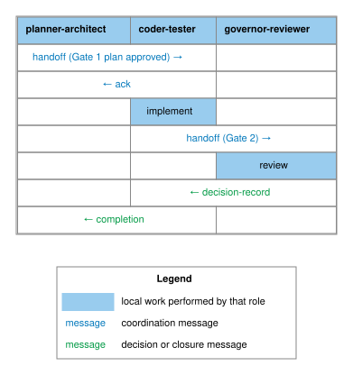
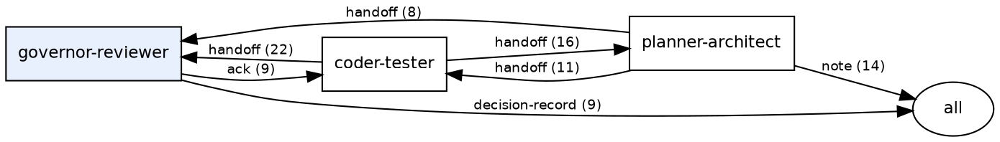

# Coordination protocol

*Status: Deployable (v2.0). Audience: developers and governors who want
to understand how agents communicate. After this page you can read a
coordination thread, run the graph command, and explain the message kinds.*

## What the coordination channel is

The coordination channel is a directory of append-only YAML-frontmatter
Markdown files — one file per message — in `docs/coordination/`. Every
message carries these fields:

| Field | Purpose |
|---|---|
| `from:` | Role that authored the message |
| `to:` | Recipient role, or `all` for broadcast |
| `kind:` | Message type (see table below) |
| `topic:` | Short slug identifying the work thread |
| `id:` | Unique identifier derived from timestamp and sender |
| `timestamp:` | UTC timestamp |
| `immutable: true` | Filed messages are never edited |
| `references-to:` | List of earlier message IDs this entry responds to |

No server, no database, no shared state: the channel is the directory.
Any agent, CI job, or human can read it with `ls` and a text editor.
`agov coord status` renders a structured summary.

## How agents communicate

Figure 1 traces the lifecycle of a governed change through the coordination
channel.



One agent writes a `handoff`; another reads it via `agov session resume`,
implements, then files a Gate 2 `handoff` to `governor-reviewer`. The
governor files a `decision-record`. The original agent closes with a
`completion`. Each entry in the chain carries `references-to:` links
pointing to its predecessor — the audit trail is reconstructible from
the files alone.

## Message kinds

| Kind | Direction | Purpose |
|---|---|---|
| `handoff` | agent → agent | Pass work with a deliverable and a checklist |
| `decision-record` | governor → all | Gate approval or rejection with conditions |
| `note` | any → any or `all` | Status update, polling cycle, broadcast |
| `completion` | agent → all | Close a task; reference the Gate 2 decision |
| `review` | reviewer → all | Gate 2 findings before the decision record |
| `ack` | agent → agent | Acknowledge receipt of a `requires-ack` handoff |
| `claim` | agent → all | Reserve ownership of an artifact |

## Generating the communication map

`agov coord graph` reads the channel and emits Graphviz dot to stdout.
No graphviz binary is required to emit the dot; rendering is the caller's
responsibility.

```bash
# Render to SVG (requires graphviz dot installed)
agov coord graph | dot -Tsvg > coordination-map.svg

# Human-readable edge list — no graphviz needed
agov coord graph --format text
```

The command counts messages by `(from, to, kind)` triple and emits one
directed edge per triple, labelled with the kind and count.
`governor-reviewer` is distinguished with a filled node to reflect its
approval authority; `all` (the broadcast target) renders as an ellipse.

The following rendered map is a dated example from the AGF foundry channel
captured during the v2.0 documentation work. It is not a required topology:
adopting projects may define more specialized agent roles and may show
different communication patterns as their governance model matures.


The matching dot output shows the representative subset of the busier edges:



The map shows the three pipeline roles and the broadcast `all` target.
The dominant flow is `coder-tester → governor-reviewer` (Gate 2 handoffs
and completions) and `governor-reviewer → coder-tester` (acks and
decision records). `planner-architect → coder-tester` are Gate 1
handoffs passing approved plans to implementation.

## See also

- [Roles and gates](roles-and-gates.md) — role definitions, gate
  mechanics, and the coordination channel overview
- [Day-to-day operation](../operate/day-to-day.md) — the daily rhythm
  of reading and writing coordination messages
