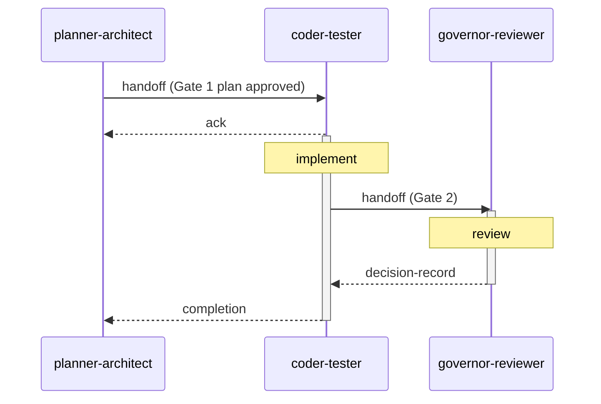
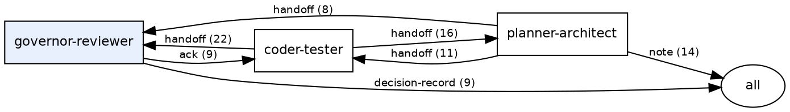

# Coordination protocol

*Status: Deployable (v2.0). Audience: developers and governors who want
to understand how agents communicate. After this page you can read a
coordination thread, run the graph command, and explain the message kinds.*

## What the coordination channel is

The coordination channel is a directory of append-only YAML-frontmatter
Markdown files — one file per message — in `docs/coordination/`. Every
message carries these fields:

| Field | Purpose |
|---|---|
| `from:` | Role that authored the message |
| `to:` | Recipient role, or `all` for broadcast |
| `kind:` | Message type (see table below) |
| `topic:` | Short slug identifying the work thread |
| `id:` | Unique identifier derived from timestamp and sender |
| `timestamp:` | UTC timestamp |
| `immutable: true` | Filed messages are never edited |
| `references-to:` | List of earlier message IDs this entry responds to |

No server, no database, no shared state: the channel is the directory.
Any agent, CI job, or human can read it with `ls` and a text editor.
`agov coord status` renders a structured summary.

## How agents communicate

Figure 1 traces the lifecycle of a governed change through the coordination
channel.



One agent writes a `handoff`; another reads it via `agov session resume`,
implements, then files a Gate 2 `handoff` to `governor-reviewer`. The
governor files a `decision-record`. The original agent closes with a
`completion`. Each entry in the chain carries `references-to:` links
pointing to its predecessor — the audit trail is reconstructible from
the files alone.

The references make the work thread navigable; they are not a magic conflict
resolver. Validators can check message shape, required fields, and duplicate
identifiers. The human review still decides whether a chain proves the right
thing: that the cited plan, review, and decision actually authorize the change
being merged.

## Miniature example thread

A complete four-file thread from Gate 1 approval to task closure.

**Step 1 — Gate 1 plan approved** (`20260614T120000Z-pa-add-export-feature.md`)

```markdown
---
id: 20260614T120000Z-pa-add-export-feature
from: planner-architect
to: governor-reviewer
kind: handoff
topic: add-export-feature
status: pending
requires-ack: false
---

Gate 1 plan filed for CSV export route.
See docs/plans/add-export-feature.md.
```

**Step 2 — Governor approves** (`20260614T121500Z-gr-add-export-feature.md`)

```markdown
---
id: 20260614T121500Z-gr-add-export-feature
from: governor-reviewer
to: planner-architect
kind: decision-record
topic: add-export-feature
status: approved
references-to:
  - 20260614T120000Z-pa-add-export-feature.md
---

Gate 1 approved. Proceed with implementation.
```

**Step 3 — Coder-tester files Gate 2** (`20260614T150000Z-ct-add-export-feature.md`)

```markdown
---
id: 20260614T150000Z-ct-add-export-feature
from: coder-tester
to: governor-reviewer
kind: handoff
topic: add-export-feature
status: pending
requires-ack: false
references-to:
  - 20260614T121500Z-gr-add-export-feature.md
---

Gate 2 handoff. Branch: feat/add-export-feature.
Tests pass. MR link: <url>.
```

**Step 4 — Closure** (`20260614T160000Z-ct-add-export-feature-done.md`)

```markdown
---
id: 20260614T160000Z-ct-add-export-feature-done
from: coder-tester
to: all
kind: completion
topic: add-export-feature
status: resolved
references-to:
  - 20260614T150000Z-ct-add-export-feature.md
---

Merged. MR squash-merged to main at commit abc1234.
```

The four files form a navigable chain: plan → approval → implementation → closure.
Each `references-to:` field links backward; `agov session resume` and
`agov coord graph-index` follow the chain forward.

## Message kinds

| Kind | Direction | Purpose |
|---|---|---|
| `handoff` | agent → agent | Pass work with a deliverable and a checklist |
| `decision-record` | governor → all | Gate approval or rejection with conditions |
| `note` | any → any or `all` | Status update, polling cycle, broadcast |
| `completion` | agent → all | Close a task; reference the Gate 2 decision |
| `review` | reviewer → all | Gate 2 findings before the decision record |
| `ack` | agent → agent | Acknowledge receipt of a `requires-ack` handoff |
| `claim` | agent → all | Reserve ownership of an artifact |

Polling-cycle notes should be concrete. Name the branch or MR scope checked and
the timer convention in use. If you use shorthand such as `15mins/180min`, make
clear that it means "scan every 15 minutes, stop after 180 idle minutes, reset
idle time on new incoming coordination or MR activity." For AI agents, prefer
internal assistant reminders; external shell timers are monitors, not assistant
attention.

## Parallel work and conflicts

The channel is append-only, so most parallel work does not create text-file
conflicts: two agents normally create two different files. The hard part is not
the Markdown merge; it is deciding whether two work threads are trying to own
the same artifact, plan, or gate.

Use `claim` messages for work that needs temporary artifact ownership. Before
starting or resuming, run `agov coord status` or `agov session resume` and look
for active claims and pending handoffs. If two branches claim the same file or
scope, do not edit either historical claim to make the conflict disappear.
Resolve it with a new `note`, `review`, or `decision-record` that names the
winning scope, the postponed scope, or the split of responsibility.

If git reports an actual conflict in `docs/coordination/`, keep both immutable
messages whenever they have distinct IDs. If the conflict is a duplicated manual
filename or duplicated ID, create a new coordination message with a fresh ID on
the branch being repaired, reference the superseded message from the body, and
leave the old record visible in history. Corrections are new records; filed
coordination messages are not rewritten to make the log look cleaner.

## Generating the communication map

`agov coord graph` reads the channel and emits Graphviz dot to stdout.
No graphviz binary is required to emit the dot; rendering is the caller's
responsibility.

```bash
# Render to SVG (requires graphviz dot installed)
agov coord graph | dot -Tsvg > coordination-map.svg

# Human-readable edge list — no graphviz needed
agov coord graph --format text
```

The command counts messages by `(from, to, kind)` triple and emits one
directed edge per triple, labelled with the kind and count.
`governor-reviewer` is distinguished with a filled node to reflect its
approval authority; `all` (the broadcast target) renders as an ellipse.

The following rendered map is a dated example from the AGF foundry channel
captured during the v2.0 documentation work. It is not a required topology:
adopting projects may define more specialized agent roles and may show
different communication patterns as their governance model matures.


The matching dot output shows the representative subset of the busier edges:



The map shows the three pipeline roles and the broadcast `all` target.
The dominant flow is `coder-tester → governor-reviewer` (Gate 2 handoffs
and completions) and `governor-reviewer → coder-tester` (acks and
decision records). `planner-architect → coder-tester` are Gate 1
handoffs passing approved plans to implementation.

## See also

- [Roles and gates](roles-and-gates.md) — role definitions, gate
  mechanics, and the coordination channel overview
- [Day-to-day operation](../operate/day-to-day.md) — the daily rhythm
  of reading and writing coordination messages
