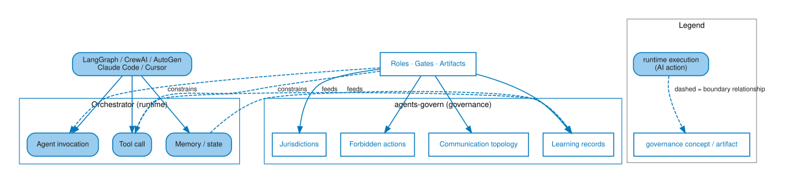
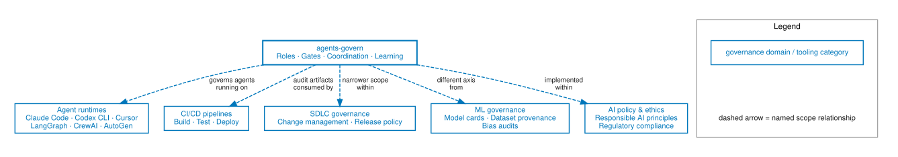

<!--
SPDX-License-Identifier: CC-BY-SA-4.0
-->
# AGF and agent runtimes

*Status: Released. Current framework version: see [Release information](../../reference/release-info.md). Audience: developers evaluating
how AGF fits alongside their existing tooling. After this page you can
explain the relationship between AGF and an orchestrator, and know which
per-tool notes apply to your stack.*

agents-govern is a governance layer, not an agent runtime. The two are
complementary: an orchestrator runs agents; AGF defines which agents
exist, what they may do, and which gates they pass through.

## Concrete relationship

Governance (left in the diagram) defines
authority boundaries and collects learning; the runtime (right) executes
agents under those boundaries.

*AI-generated figure. Publication remains the responsibility of the human maintainer.*

[Open the full-size runtime and governance boundary figure (SVG)](../../reference/figures/runtime-governance-boundary.svg)

*Palette: runtime/orchestrator nodes (right) use the AI action treatment
(rounded, blue-light fill) — this diagram's own body text calls the
runtime side "executes agents." Governance nodes (left) use the Shared
concept treatment (white fill, blue-mid border) — jurisdictions,
forbidden actions, communication topology, and learning records are
framework concepts and artifacts, not actions performed by a single
actor type.*

The orchestrator runs agents. agents-govern says **which agents exist,
what they may do, and which gates they pass through.**

AGF does not intercept or monitor runtime behavior. It operates
pre-action (rules loaded as assistant instructions, Gate 1 plan
approval) and post-action (coordination records, Gate 2 review, learning
records). The enforcement surface is the audit trail and the human
governor's gate decisions, not a runtime hook.

## Per-tool notes

### Claude Code

The project author has used the Claude and Codex integrations in Visual
Studio Code for Foundry planning, implementation, validation, review, and
release work. This is author-operated evidence, not independent validation of
every assistant or configuration.

Use [assistant loader configuration](../adopt/assistant-loader-configuration.md)
for the supported loader pattern. Keep rules in `agf/rules/` and point the
assistant at that canonical tree; do not copy it into tool-specific directories.
The loader page also describes skill discovery and its limits.

### Codex (OpenAI)

Use the same canonical [loader guidance](../adopt/assistant-loader-configuration.md)
for `AGENTS.md` and supported skill pointers. Loader and skill discovery depend
on the assistant surface; AGF does not promise identical runtime behavior.

### Cursor / Windsurf

The rule content is tool-agnostic Markdown. Configure your tool to read the
canonical files and verify what it actually loaded using the
[loader verification prompt](../adopt/assistant-loader-configuration.md#verify-the-loader).
The Foundry evidence above does not validate these other assistants.

### LangGraph / CrewAI / AutoGen

These libraries build agent runtimes. The following are conceptual mappings
(**Theoretical**), not shipped integrations or observed adopter deployments:

- AGF role definitions could inform nodes or crew responsibilities.
- Plan and merge gates could surround work on a runtime or its configuration.
- Coordination and learning records could remain in the repository independently
  of the runtime's execution model.

An adopter would need to design and validate any callbacks or enforcement
integration. AGF supplies written boundaries and evidence conventions; it does
not install runtime hooks.

## How AGF relates to other frameworks

AGF occupies a specific niche. Understanding where it sits relative to
adjacent categories prevents both over-scoping and under-scoping what
adoption delivers.

*AI-generated figure. Publication remains the responsibility of the human maintainer.*

[Open the full-size AGF governance-position figure (SVG)](../../reference/figures/governance-scope-position.svg)

*Palette: every node here is a governance domain or tooling category being
compared, not an actor performing an action — the Shared concept treatment
applies uniformly (matching the established precedent in
`coordination-map-example.dot`, where uniform treatment replaced a prior
false per-node responsibility mapping). No node in this comparison is
"who is responsible" in the sense the other four categories describe.*

**vs SDLC governance.** SDLC governance covers the full software delivery
lifecycle. AGF covers the agent-specific slice: which AI agents exist,
what they may decide, how evidence is captured. Adopters already under
SDLC governance add AGF within that umbrella; AGF does not replace it.

**vs CI/CD.** CI/CD pipelines execute builds, tests, and deployments.
AGF generates artifacts (coordination records, learning records,
validation outputs) that CI consumes as quality gates. The pipeline
enforces; AGF governs what goes into it.

**vs ML governance.** ML governance covers models — training data
provenance, bias audits, model cards, deployment approval. AGF covers
the agents that may *use* those models. The two are complementary and
operate at different levels; both may apply to the same project.

**vs AI policy and ethics frameworks.** Policy frameworks set principles
at an organisational or regulatory level. AGF implements specific
operational mechanisms — written role boundaries, gate records, audit
trails — within those principles. Policy sets the ceiling; AGF is one
implementation below it.

## Enterprise boundary

AGF is repository-local SDLC governance evidence. It can support an enterprise
control environment, but it is not the enterprise control environment.

For organisation-wide adoption, layer AGF with the controls your environment
already requires:

- branch protection and required merge requests;
- code owners or domain-owner review;
- secure SDLC controls and security scanning;
- privacy, labor, and purpose-limitation review;
- identity governance and alias policy;
- audit-retention policy for git, CI, issue trackers, and chat;
- compliance control mapping, where required;
- model/provider risk management for hosted AI assistants;
- supplier assurance and vulnerability management.

AGF gives those layers better repository evidence: plans, handoffs, gate
decisions, validation output, learning records, and release discipline. It does
not certify compliance, approve production risk outside the repository, monitor
runtime behavior, or replace model-risk and privacy programs.

## What AGF does not do

AGF does not:

- Execute agents or call LLM APIs.
- Manage prompt templates, conversation memory, or embedding stores.
- Intercept or monitor agent behavior at runtime.
- Replace your CI, code review, or merge tooling.

If you need runtime execution, pick an orchestrator. If you need the
boundaries, evidence trail, and quality gates that make multi-agent work
auditable, add AGF on top.

## Next

- How roles and gates work: [Roles and gates](roles-and-gates.md)
- How evidence accumulates from tool use: [Learning loop and evidence](evidence-and-learnings.md)
- Consultative questions for challenging any governance design's scope
  and guarantee claims, including this one:
  [Philosophical lenses on AI governance](philosophical-lenses.md)
- Install for your tool: [Install the `agf/` directory](../adopt/install-and-layouts.md)
