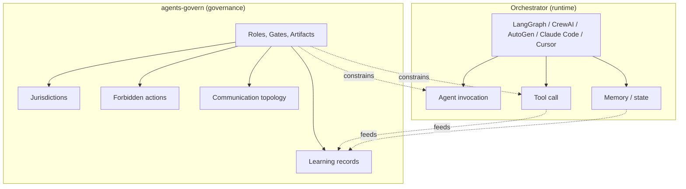

<!--
SPDX-License-Identifier: CC-BY-SA-4.0
-->
# AGF and agent runtimes

*Status: Released (v2.1 documentation). Audience: developers evaluating
how AGF fits alongside their existing tooling. After this page you can
explain the relationship between AGF and an orchestrator, and know which
per-tool notes apply to your stack.*

agents-govern is a governance layer, not an agent runtime. The two are
complementary: an orchestrator runs agents; AGF defines which agents
exist, what they may do, and which gates they pass through.

## Concrete relationship

The diagram below is the load-bearing answer. Governance (left) defines
authority boundaries and collects learning; the runtime (right) executes
agents under those boundaries.

The orchestrator runs agents. agents-govern says **which agents exist,
what they may do, and which gates they pass through.**

AGF does not intercept or monitor runtime behavior. It operates
pre-action (rules loaded as assistant instructions, Gate 1 plan
approval) and post-action (coordination records, Gate 2 review, learning
records). The enforcement surface is the audit trail and the human
governor's gate decisions, not a runtime hook.

## Per-tool notes

### Claude Code

Claude Code is the reference integration. The typical setup:

- `agf/agents/*.yaml` role definitions become the assistant's system
  prompt context — copy or reference them in the CLAUDE.md loader.
- `agf/rules/` ships to `.claude/rules/` (or is loaded via CLAUDE.md).
- `agf/skills/` installs as `.claude/commands/` for slash-command access.
- `agov` validators run in pre-commit hooks and CI.

The framework's own development (codename *foundry*) runs on Claude Code.
This is the most evidence-backed integration path.

### Codex CLI (OpenAI)

Codex CLI loads instructions from `AGENTS.md` at the repository root. The
AGF install creates an `AGENTS.md` that references role definitions and
rules. Skills are Claude Code-specific slash commands; Codex adopters
either adapt them as scripts or skip the skill layer.

The governance layer — roles, gates, coordination channel, validators —
is runtime-neutral and works identically. The difference is the loader
file format and the absence of a slash-command surface.

### Cursor / Windsurf

Translate `agf/agents/<role>.yaml` into the editor's native rules format
(`.cursorrules`, `.windsurfrules`, or the editor's rules directory).
`agf/rules/` content is tool-agnostic markdown; copy it to the editor's
equivalent path. The skills layer is currently Claude Code-specific;
Cursor and Windsurf adopters skip or re-implement skills as editor
macros or scripts.

### LangGraph / CrewAI / AutoGen

These are libraries for building custom multi-agent systems in code.
AGF provides the governance layer; the library provides the runtime.

- Role definitions (`agf/agents/*.yaml`) can inform the taxonomy of
  LangGraph nodes or CrewAI crew members.
- The gate concept maps onto conditional edges or approval callbacks.
- The coordination channel and learning records operate independently
  on git repos and YAML files — the library's execution model does
  not need to know about them.

The governance value is the audit trail and the written role boundaries,
not runtime integration. Adopters using these libraries typically apply
AGF governance around the library (plan before building the graph,
review before deploying it) rather than embedding AGF inside the
agent execution loop.

## What AGF does not do

AGF does not:

- Execute agents or call LLM APIs.
- Manage prompt templates, conversation memory, or embedding stores.
- Intercept or monitor agent behavior at runtime.
- Replace your CI, code review, or merge tooling.

If you need runtime execution, pick an orchestrator. If you need the
boundaries, evidence trail, and quality gates that make multi-agent work
auditable, add AGF on top.

## Next

- How roles and gates work: [Roles and gates](roles-and-gates.md)
- How evidence accumulates from tool use: [Evidence and learnings](evidence-and-learnings.md)
- Install for your tool: [Install the `agf/` directory](../adopt/install-and-layouts.md)
