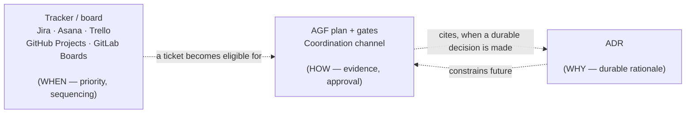

<!--
SPDX-License-Identifier: CC-BY-SA-4.0
-->
# AGF, ADRs, and roadmap/ticketing tools

*Status: Released (v2.1 documentation). Audience: developers and governors
who already plan work in a roadmap or ticketing tool and want to know where
AGF fits alongside it. After this page you can place AGF's gates, ADRs, and
your team's tracker on the same mental map without either duplicating or
conflicting with each other.*

## What this page is, and is not

This page describes a **coexistence pattern**: how AGF's plan-and-gate
workflow sits alongside a roadmap board or ticketing tool your team already
uses. It is not an integration feature. AGF ships no Jira, Asana, Trello,
GitHub, or GitLab API client, no webhook, and no required schema field for
a ticket ID. Everything below is a convention you can adopt with a link and
a habit, not a dependency AGF requires.

## Three questions, three artifacts

A governed change usually needs to answer three different questions, and
each one already has a natural home:

| Question | Answered by | Mutability |
|---|---|---|
| **Why** is the architecture this way? | An Architecture Decision Record | Durable, rarely revised |
| **How** did this specific change move from proposal to merge? | The coordination channel and Gate 1/Gate 2 records | Append-only, immutable once written |
| **When**, and relative to what else, should this work happen? | A roadmap or ticketing tool (GitLab Board, GitHub Project, Jira, Asana, Trello) | Mutable — cards move, priorities change |

The first two are already covered in
[the adopter FAQ](../start/adopter-faq.md#how-do-adrs-fit-with-agf): "ADRs
explain why the architecture is the way it is; coordination records explain
how a specific governed change moved from proposal to merge." This page adds
the third leg — the *when* — without changing that split.

These three answer different questions, on different mutability profiles.
None of them substitutes for either of the other two. A ticket without a
Gate 1 plan behind it is an intention, not evidence. A Gate 1 plan without a
ticket is ungoverned by whatever prioritization process your team actually
uses. An ADR without coordination records has no trail showing whether the
decision was actually followed.

## Where the axes actually meet

**A ticket becomes eligible for implementation, not automatically
implemented.** Moving a card to "In Progress" on a board answers "we chose
this over other work now." It does not answer "is this specific plan safe
and correct." Gate 1 still asks that question, independently of whatever
priority process put the ticket in front of the implementer.

**A claim is already a lightweight WIP-limit.** AGF's coordination channel
already tracks which agent holds an active claim on a set of files (see
[downstream impact](../adopt/downstream-impact.md)) — the same shape a
board's WIP-limit column serves, just recorded as a coordination message
instead of a board rule. Teams using both do not need to reconcile them;
the claim and the board card can simply agree with each other.

**Board columns can mirror gate state, if you want that.** "To Do → In
Progress → Review → Done" maps loosely onto: no claim yet → claimed → Gate
1/Gate 2 open → merged. Some teams wire this with CI automation (an MR
event moves the card); others move cards by hand. Neither is required.

## Per-tool notes

### GitLab Boards / Issues

Native fit if the AGF repository already lives on GitLab: link the issue
number from the Gate 1 plan's frontmatter or body (a plain reference, not a
required field), and let MR events move the board card. GitLab milestones
can hold the roadmap-level grouping; AGF has no opinion on milestone naming
or cadence.

### GitHub Projects / Issues

Same pattern as GitLab: reference the issue number from the plan, let PR
events (if the AGF adoption mirrors branches as PRs) move the project board
card. GitHub Projects' custom fields can hold whatever priority or
estimation convention the team already uses — AGF does not need those
fields populated to function.

### Jira

The most common enterprise fit: an epic holds the roadmap-level grouping, a
story or task holds the ticket-level link to the Gate 1 plan file, and Jira's
own workflow states (however the team has configured them) track the *when*
independently of AGF's gate states. Teams already using Jira for
cross-team visibility keep doing so; AGF adds the plan-and-evidence layer
underneath a ticket, not instead of it.

### Asana

Asana's task/subtask and project structure maps the same way: a project
holds the roadmap grouping, a task holds the link to the plan file, and
Asana's own status fields (or custom fields, if the team uses them) track
sequencing. Nothing about AGF's file-based coordination channel requires
Asana to know it exists.

### Trello

Trello's card-and-list model is the simplest of the five to map directly
onto gate state, precisely because it has the fewest built-in concepts: a
list per gate state ("Backlog," "Claimed," "Gate 1," "Gate 2," "Done") with
one card per plan is a workable convention some smaller teams may prefer
over a heavier tracker. This is a suggestion, not a recommendation over the
other four — team size and existing habits should decide, not this page.

## The discipline that keeps this from drifting

Running two record-keeping systems side by side (a tracker and a
git-native coordination channel) only works if one is canonical and the
other is a view. The coordination channel and git history stay canonical
for gate state, because they are append-only and already the audit trail
AGF is built around. The tracker is a *view* into that state — ideally kept
current by automation from git/MR events, not by a human or agent manually
re-typing "Done" in two places.

The failure mode to watch for: a ticket marked "Done" while the
coordination channel shows no Gate 2 approval, or vice versa. When that
happens, the coordination channel is the one to trust — it is the append-only
ledger; the tracker is not.

## What this does not change

- AGF still makes no roadmap-date commitments of its own (see
  [Where v2 could evolve](../../future/evolution.md) for the honesty
  boundary that applies to AGF's own roadmap claims).
- No AGF schema gains a required tracker-ID field. An optional, freeform
  reference in a plan's body is enough for the linking pattern above.
- Prioritization authority does not move to AGF. Gate 1 and Gate 2 answer
  "is this safe and correct," never "should we do this before that other
  ticket."

## Next

- The two axes this page builds on:
  [How do ADRs fit with AGF?](../start/adopter-faq.md#how-do-adrs-fit-with-agf)
  and [Coordination protocol](coordination-protocol.md).
- Where AGF sits relative to adjacent tool categories more broadly:
  [AGF and agent runtimes](position.md#how-agf-relates-to-other-frameworks).
- What a claim looks like in the coordination channel:
  [Downstream impact](../adopt/downstream-impact.md).
