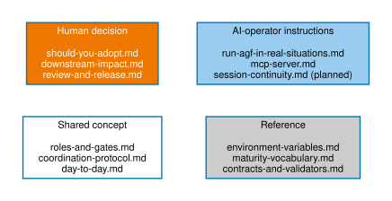

# Documentation

*Status: Released (v2.1 documentation).*

This documentation is a learning path, not a pile of pages. Each stage
assumes the previous one. Pick your entry point from the table, then follow
the path forward.

!!! info "AGF in a Nutshell — one-page orientation flyer"
    A single-page overview of the roles, the two gates, and the
    coordination channel, suitable for printing or sharing:
    [view the full-size flyer (PNG)](../reference/figures/agf-nutshell-flyer.png).

## How to read this site

Every page below falls into one of four kinds. Knowing which kind you're
reading tells you who is actually meant to act on it — most of AGF's
procedural detail (running `agov`, writing YAML frontmatter, filing
coordination messages) is AI-executed work a human delegates and reviews,
not a personal to-do list:

- **Human decision** — pages that ask a human to decide something: adopt or
  not, approve or reject, accept a risk. No AI substitute exists for these.
- **AI-operator instructions** — pages that are majority procedure for an AI
  agent to execute, with the human supervising and reviewing the result.
- **Shared concept** — the mental model both a human and an AI agent need,
  so they can coordinate using the same vocabulary.
- **Reference** — command, schema, and environment-variable precision, read
  after the concept is already clear.



## The path

```
Start ──► Concepts ──► Adopt ──► Operate ──► Advanced ──► Evolution
 (decide)   (mental      (impact,    (daily      (contracts,   (future,
             model)       install,    loop,       customize)    non-binding)
                          exit path)  release)
```

### 1. Start — decide

- [Should you adopt?](start/should-you-adopt.md) — an honest decision page:
  who benefits now, who should wait, who should skip.
- [Adopter FAQ](start/adopter-faq.md) — plain answers to the questions that
  usually appear while commissioning the framework: tooling, learnings,
  upstreaming evidence, and multi-agent team use.

### 2. Concepts — the mental model

- [AGF and agent runtimes](concepts/position.md) — how AGF relates to
  orchestrators (Claude Code, Codex CLI, Cursor, LangGraph, CrewAI);
  per-tool setup notes.
- [Roles and gates](concepts/roles-and-gates.md) — agents, authority
  boundaries, Gate 1/Gate 2, the coordination channel.
- [Coordination protocol](concepts/coordination-protocol.md) — message kinds,
  handoffs, acknowledgements, and the communication map that keeps roles
  reconstructible across sessions.
- [Learning loop and evidence](concepts/evidence-and-learnings.md) — the
  learning system; upstream-owned vs adopter-owned records; anonymization.

### 3. Adopt — install with eyes open

- [Downstream impact](adopt/downstream-impact.md) — **read before
  adopting**: every file, CI job, obligation, and ongoing cost adoption
  introduces.
- [Install the `agf/` directory](adopt/install-and-layouts.md) — commissioning
  the files into the single supported v2.0 layout with an assistant-prepared
  diff.
- [Your first governed change](start/first-governed-change.md) — one small
  change through plan approval, implementation, and review.
- [Tooling and token savings](adopt/tooling-and-tokens.md) — how the `agov`
  CLI replaces repeated AI reads with deterministic tool output, current
  command maturity, and how to wire it into CI.
- [Exit and decommission](adopt/exit-and-decommission.md) — how to leave
  cleanly, so you know adoption is reversible.

### 4. Operate — the daily loop

- [Day-to-day operation](operate/day-to-day.md) — claims, handoffs, gates,
  completions in an active project.
- [Run AGF in real situations](operate/run-agf-in-real-situations.md) —
  choose the right AGF move for common and less-common project moments.
- [Review and release](operate/review-and-release.md) — Gate 2 practice,
  release via merge request, upgrades, audit trail hygiene.

### 5. Advanced — integration and customization

- [Contracts and validators](advanced/contracts-and-validators.md) —
  JSON schemas, binding contracts, wiring `agf` checks into CI.
- [Customizing the framework](advanced/customizing-the-framework.md) —
  what you may tune freely, and where customization breaks contract
  semantics.
- [Tooling conformance](../reference/tooling-conformance.md) — how the
  `agf` command surface remains language-neutral as implementations evolve.

### 6. Contribute

- [Contribute](../contribute.md) — three paths for feeding evidence back:
  submit a learning, propose a rule, propose an agent. Evidence thresholds,
  anonymization requirement, and independent-adopter gaps.

### 7. Evolution — explicitly non-binding

- [Where v2 could evolve](../future/evolution.md) — hypotheses under
  consideration, labelled as such. Nothing on that page is a commitment.

## Reference

- [Quick reference](https://gitlab.com/janipaijanen/agent-governance) —
  one-page roles/pipeline/rules summary ships in the distribution at
  `docs/reference/quick-reference.md`.
