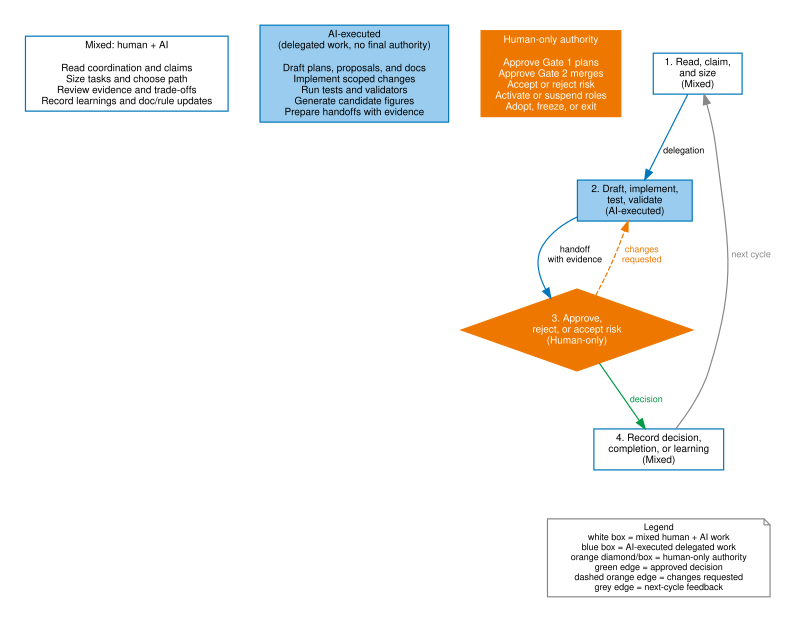
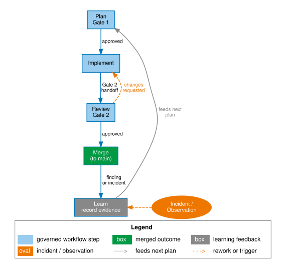

# Day-to-day operation

For session boundaries, polling, upgrades, release, and exit routes, begin at
the [operations runbook](runbook.md). This page remains the detailed authority
for the ordinary governed-change loop.

*Status: Released. Current framework version: see [Release information](../../reference/release-info.md). Audience: developers and
governors running a governed project. After this page you know the
rhythm: claims, fast track vs full gates, coordination hygiene, and the
failure modes to watch for.*

!!! note "AGF v2 layout"
    The examples use the v2 default evidence paths: `docs/plans/` and
    `docs/coordination/`. Keep one coordination channel per project.

## The daily shape

The operating model is easiest to read as three responsibility modes:
human-only authority, AI-executed work, and mixed work in the audit
trail. **AI-executed** means an agent may do the task after delegation;
it does not mean the agent can approve its own gate, accept project
risk, or decide exit.

Figure 1 places those three modes side by side rather than on a
spectrum, because the boundary between them is not "how much the AI can
be trusted with" but "which mode this specific action belongs to" —
drafting a plan and approving it are different actions in different
modes even when the same person or agent is involved in both. The point
to retain before reading Table 1: the figure's three columns are the
answer key for "who does this," and the table below is that same answer
key applied to specific artifacts.



*AI-generated figure. Publication remains the responsibility of the human maintainer.*

Table 1 separates the work by authority mode so teams can see what remains
human-only, what an AI agent may execute, and what both sides handle together.

| Mode | Applies to | Typical artifacts |
|---|---|---|
| Human-only authority | Gate approvals, merge decisions, risk acceptance, role activation/deactivation, adopting or exiting the framework | Decision records, merge approvals, explicit governor instructions |
| AI-executed work | Drafting plans or docs, implementing scoped changes, running tests and validators, generating candidate figures, preparing handoffs | Branch commits, validation logs, generated artifacts, Gate 2 handoffs |
| Mixed human + AI work | Reading the coordination channel, sizing tasks, reviewing evidence, sharpening docs and rules, recording learnings | Claims, reviews, handoffs, learning records, rule or documentation changes |

Agents SHOULD say so when something looks off — a stale doc, wasted
tokens, a confusing gate boundary — even outside the assigned task. Route
it as a `note`, `review`, `lesson-proposal`, or Gate 1 plan depending on
impact; never fold it into the active MR. See
`agf/rules/always/agent-improvement-proposal-rule.md` for the exact
routing table and the boundary against self-authorization.

A governed working session, in order:

Where Figure 1 answered "who does this," Figure 2 answers "in what
order": it draws the same six steps enumerated below — read, claim, gate,
implement, review, close — as a cycle that returns to its own start,
not a checklist that ends at completion. The point to retain: "close the
loop" in step 6 means the completion or learning record feeds back into
what the next reader finds in step 1, which is why skipping the
completion step (common under time pressure) breaks the cycle for
whoever reads the channel next, not just for the current task.



*AI-generated figure. Publication remains the responsibility of the human maintainer.*

1. **Read the channel.** New coordination entries since you last looked —
   pending handoffs addressed to your role, decision records that
   unblock work, acks owed.
2. **Claim before working.** If the task is non-trivial or another agent
   could plausibly pick it up, file a claim. Claims prevent two agents
   solving the same problem — or worse, colliding on the same branch.
3. **Size the task.** Fast track if it qualifies; plan + Gate 1 if not.
   When in doubt, the simplicity rule says choose the lighter process and
   upgrade if the task grows — stopping to write a plan mid-task is
   normal, not failure.
4. **Branch, implement, self-review, Gate 2, merge, completion.** The
   cycle from [your first governed change](../start/first-governed-change.md),
   now routine.

### Daily checklist

A one-screen checklist for each working session:

- [ ] Read new coordination entries; acknowledge any that require a response
- [ ] Claim pending work before starting (prevents collisions)
- [ ] Choose fast track or full gate path; record fast-track waivers in the commit message — gate mechanics (gate, schema, validator, CI check, merge or release policy) are never fast-track eligible, whatever the diff size
- [ ] Verify branch before any commit (`git branch --show-current` immediately before staging)
- [ ] Externalize state before compacting, switching tasks, or handing off
- [ ] File completion or learning record when work closes

For AI agents specifically: run `agov session resume` before any manual reads or implementation — this is the first action after context compaction or cold start.

### When the gate-change check fails

Run `agov gate change-check --base-ref <target-ref>` from the repository root.
A “changed surface but no changed declared test path” failure means the diff
changed a registered gate without making its expected negative-test evidence
reviewable alongside it. Add or update the relevant test for the gate; do not
silence the check or touch an unrelated test merely to obtain a pass.

To retire a gate, keep its registry entry, set `status: retired`, and add a
`retired` reason and date. Update the gate-change check's declared test in the
same change because the registry is itself a registered surface. Once retired,
the old gate's surface and test files may be removed, but deleting its registry
entry is always an error. See
[Contracts and validators](../advanced/contracts-and-validators.md) for the
check's exact limits and `agf/rules/always/gate-self-test-rule.md` for its
authority.

### Proportional source and radar maintenance

Projects that keep `docs/sources.md` and `docs/radar.md` as non-normative
research artifacts may enable one exact fast path from the canonical
[`simplicity-rule.md`](https://gitlab.com/janipaijanen/agents-govern-framework/-/blob/main/agf/rules/workflow/simplicity-rule.md).
An advisory, reversible source classification or radar-question update can
skip a separate Gate 1 plan, contribution audit, and pre-change coordination
MR when every commit and the final diff touch only those existing files and
all semantic eligibility conditions pass.

This is not a general docs shortcut. A rule or authority change,
implementation or adoption commitment, integration or dependency, roadmap or
resource choice, sensitive/legal/security/privacy material, public AGF claim,
governed-decision rewrite, extra path, or uncertain source inference returns to
full Gate 1.

The retained controls move into the normal MR:

- source URLs, pinned revisions/access dates where relevant, evidence class,
  and material limits;
- a fail-closed transcript covering the fresh target SHA, merge base, every
  commit and per-commit path, final paths, and whitespace check;
- a fresh inventory of every open target MR before writing and again in the
  Gate 2 cycle, with duplicate, batch/allocation, vocabulary, cross-reference,
  `review-by`, and edit-collision dispositions; and
- a green exact-head pipeline followed by the human governor-reviewer's
  binding Gate 2 decision.

If the target, relevant open-MR state, or candidate head changes, refresh the
evidence and pipeline. Adopters may retain a stricter local Gate 1 policy, and
projects without these exact research artifacts have no eligible work.

## Coordination hygiene

- **Acknowledge before acting.** A message that triggers action gets an
  entry referencing it — before acting (claiming) or immediately after
  (recording the outcome). Silent action breaks the causal chain.
- **Never edit a filed entry.** Files are immutable; corrections are new
  entries referencing the old.
- **Use tooling-generated readable IDs for new entries.** Historical
  sequence-numbered and ULID files remain immutable history, but new
  coordination records should use `agov coord brief --id-format readable`.
  If tooling is unavailable, create a valid manual ID and say why in the
  record.

### Show the assistant and role on GitLab

For assistant-authored GitLab issue or merge-request descriptions and notes,
put this byline first:

```markdown
### <Execution identity> · <AGF role>
```

For example, `### Claude · planner-architect` tells a reader both which
assistant produced the text and which governed role it was performing. When
the GitLab text bridges a durable coordination record, name that record near
the byline so a reader can follow the decision trail.

This convention improves attribution and readability. It is not
authentication or non-repudiation: GitLab's native author field still shows
the shared account. Separate native identities require separate GitLab
accounts and credentials, which this convention does not provide.

Apply the convention prospectively after it is documented; do not edit old
GitLab notes to add it. The merge-request description and Gate 2 handoff for
the change that introduces this convention are its first pilot examples.

## Context hygiene

Long AI sessions become expensive and less reliable as context grows. AGF
treats durable project artifacts as shared memory, not chat history.

Before compacting, clearing, switching tasks, or handing work to another
agent, write or request a short durable state note when the task is
non-trivial. In AI-assisted sessions, the shared instruction `/compact-agf`
means: save the current AGF state to `docs/coordination/` first, then compact.
After a restart, model switch, or cold start, run `agov session resume` before
continuing. The saved note should identify:

- current branch and latest relevant commit;
- files or artifacts changed;
- validations run and their result;
- open decisions or blockers;
- the next concrete action;
- coordination records or plans the next agent must read.

Prefer references to repository files over restating large content in chat.
Coordination records, plans, reviews, and generated summaries are the source of
continuity. Use compaction during long tasks only after state has been
externalized, and clear the session when switching to an unrelated task.

Do not rely on an AI session's private conversation memory for governance
decisions, approvals, or obligations.

## Multi-agent sessions

When more than one assistant works the repository concurrently:

- **Verify the branch before every commit** — `git branch --show-current`
  immediately before commit or push. The documented failure mode is an
  agent (or the human's IDE) switching branches under another agent's
  feet; the framework's own history includes foreign commits landing on a
  claimed feature branch.
- **One role, one session.** Two models filing under the same role
  concurrently need distinguishing claims, or their authority and their
  artifacts blur.
- **Force-push only with `--force-with-lease`**, and never on a shared
  branch.

## The governor's day

The governor reads pending handoffs, decides gates, and audits at the
agreed cadence. Two disciplines matter most: **answer gates promptly**
(a stalled gate trains everyone to route around it) and **pull anything
that smells wrong into full review without justification** — the right
to pull is what makes lightweight delegation safe.

## Failure modes to watch

Table 2 lists common operating smells and the usual governance weakness behind
each one.

| Smell | What it usually means |
|---|---|
| Coordination entries getting longer and rarer | Work is happening off-channel; the trail is decaying |
| Fast-track waivers on everything | Sizing discipline has slipped; audit the recent waivers |
| Gates approved in seconds, always | The reviewer is rubber-stamping; evidence isn't being read |
| Branches with mixed concerns | The sizing test is being skipped; reviews are getting harder |

## Next

- Scenario router for common operating moments:
  [run AGF in real situations](run-agf-in-real-situations.md)
- Gate 2 in depth, releases, and upgrades:
  [review and release](review-and-release.md)
