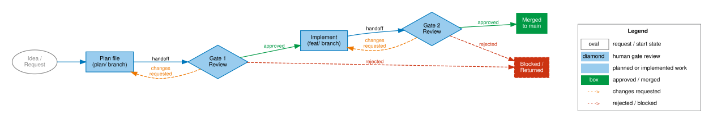

# Your first governed change

*Status: Released. Current framework version: see [Release information](../../reference/release-info.md). Audience: developers who have
completed [install and layouts](../adopt/install-and-layouts.md). After
this page you have taken one real change through both gates and validated the
files that make the audit trail.*

Two approvals frame this change. Gate 1 is the human governor's approval of the
written plan before work starts. Gate 2 is the human governor's approval of the
finished change before it merges. In a solo project, that is you. Your assistant
does the work in between and cannot approve its own.

Pick a small, real change: a modest bug fix or feature that is large enough to
need review, but small enough that the mechanics stay visible. The example
below uses a safer login error message. Replace the file names with your own
project's files.

The eight numbered steps below are one walk through the same six-stage
path shown in Figure 1: plan, Gate 1, implementation, Gate 2, merge, and
completion. Keep the figure in view while you work through the numbered
steps — each step maps onto exactly one stage, so if you find yourself
implementing before step 4's Gate 1 decision, or merging before step 6's
Gate 2 review, you have skipped a stage the figure shows as required, not
optional. The point to retain for this first run: the order in the
figure is the order you are about to follow, with no stage collapsed or
reordered for a first attempt.



*AI-generated figure. Publication remains the responsibility of the human maintainer.*

Each step below is marked with who actually does it, using the same
responsibility vocabulary as the rest of this site (see
["How to read this site"](../index.md#how-to-read-this-site)): a **Human
decision** step has no AI substitute; an **AI action** step is procedure
your assistant runs while you review the result; an **Automated check**
step is a deterministic tool result, not a judgment call; **Shared
concept** is a mental model both of you need, so you can coordinate using
the same vocabulary. A step that genuinely splits across two of these
names both, rather than being forced into one.

## 1. Know where the files will go

**Who does this: AI action for the directories themselves — step 2's
assistant prompt creates any that are missing. The human decision is the
path, not the mkdir.**

AGF itself lives in `agf/`. The POC default keeps project-owned gate evidence
in root `docs/plans/` and `docs/coordination/`. If your project chooses
another coordination path, decide and document it now, before agents start
writing files — do not let agents split records across two channels.

Step 2's assistant prompt below creates `docs/plans/`, `docs/coordination/`,
and `agf/learnings/` for you as part of preparing the starter files. If you
are working without an assistant for this step, create them yourself first:

```bash
mkdir -p docs/plans docs/coordination agf/learnings
```

## 2. Ask your assistant to prepare the starter files

**Who does this: AI action — paste the prompt below to your assistant;
you review what it produced.**

Do not spend your first AGF trial copying template files by hand. Let the AI do
the clerk work, then review what it produced.

Paste this into your coding assistant:

```text
Prepare the starter files for my first governed AGF change.

Use this example task:
"Use a safer, less revealing login error message."

Create or update:
- docs/plans/
- docs/coordination/
- agf/learnings/
- docs/plans/sample-login-error-message.md from agf/templates/gate1-plan.md
- one Gate 1 handoff coordination message
- agf/learnings/sample-project.yaml from agf/templates/learning-record.yaml

Use `agov coord brief --id-format readable --from <role>` for new coordination
messages when the tooling is available. New readable-ID coordination filenames
must be `<id>.md`.

Fill only the fields you can honestly fill for this trial. Leave obvious
placeholders where the governor or implementation evidence must be supplied
later. Do not invent tests, commits, approvals, or validation results.
```

The assistant should create the files and tell you what it changed. Review the
diff. The point of the first trial is not to test your ability to copy
templates; it is to see whether the assistant can work inside the governance
loop and leave an audit trail you can read.

If you are working without an assistant for the setup step, the manual fallback
is to copy the starter templates yourself and then rename the coordination
files using readable IDs from `agov coord brief`.

## 3. Validate the plan and first handoff

**Who does this: AI action to run the commands; Automated check for the
result — your assistant invokes the validator, but the pass/fail output is
the validator's deterministic result, not the assistant's judgment; you
read that result, not the raw files.**

Use the `agov` command for core validation. In this repository it points at
`tooling/agov`; in another checkout, symlink that executable into
`~/.local/bin` or run `./tooling/agov` directly.

```bash
agov plan validate docs/plans/sample-login-error-message.md
agov coord validate docs/coordination/<gate-1-handoff-id>.md
```

The plan contains real YAML front matter, including the required advisory
consultation entries. The handoff contains the required handoff object. If
validation fails, fix the file before continuing.

Advisory consultation evidence is required for a valid non-trivial plan, but
advisors do not approve or reject Gate 1. The validator can block a malformed
or missing consultation record; the governor-reviewer records the binding gate
decision.

## 4. Gate 1: decide before implementation

**Who does this: Human decision — no AI substitute. The assistant may draft
a decision-record skeleton, but the governor writes the actual decision.**

The governor-reviewer reads:

- `docs/plans/sample-login-error-message.md`
- the Gate 1 handoff coordination message

Then the governor files the decision. For this trial, the assistant may prepare
a decision-record skeleton, but the governor writes the actual decision and
conditions. Do not let the assistant approve its own plan.

Validate it:

```bash
agov coord validate docs/coordination/<gate-1-decision-id>.md
```

Nothing is implemented before Gate 1 approval lands.

## 5. Branch and implement test-first

**Who does this: AI action — your assistant branches and implements;
you review the diff and test results before Gate 2.**

```bash
git checkout -b fix/sample-login-error-message
```

Write or update the failing test, make it pass, then refactor. The TDD rule in
your assistant rules is binding on the assistant even when the change feels
small.

## 6. Gate 2: review before merge

**Who does this: Human decision — the assistant may prepare the handoff
evidence, but the governor reviews and approves.**

After implementation, update the prepared Gate 2 handoff with the real changed
files and validation commands:

```bash
$EDITOR docs/coordination/<gate-2-handoff-id>.md
agov coord validate docs/coordination/<gate-2-handoff-id>.md
```

The governor-reviewer reviews the implementation diff, the tests, and the
handoff evidence. Approval is a new `decision-record` naming the branch and any
conditions. Do not merge without Gate 2 approval.

## 7. Merge and close the loop

**Who does this: Human decision to merge; the assistant may prepare the
completion entry for you to review before it's filed.**

Merge through your normal reviewed merge path. Then update and file the
completion entry:

```bash
$EDITOR docs/coordination/<completion-id>.md
agov coord validate docs/coordination/<completion-id>.md
```

The chain is now reconstructible:

```text
plan -> Gate 1 handoff -> Gate 1 decision -> implementation -> Gate 2 handoff -> Gate 2 decision -> completion
```

That chain is the audit trail. Six months later, "why did this land?" is answered
by files, not memory.

## 8. Record what you learned

**Who does this: AI action to draft the entry; Human decision on what's
worth recording — the assistant can draft the entry, but you decide what's
worth recording and check it before it's shared upstream.**

If the first run exposed friction, record it in
`agf/learnings/sample-project.yaml` under your codename. Do not include real
project, company, customer, credential, or private URL data in externally shared
learning records.

## Fast track after the first run

For the first walkthrough, use the full ceremony once. After that, check the
fast-track criteria before writing a plan:

- no more than three files;
- no shared interface, data model, security boundary, or migration change;
- no conflicting claim;
- no scope uncertainty.

If every criterion holds, Gate 1 may be waived, but Gate 2 still applies.

## Next

- Mental model behind the ceremony: [roles and gates](../concepts/roles-and-gates.md)
- Daily rhythm without the training wheels: [day-to-day operation](../operate/day-to-day.md)
- Exit path if the trial does not pay off: [exit and decommission](../adopt/exit-and-decommission.md)
