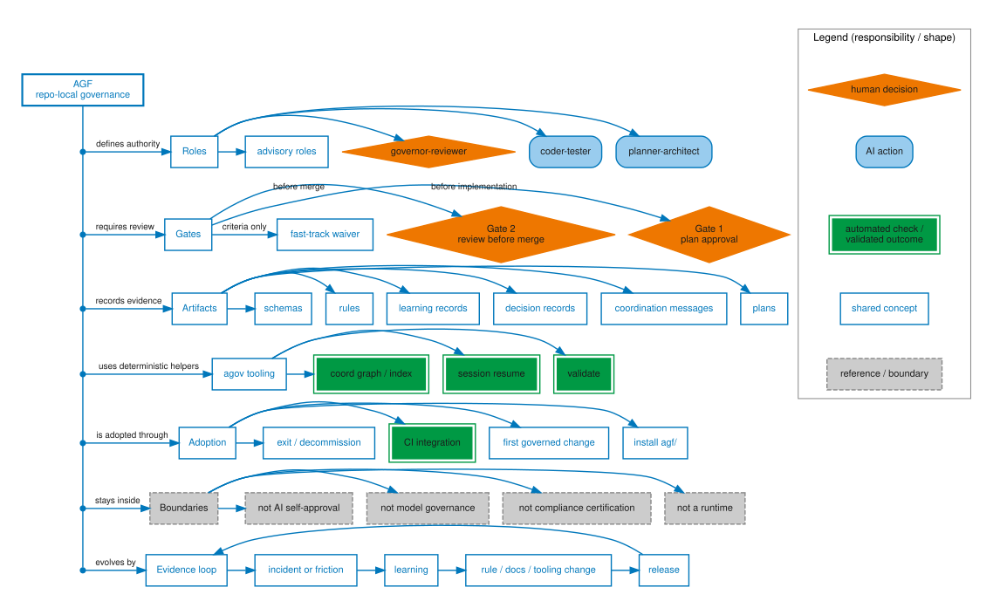

# Framework map

*Status: Released. Last verified against agents-govern v2.2; current framework version: see [Release information](../../reference/release-info.md). Audience: evaluators, adopters, and
AI assistants that need a quick orientation before reading the detailed pages.
After this page you can name the main AGF concepts and know where to read
next.*

This map is an orientation layer, not a new source of authority. The rules,
schemas, coordination records, and gate decisions remain the controlling
artifacts. Use this page when you need the shape of the framework before
reading the exact contracts.

The diagram groups every AGF concept under one of five headings — AGF
itself, roles, gates, artifacts, and the categories this site organizes
around — and connects each concept to the heading that owns it, not to
every other concept it happens to relate to. The point to retain: this
map answers "which category does this term belong to," not "what is the
full relationship between these terms" — for the latter, follow the link
each concept eventually points to in the pages below.

[Open the full-size AGF concept map (SVG)](../../reference/figures/framework-map.svg)

*Palette rationale: `governor-reviewer` and both gates are explicit human
approval points (this page's own body text names Gate 1 "plan approval"
and Gate 2 "review before merge"), so they use the Human decision
treatment. `planner-architect`/`coder-tester` are named, single-actor-type
AI agent roles — each is played by exactly one actor class — so AI action.
`agov` tooling commands (`validate`, `session resume`, `coord
graph/index`) and `CI integration` are deterministic automated steps, so
Automated check. The "Boundaries" section and its four "not a ..."
statements are explicitly reference/scope-limiting statements, not
actions, so Reference/deferred content. Everything else — category
headers, artifacts (plans, coordination messages, decision records,
learning records, rules, schemas), adoption steps, and evidence-loop
stages — mixes human and AI participation with no single responsible
actor type, so Shared concept.

The map mixes actors (Human decision), actions (AI action), mechanisms
(Automated check), and concepts (Shared concept) by design — this map is
an orientation layer over the framework's concept vocabulary, not a
single-axis diagram, so nodes are classified by what each one most
concretely represents. `advisory roles` specifically stays Shared concept
rather than AI action: unlike `planner-architect`/`coder-tester`, it is a
plural umbrella label covering multiple distinct roles with different
actor types (`contribution-auditor`, `academic-peer-reviewer`,
`fact-checker`, `infosec-sentinel` — themselves a mix of AI, mixed
human+AI advisory, and tooling/CI roles per the role-category axis
established in `role-communication-topology.dot` and
`agent-participation-by-phase.dot`). Collapsing that mix into a single
AI-action fill would misrepresent it the same way BLOCK 1/2 in `r1gq`
flagged for the Class 3 figures.*

## What is included

The map includes only the load-bearing concepts a first reader needs:

- roles, especially the human governor-reviewer;
- Gate 1, Gate 2, and fast-track waivers;
- plans, coordination messages, decision records, learning records, rules, and
  schemas;
- the `agov` commands that summarize or validate repo state;
- adoption entry and exit points;
- boundaries that prevent overclaiming;
- the evidence loop that turns incidents and repeated patterns into framework
  changes.

## What is excluded

The map deliberately excludes:

- every individual rule;
- every schema field;
- every specialist role;
- every `agov` subcommand;
- release artifact implementation detail;
- roadmap hypotheses that are not shipped;
- project-specific customizations.

Those details matter, but putting all of them on the map would make it harder
to see the framework.

## Node guide

| Node | Meaning | Read more |
|---|---|---|
| AGF | Repository-local governance for AI-assisted software work. | [AGF and agent runtimes](../concepts/position.md) |
| Roles | Named responsibilities that keep planning, implementation, and approval separate. | [Roles and gates](../concepts/roles-and-gates.md) |
| Gates | Human-reviewed checkpoints before implementation and before merge. | [Roles and gates](../concepts/roles-and-gates.md) |
| Artifacts | Files that make decisions reconstructible after chat context is gone. | [Coordination protocol](../concepts/coordination-protocol.md) |
| agov tooling | Deterministic helpers for validation, resume, status, and graphing. | [Tooling and token savings](../adopt/tooling-and-tokens.md) |
| Adoption | The path from decision to first governed change, CI, and exit. | [Install the agf directory](../adopt/install-and-layouts.md) |
| Boundaries | What AGF is not: runtime, compliance certification, model governance, or AI self-approval. | [AGF and agent runtimes](../concepts/position.md) |
| Evidence loop | Incidents and repeated patterns become learnings, then rules, docs, tooling, or retirements. | [Learning loop and evidence](../concepts/evidence-and-learnings.md) |

## Edge guide

| Edge | Meaning |
|---|---|
| `defines authority` | Role files and rules say who may do what. |
| `requires review` | Gate 1 and Gate 2 create explicit human checkpoints. |
| `records evidence` | Plans, decisions, reviews, and learnings stay in git. |
| `uses deterministic helpers` | `agov` summarizes and validates structure so agents do not improvise it. |
| `stays inside` | Boundaries prevent AGF from pretending to be a runtime or compliance system. |
| `evolves by` | Learning records and release discipline keep framework changes evidence-based. |

## Next

- Decide whether AGF fits: [Should you adopt?](should-you-adopt.md)
- See the operating sequence: [Your first governed change](first-governed-change.md)
