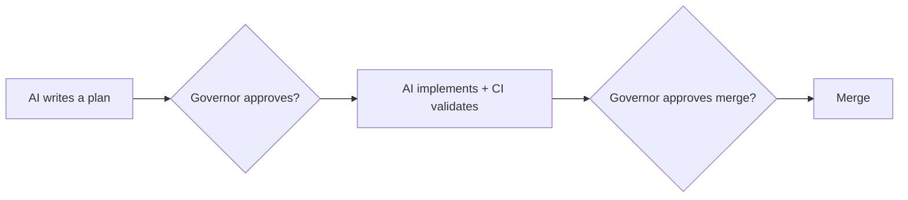

# agents-govern

**AI coding with human accountability.**

AI coding agents can produce changes you cannot reconstruct later.
agents-govern makes AI-assisted software work auditable without adding a hosted
service or runtime.

Your assistant can plan, patch, and test. Six months later, git history alone
often cannot answer why a change was requested, who accepted the risk, or what
the AI was supposed to do. agents-govern adds three file-based controls on top
of your existing repository:

- **Roles:** AI agents operate under named responsibilities. An agent cannot
  approve its own work, and a human governor holds gate authority.
- **Two gates:** Gate 1 approves a plan before implementation. Gate 2 approves
  the implementation before merge. CI validators provide evidence; the governor
  decides.
- **Decision log:** Plans, reviews, approvals, and handoffs are files in the
  repository, so later readers can reconstruct the chain of decisions.

No new accounts. No hosted service. No runtime. The framework is files in your
repo, instructions your AI assistant reads, and optional validators your CI can
run.

Typical cost: an afternoon to install, plus about 5-15 minutes of governor
attention for a non-trivial change. Exit is documented: pause the gates, keep
only the rules you still want, or remove the AGF files in an ordinary cleanup
commit for a small default install.

Next step: read [Should you adopt?](docs/start/should-you-adopt.md), the
five-minute filter for deciding whether AGF is useful for your project now.

> **Status:** This site documents the released **agents-govern v2.1** line.
> Some rules and extension points are still marked experimental or
> evidence-limited where the evidence base is narrow. The exact version and
> source commit for this build are recorded in
> [Release information](reference/release-info.md). Release archives and
> platform-specific Rust binaries are published on the
> [GitLab Releases page](https://gitlab.com/janipaijanen/agents-govern-framework/-/releases).

## How to adopt

Use this as the twenty-minute path after the first scan. Adoption is an
afternoon for a developer who has read the linked pages below and already has a
git repository with an AI assistant.

**Step 1 — Make the decision once.**
Read [Should you adopt?](docs/start/should-you-adopt.md). It is a single page
with a clear adopt / wait / skip decision guide, the full list of commitments
you accept, and the costs stated plainly. Also read
[Exit and decommission](docs/adopt/exit-and-decommission.md): knowing how to
leave without rewriting history is part of the decision.

**Step 2 — Let the assistant prepare the files; you review the rules.**
Follow [Install the `agf/` directory](docs/adopt/install-and-layouts.md) to
commission the framework in the single supported v2.0 layout. The guide gives
you a pasteable assistant prompt for the clerical setup. Your job is to review
the diff, resolve `CUSTOMIZE` markers, and delete rules that do not apply; an
inapplicable rule trains agents that rules are optional.

**Step 3 — Run one real change through both gates.**
Work through [Your first governed change](docs/start/first-governed-change.md).
Gate 1 is plan approval before implementation; Gate 2 is review before merge.
One small change teaches you the loop without committing the whole project.

That is the full install. Everything else — validators, token savings, advanced
configuration — layers on top once the basics work.

## How it works

**Role separation.** Agents get plain-language job descriptions. An implementer
writes code. A reviewer checks it. A human governor approves gates and owns the
project risk. An agent cannot approve its own work.

**Hard gates.** Gate 1 asks whether the agent has a plan worth implementing.
Gate 2 asks whether the implementation followed the rules and is ready to
merge. Validators and CI provide evidence, but human governor decisions remain
binding.

**Git-native operation.** There is no hosted service, shared runtime, or message
API. Assistants coordinate by reading and writing files in git, so the framework
can work with different coding tools across separate sessions.

## Token savings with the Rust tooling (optional)

Every time an AI agent reads coordination files to reconstruct channel state, it
uses context tokens. The AGF tooling replaces many of those reads with
deterministic command output: the tool answers the question in milliseconds and
returns a compact summary the agent reads instead of scanning dozens of files
itself.

The shipped Rust binary (`agov`) is the adopter-facing tooling surface. The
table below shows current maturity — commands at Level 5 are in production use
on this project:

| Command | Replaces | Maturity |
|---|---|---|
| `agov coord validate <file>...` | AI reads a coordination file to check schema compliance | Level 5 — Deployable |
| `agov plan validate <file>...` | AI reads a Gate 1 plan file to check front-matter | Level 5 — Deployable |
| `agov validate` | AI reads adoption, agent, and learning files to spot problems | Level 5 — Deployable |
| `agov coord brief ...` | AI asks a human or guesses a coordination ID and filename | Level 5 — Deployable |
| `agov handoff next <role>` | Agent scans handoff files and mentally subtracts resolved items | Level 5 — Deployable |
| `agov coord status` | Agent counts pending handoffs and active claims by reading the channel | Level 5 — Deployable |
| `agov session resume --role <role>` | Agent reads recent coordination files to reconstruct its starting state | Level 5 — Deployable |
| `agov coord stale` | Agent identifies expired artifact claims by reading all claim messages | Level 5 — Deployable |
| `agov coord visibility` | Agent scans branches for hidden coordination obligations | Level 5 — Deployable |
| `agov token roi report` | Agent summarizes deterministic-tool token savings from local telemetry | Level 5 — Deployable |
| `agov usage report` | Agent counts active roles, senders, message kinds, and unknown senders | Level 5 — Deployable |

*Maturity levels follow the [implementation honesty model](docs/concepts/evidence-and-learnings.md):
Level 5 is deployable and in active use; Level 1 is planned. Do not conflate
the two.*

Release archives ship platform-specific Rust tooling. Source-checkout users
should use the same `agov` command surface as release-archive adopters. See
[Tooling and token savings](docs/adopt/tooling-and-tokens.md) for setup,
estimates, and the evidence base behind the savings claims.

## What you get

**Accountability structure for AI agents.** Each agent operates under a
written definition: what it owns, what it may change, what it must escalate.
An implementing agent cannot approve its own work; a reviewing agent cannot
implement. The separation is structural, not aspirational.

**Decisions you can reconstruct.** Every plan approval, review finding, and
merge decision is a file in the coordination channel — the append-only decision
log. Six months later, you can answer "why was this merged?" by reading the
chain, not by archaeology on commit messages. Because the channel is just files
in a repository, it works whether one assistant fills all roles across sessions
or several assistants collaborate in parallel.

**Quality gates that bind assistants too.** The rule library expresses your
engineering discipline (test-first, migration hygiene, immutable tags,
merge-request workflow) in a form AI assistants load as instructions. Gate 1
and Gate 2 provide human-reviewed checkpoints with CI validators supplying
evidence; the governor makes the binding decision.

**Learning that compounds.** Incidents become learning records — structured
incident and pattern notes; recurring patterns become rules; rules ship to every
adopter. The framework grows from evidence, and the anonymization policy means
your learnings can flow upstream without revealing your project.

## What it costs

Adoption is not free, and the documentation does not pretend otherwise: files
added to your repo, CI jobs to run, review ceremony per non-trivial change, and
a habit to record incidents as learning notes. The overhead is proportional to
change size — trivial edits use a fast track (three files or fewer, no shared
interface or data contract change); architecture changes get the full gate
sequence. The [downstream impact](docs/adopt/downstream-impact.md) page itemises
the full cost, and [exit and decommission](docs/adopt/exit-and-decommission.md)
documents the way out. Read both before adopting.

## Who benefits

- **Solo maintainers** get a repeatable review structure around AI-generated
  work, even when one human owns the final decision.
- **Small teams** get shared conventions that assistants can follow across
  sessions and tools.
- **Engineering leads** get review gates that hold even when changes are
  machine-generated at machine speed.
- **Developers** get an assistant that follows the project's actual conventions
  consistently — the rules load as files the assistant reads every session, not
  as prompts you retype or conventions the assistant re-derives from scratch.
- **Auditors and security reviewers** get an append-only decision trail and
  explicit security escalation boundaries.

## Where to go next

| Intent | Start here |
|---|---|
| Make the adopt / wait / skip decision | [Should you adopt?](docs/start/should-you-adopt.md) |
| Answer commissioning questions | [Adopter FAQ](docs/start/adopter-faq.md) |
| Understand cost and exit path | [Downstream impact](docs/adopt/downstream-impact.md) → [Exit and decommission](docs/adopt/exit-and-decommission.md) |
| Install and run one governed change | [Install the `agf/` directory](docs/adopt/install-and-layouts.md) → [Your first governed change](docs/start/first-governed-change.md) |
| Set up the tooling and understand token savings | [Tooling and token savings](docs/adopt/tooling-and-tokens.md) |
| Operate a project day to day | [Day-to-day operation](docs/operate/day-to-day.md) |
| Follow the full learning path | [Documentation index](docs/index.md) |

## Evidence, honestly stated

The framework's evidence base is its [learning records](docs/concepts/evidence-and-learnings.md):
operational incidents and validated patterns from the framework's own development
and from early adopters, recorded under codenames. Rules shipped on
single-adopter evidence are explicitly marked **Provisional** in the rule text
itself. We state maturity levels rather than claiming capabilities — see the
[evolution page](future/evolution.md) for what is shipped versus hypothesised.

Version, source commit, copyright, and license details are listed in
[Release information](reference/release-info.md). Framework content:
CC BY-SA 4.0, with separate commercial licensing available for alternative
terms. Tooling code: MIT.
