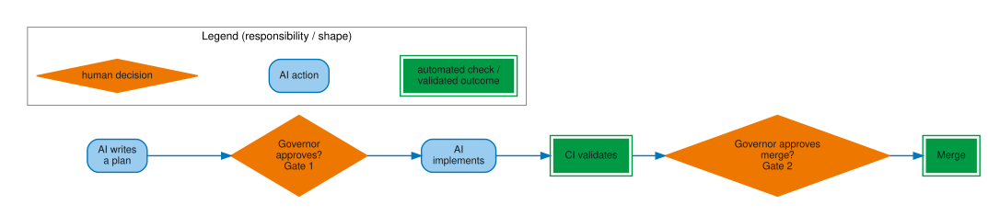

<!--
SPDX-License-Identifier: CC-BY-SA-4.0
-->
# Figures

All figures are generated from DOT source files in
`agf/docs/figures/src/`. SVG outputs are committed to
`docs/site/reference/figures/` as source-of-truth artifacts.

**To regenerate all figures:**

```bash
cd agf/docs/figures
for f in src/*.dot; do
  name=$(basename "$f" .dot)
  dot -Tsvg "$f" -o "../site/reference/figures/${name}.svg"
done
```

Requires Graphviz (`dot` version 2.x or later).

## Governance loop

The framework's own development runs the same cycle it prescribes for
adopters: plan, implement, review, merge, learn, and back to plan.
Figure 1 draws that as a closed loop rather than a line specifically
because the "learn" step is not optional cleanup — incidents and
observations from one cycle feed the learning record, and the learning
record feeds new rules, tools, and documentation updates that the next
cycle's plan step is bound by. The point to retain: skipping "learn"
does not shorten the cycle, it breaks the loop's only feedback path.

<figure markdown>

<figcaption>Figure 1. Governance work forms a closed evidence-feedback loop. AI-generated figure; publication remains the responsibility of the human maintainer.</figcaption>
</figure>

**Source:** `docs/figures/src/governance-loop.dot`

---

## Gate 1 / Gate 2 pipeline

This is the canonical rendering of the two-gate pipeline referenced by
name from every other page that discusses Gate 1 or Gate 2 — the
reference copy other pages' own page-specific figure prose points back
to. Figure 2 places both gates on one request-to-merge path: Gate 1
approves the plan before implementation starts, Gate 2 approves the
implementation before merge, and either gate can return the work for
changes or reject it outright rather than only ever advancing forward.
The point to retain: a rejection at either gate is a normal path shown
in the figure, not an exception to it.

<figure markdown>

<figcaption>Figure 2. Gate 1 governs the plan and Gate 2 governs the implementation. AI-generated figure; publication remains the responsibility of the human maintainer.</figcaption>
</figure>

**Source:** `docs/figures/src/gate-pipeline.dot`

---

## Coordination channel

This is the reference rendering of the coordination channel's message
kinds, which the narrower per-page uses of this figure elsewhere on the
site assume you have already seen. Figure 3 groups messages by what they
do rather than by who sends them: handoffs direct attention to the next
agent, decision records gate or block, completions close tasks, and
notes carry advisory or status information that does not itself gate
anything. The point to retain: only decision records carry gating
authority — a handoff, note, or completion cannot substitute for one,
regardless of how much detail it contains.

<figure markdown>
<div class="figure-scroll" markdown>

</div>
<figcaption>Figure 3. Message kinds route work, record decisions, or preserve status. AI-generated figure; publication remains the responsibility of the human maintainer.</figcaption>
</figure>

**Source:** `docs/figures/src/coordination-channel.dot`

---

## Operating responsibility map

Figure 4 is the reference version of the three-mode split used
day-to-day: human-only authority, AI-executed work, and mixed work in
the audit trail. It separates the three modes by what kind of action
they are, not by how much oversight happens to be applied to a given
instance of the action. The point to retain: "AI-executed" means
delegated execution of a task, never autonomous approval authority — an
AI agent that executes a task in this mode still cannot move that same
task into the human-only mode by approving it itself.

<figure markdown>

<figcaption>Figure 4. Responsibility mode does not transfer human approval authority. AI-generated figure; publication remains the responsibility of the human maintainer.</figcaption>
</figure>

**Source:** `docs/figures/src/operating-responsibility-map.dot`

---

## Evidence lifecycle

Figure 5 is the only figure on this site that tracks a single piece of
evidence through its full promotion path rather than a recurring cycle:
an observation becomes a learning record; learning records promote to
rules, validators, or documentation updates; and sufficient
corroboration — two or more independent adopters reporting the same
pattern — promotes a rule from Provisional to Recommended. The point to
retain: promotion is gated on independent corroboration, not on the
rule's author restating conviction, which is why a single-adopter rule
stays labeled Provisional no matter how strongly its own adopter argues
for it.

<figure markdown>

<figcaption>Figure 5. Independent corroboration governs evidence promotion. AI-generated figure; publication remains the responsibility of the human maintainer.</figcaption>
</figure>

**Source:** `docs/figures/src/evidence-lifecycle.dot`

---

## Learning loop

Where Figure 5 traced one piece of evidence through a single promotion
path, Figure 6 is the reference view of the recurring cycle that
generates it: governed work produces incidents, friction, or validation
results; learning records preserve the evidence; system-level analysis
asks which control should change; governed approval precedes
implementation; and observed project use confirms, challenges, revises,
or retires the change before feeding the next cycle. The point to
retain: "observed project use" is itself a cycle input, not an end
state — a shipped rule remains subject to the same evidence discipline
that produced it.

<figure markdown>

<figcaption>Figure 6. Observed use feeds the next learning cycle. AI-generated figure; publication remains the responsibility of the human maintainer.</figcaption>
</figure>

**Source:** `docs/figures/src/learning-loop.dot`

---

## Adoption and exit flow

Figure 7 is the reference rendering of the full adoption-to-exit
timeline: Step 0 assesses risk profile, install and a first governed
change establish the governance habit, and from there the timeline
branches into the exit paths — freeze, replace-on-update, and full
decommission — detailed on the per-page uses of this figure elsewhere on
the site. The point to retain: all three exit paths preserve the
coordination record history: choosing an exit path changes what keeps
running, not what remains auditable.

<figure markdown>

<figcaption>Figure 7. Every exit path preserves the coordination history. AI-generated figure; publication remains the responsibility of the human maintainer.</figcaption>
</figure>

**Source:** `docs/figures/src/adoption-exit-flow.dot`

---

## Coordination map example

Unlike the other seven figures on this page, Figure 8 is not a
normative diagram of how AGF works — it is a dated snapshot of one real
channel, the AGF foundry's own, generated from actual coordination
messages rather than drawn to illustrate a concept. Parenthesized
numbers on edges (e.g. `handoff (22)`, `decision-record (9)`) are
message counts from that captured sample, labeled in the embedded legend
as "Edge label = kind (message count)"; they reflect this one project's
history at generation time, not a universal ratio any adopting project
should expect to reproduce. The point to retain: adopting projects may
define more specialized roles and show entirely different communication
patterns as their own governance model matures — a thin or absent edge
here is evidence about the foundry's history, not a target topology.

<div class="figure-scroll" markdown>

</div>

*AI-generated figure. Publication remains the responsibility of the human maintainer.*

**Source:** `docs/figures/src/coordination-map-example.dot`

---

## Governed change flow

Figure 9 is the compact landing-page orientation: AI writes a plan, the human
governor decides Gate 1, AI implements, CI validates, and the governor decides
Gate 2 before merge. Shape and border treatment distinguish AI action, human
decision, and automated validation without relying on colour alone.

[](figures/governed-change-flow.svg)

*AI-generated figure. Publication remains the responsibility of the human maintainer.*

[Open the full-size governed change flow (SVG)](figures/governed-change-flow.svg)

**Source:** `docs/figures/src/governed-change-flow.dot`

---

## Runtime and governance boundary

Figure 10 separates runtime execution from AGF governance. The runtime invokes
agents, tools, and memory or state; AGF defines roles, gates, artifacts, and
the boundaries and learning records around that execution.

[](figures/runtime-governance-boundary.svg)

*AI-generated figure. Publication remains the responsibility of the human maintainer.*

[Open the full-size runtime and governance boundary figure (SVG)](figures/runtime-governance-boundary.svg)

**Source:** `docs/figures/src/runtime-governance-boundary.dot`

---

## AGF governance position

Figure 11 names AGF's relationship to five adjacent categories: it governs
agents on runtimes, emits evidence used by CI/CD, occupies a narrower scope
within SDLC governance, differs from ML governance, and operates within wider
AI policy and ethics.

[](figures/governance-scope-position.svg)

*AI-generated figure. Publication remains the responsibility of the human maintainer.*

[Open the full-size AGF governance-position figure (SVG)](figures/governance-scope-position.svg)

**Source:** `docs/figures/src/governance-scope-position.dot`

---

## Gate handoff sequence

Figure 12 reads from top to bottom. It preserves the ordered coordination
chain from the approved Gate 1 handoff through acknowledgement,
implementation, Gate 2 handoff and decision, and final completion.

[](figures/gate-handoff-sequence.svg)

*AI-generated figure. Publication remains the responsibility of the human maintainer.*

[Open the full-size Gate 1-to-Gate 2 handoff sequence (SVG)](figures/gate-handoff-sequence.svg)

**Source:** `docs/figures/src/gate-handoff-sequence.dot`

---

## Framework concept map

Figure 13 groups the orientation vocabulary under roles, gates, artifacts,
tooling, adoption, boundaries, and the evidence loop. It is a category map,
not an exhaustive relationship graph; the surrounding framework-map page
routes each category to its detailed contract.

[](figures/framework-map.svg)

*AI-generated figure. Publication remains the responsibility of the human maintainer.*

[Open the full-size AGF concept map (SVG)](figures/framework-map.svg)

**Source:** `docs/figures/src/framework-map.dot`

---

## Usage rules

- Embed SVG in Markdown with `` from this page,
  or with the full relative path from other pages.
- Every AI-generated figure embed must use descriptive alt text and include the
  visible disclosure "AI-generated figure. Publication remains the
  responsibility of the human maintainer." Do not rely on image metadata or a
  site-wide acknowledgement as the only disclosure.
- Do not hand-edit generated SVG files — edit the DOT source and regenerate.
- Every figure must include an embedded legend in the generated image. Do not
  rely on page prose or captions to explain color, shape, or line semantics.
- Legend samples should remain visual samples: do not put literal shape names
  such as `oval`, `diamond`, or `box` inside the swatch. Put the meaning in the
  adjacent label text instead.
- **Numeric labels must explain their unit.** Any figure that displays numeric
  labels (counts, percentages, durations) must state the unit and sampling
  context inside the figure itself (in the legend or a label), and the page
  text immediately before or after the figure must repeat the meaning in plain
  language. "Edge label = kind (22)" is insufficient on its own; add
  "(message count)" or equivalent in the legend and explain what the sample
  covers in the surrounding text.
- Keep figure text readable at page scale: node labels should normally be
  `11pt`, edge labels `10pt`, and rendered SVGs should stay near or below
  `720pt` wide unless the page intentionally provides a scrollable view.
- Use white backgrounds for standalone SVGs so direct figure URLs remain
  readable outside the MkDocs page chrome.
- Use the [visual palette](palette.md) for all new figures.

## See also

- [Visual palette](palette.md) — colour tokens and usage rules
- Source workflow and authoring standards live in
  `agf/docs/figures/figures.md`.
