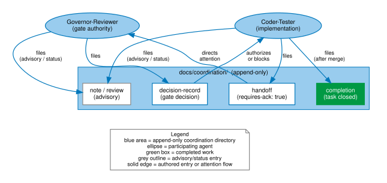
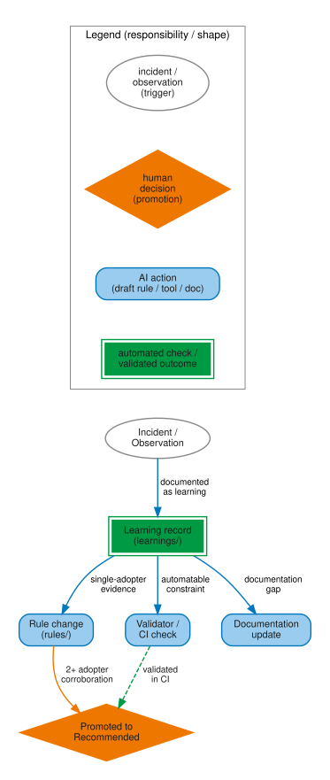
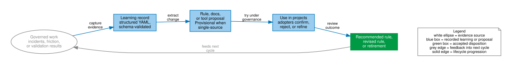

<!--
SPDX-License-Identifier: CC-BY-SA-4.0
-->
# Figures

All figures are generated from DOT source files in
`agf/docs/figures/src/`. SVG outputs are committed to
`docs/site/reference/figures/` as source-of-truth artifacts.

**To regenerate all figures:**

```bash
cd agf/docs/figures
for f in src/*.dot; do
  name=$(basename "$f" .dot)
  dot -Tsvg "$f" -o "../site/reference/figures/${name}.svg"
done
```

Requires Graphviz (`dot` version 2.x or later).

## Governance loop

Figure 1 shows the framework's self-applied governance cycle.


The self-applied cycle: plan → implement → review → merge → learn →
plan. Incidents and observations feed the learning record; the learning
record feeds new rules, tools, and documentation updates.

**Source:** `docs/figures/src/governance-loop.dot`

---

## Gate 1 / Gate 2 pipeline

Figure 2 shows the two-gate quality pipeline from request to merge.


The two-gate quality pipeline. Gate 1 approves the plan before
implementation starts. Gate 2 approves the implementation before merge.
Both gates can return for changes or reject outright.

**Source:** `docs/figures/src/gate-pipeline.dot`

---

## Coordination channel

Figure 3 shows how append-only coordination entries route attention and
record outcomes between agents.



The append-only coordination channel. Handoffs direct attention to the
next agent; decision records gate or block; completions close tasks;
notes carry advisory or status information.

**Source:** `docs/figures/src/coordination-channel.dot`

---

## Operating responsibility map

Figure 4 separates human-only authority, AI-executed work, and mixed
work in the day-to-day audit trail.


The day-to-day split between human-only authority, AI-executed work, and
mixed work in the audit trail. "AI-executed" means delegated execution,
not autonomous approval authority.

**Source:** `docs/figures/src/operating-responsibility-map.dot`

---

## Evidence lifecycle

Figure 5 shows how incidents and observations become learning records,
then rules, validators, or documentation updates.



From incident to improvement. An observation becomes a learning record;
learning records promote to rules, validators, or documentation updates;
sufficient corroboration (2+ adopters) promotes a rule from Provisional
to Recommended.

**Source:** `docs/figures/src/evidence-lifecycle.dot`

---

## Learning loop

Figure 6 shows the evidence-driven feedback loop as a recurring cycle.



The evidence-driven feedback loop. Governed work produces incidents,
friction, or validation results; learning records turn that evidence
into rule, documentation, or tooling proposals; project use confirms,
revises, or retires the change and feeds the next cycle.

**Source:** `docs/figures/src/learning-loop.dot`

---

## Adoption and exit flow

Figure 7 shows the adoption path and the documented exit paths.


From assessment to decommission. Step 0 assesses risk profile; install
and first governed change establish the governance habit. Exit paths
include freeze, replace-on-update, and full decommission — all preserve
the coordination record history.

**Source:** `docs/figures/src/adoption-exit-flow.dot`

---

## Usage rules

- Embed SVG in Markdown with `` from this page,
  or with the full relative path from other pages.
- Do not hand-edit generated SVG files — edit the DOT source and regenerate.
- Use the [visual palette](palette.md) for all new figures.

## See also

- [Visual palette](palette.md) — colour tokens and usage rules
