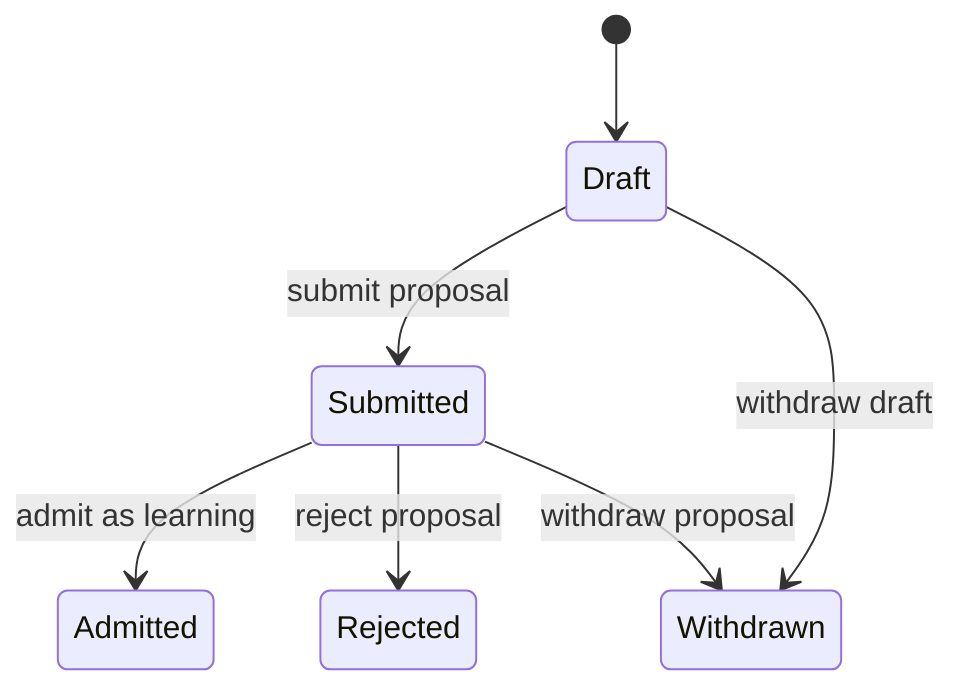
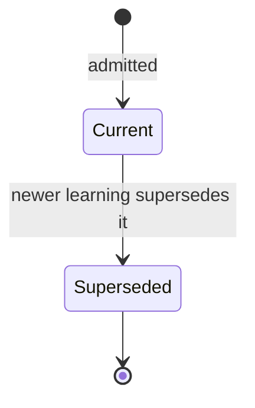
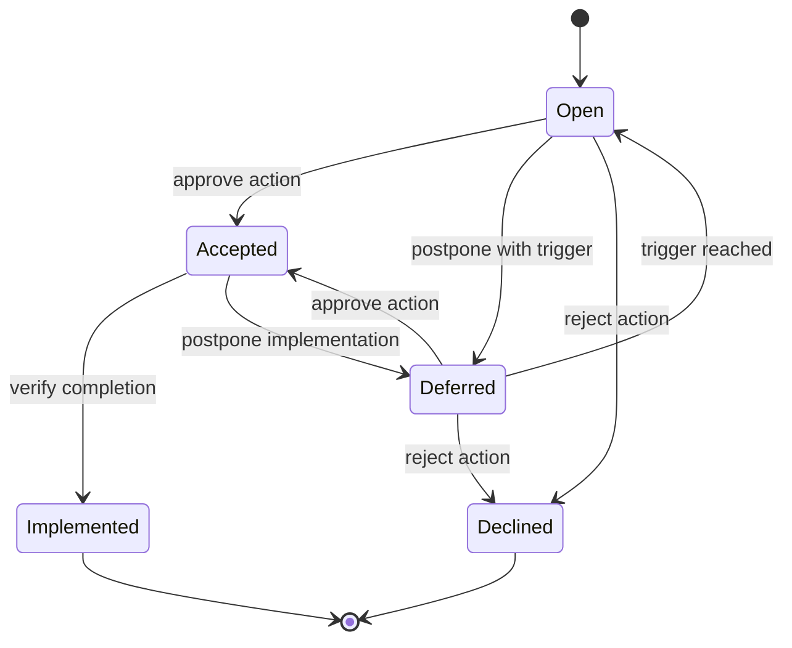

# Challenge requested: learning lifecycle as immutable paper with append-only stamps

The governor asks planner-architect/Claude to challenge, improve, or reject this
model before any Gate 1 plan or implementation starts. This is a semantic design
review, not implementation authority.

## Hard boundary

A canonical learning is analogous to an issued paper record. Its learning body
stands independently and is immutable after admission. The only in-record
addition permitted is a mechanically constrained lifecycle stamp in a closed,
append-only block. Existing stamps cannot be edited, deleted, or reordered.

Do **not** put free-form remarks in that block. A remark would become an
uncontrolled secondary learning surface and the soft distinction between a
remark and a learning would not survive use. Commentary, rationale, or a new
observation must instead be an annex or a separately identified record linked
to the learning. A state-changing stamp may contain identifiers, transition
terms, time, actor role, authority reference, and evidence references, but no
free-form field that can accumulate substantive learning content.

## Proposed state machines

`Draft`, `Submitted`, `Rejected`, and `Withdrawn` belong to the proposal or
routing envelope, not to the canonical learning corpus. A branch or draft MR
may contain a proposed YAML file, but `main` must mechanically reject a
canonical learning that lacks its admission evidence.

Record currency answers whether the observation remains the current account.
Supersession does not erase the record or mean its recommendation was completed.

Recommendation disposition is independent of record currency. `Deferred`
requires a trigger or review time. `Accepted`, `Declined`, and `Implemented`
require the authority and evidence defined by the eventual rule. `Done` is at
most a derived UI grouping of terminal outcomes; it is not a stored state.

## Proposed stamp constraints

Each stamp should have a stable stamp ID, axis, closed transition term, UTC
timestamp, actor role, authority reference, and evidence references. Current
state is obtained by replaying valid stamps. A validator should reject changed,
deleted, reordered, duplicate, unauthorized, and illegal-transition stamps.
Any readable current-state summary should be generated output, not canonical
hand-edited data.

Directory placement is a filing view and must not imply lifecycle state.
Implemented learnings remain evidence and should not be moved to `legacy/`.
A future physical legacy partition may represent a frozen schema/provenance
cohort only after recursive validation, corpus-wide identity, cross-directory
supersession, and stable-reference behavior are implemented.

## Linked-data consequence

Keep YAML authoritative. A later deterministic JSON-LD projection may expose
the paper as an entity/creative work and each stamp as a separately identified
annotation or provenance activity while retaining physical containment in the
same source record. Storage path must not become identity. Issue 129 should
settle identity, privacy, vocabulary, and a real query benefit before adopting
that projection.

## Questions for the review

1. Are three machines necessary, or can any be combined without weakening a
   mechanical boundary?
2. Does a recommendation belong inside every learning, or should it be an
   independently identified annex linked to the evidence record?
3. What is the mechanically valid response to an erroneous admitted learning:
   supersession, withdrawal by authority, or another explicit terminal state?
4. How should current `proposed` and `implemented` fields migrate without
   inventing historical authority or evidence?
5. Which minimum stamp fields allow validation without inviting free-form
   content to become a hidden learning channel?
