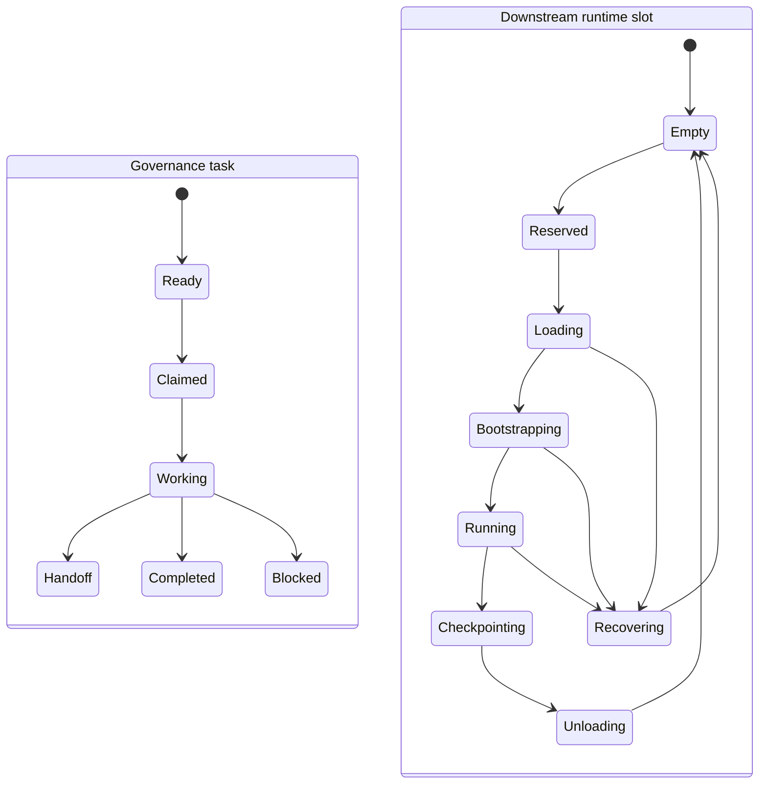

# Serial governed role execution on capacity-constrained runtimes

**Status:** accepted post-RUW capability direction; implementation not authorized
**Maturity:** Level 1 Planned; this draft proposes, but does not approve, a
Level 2 surface
**Evidence status:** Theoretical, informed by existing AGF session-continuity
and handoff mechanisms; not yet validated on a multi-model single-slot runtime

## Question and verdict

Can an adopter use one compute unit that can load only one model at a time,
while different models play different AGF roles in sequence?

Yes. The use case survives architecture, operations, contribution, and
security teardown as **serial governed role execution over a runtime with
capacity one**. It generalizes to modest consumer GPUs, confidential or
air-gapped environments, specialist models, license/cost/energy-based time
sharing, sequential cross-model review, and degraded offline operation.

AGF should define the portable governance contract. It should not become a
model runtime or GPU scheduler. A removable adapter may connect governed work
to a downstream runtime; the downstream remains responsible for model
loading, resource exclusion, process isolation, quantization, credentials,
and model supply-chain controls.

This proposal does not authorize implementation, schema changes, new blocking
authority, or an agent-role activation. Any implementation requires a bounded
Gate 1 plan after RUW work.

Governor acceptance is recorded in
`20260918T150621Z-governor-reviewer-qmgg.md`; Claude's no-addition response,
relayed by the governor, is recorded in
`20260918T150612Z-planner-architect-qs8r.md`.

## Existing work and collision disposition

- Issue #103, *Post-v2.5.0: test and publish a one-machine local-model AGF
  recipe*, is the closest existing owner. It covers one machine and one local
  model, but not sequential model swaps or role-specific staffing. The first
  pilot here should extend or become a child of #103 instead of creating a
  competing recipe.
- Issue #47 owns reviewer-independence recording. This proposal consumes that
  vocabulary; it must not invent a second definition of session, model, or
  vendor independence.
- Issue #82 warns that sequential cross-model agreement is correlated evidence,
  not automatic independent corroboration. Issue #121 owns same-role
  concurrent-session addressing; this profile is serial and must not widen
  that work.
- Issues #98 and #104 cover heavier orchestrators and reinforce the removable,
  non-authoritative adapter boundary. MR !2688's footprint assessment and MR
  !2689's approved offline quantized drafting pilot are inputs, not permission
  to widen either approved scope.
- The downstream poll/coordinate runbook and the shipped session-continuity
  guidance already cover graceful checkpoints, abrupt recovery, removable
  adapters, and the rule that model and assistant names are provenance rather
  than role authority.
- Existing `agov handoff next`, `take`, and `complete` commands already expose
  durable asynchronous obligations. Their records are governance state, not
  resource locks or model-lifecycle records.

## What survives teardown

1. An adopter can declare runtime capacity as one and execute ready,
   authorized role work serially.
2. A role may have an optional downstream staffing constraint such as an
   eligible or dedicated model profile. Loading that model does not grant the
   role or any Gate, merge, release, or tool authority.
3. Every model eviction or role switch requires a bounded durable checkpoint.
4. Each run records exact model, runtime, session, and configuration provenance
   when the runtime can establish it. Unknown values remain unknown.
5. Sequential use of different models can satisfy a required model-separation
   predicate only when the sessions and model identities are independently
   established. Serial timing alone is not independence.
6. The runtime may use an optional adapter to translate a governed ready item
   into load, health, run, checkpoint, and unload operations.
7. Physical capacity one applies to resident model execution. It does not imply
   that deterministic validators, Git operations, or other non-model tools
   must stop while the model slot is occupied.

The current manifest can describe dedicated staffing only in free-text
`played_by`; `agov` does not enforce role-to-model eligibility. Do not reuse
coordination `from`, `to`, or `model` as routing authority. If later evidence
justifies enforcement, propose an adopter-owned staffing profile consumed by
the removable adapter, where mismatch blocks local invocation or records an
explicit fallback without rewriting role authority.

## Rejected assumptions

- **Universal role-to-model binding.** Roles carry authority; models are
  replaceable players. A universal one-to-one map would turn model
  availability into authority, remove safe fallback, and encourage a renamed
  model to masquerade as a different role.
- **An AGF GPU daemon or scheduler.** AGF does not execute or monitor agents.
  GPU locks, queues, model downloads, runtime health, and process termination
  would increase footprint and create provider-specific failure domains.
- **Using coordination claims as a mutex.** Git-native claims are audit and
  collision evidence. They do not provide atomic acquisition, fencing, lease
  renewal, or stale-worker exclusion.
- **Adding runtime states to `handoff.status`.** Handoffs represent durable
  obligations and currently expose `ready` or `blocked`; they are not task
  leases or model-process state.
- **Persisting prompts, transcripts, KV caches, or hidden scratch state in
  Git.** These are large, sensitive, runtime-specific, and may carry untrusted
  instructions across roles.
- **Automatic review independence.** Different models may still share prompts,
  evidence selection, operator framing, base weights, training ancestry, or
  contaminated context. Required independence must be evaluated and recorded.
- **Concurrency or response-time guarantees.** One slot has unavoidable
  head-of-line blocking and cannot promise simultaneous wakes.
- **Forcing every task through this profile.** Some work needs low-latency or
  parallel exchange and should use another operating profile.

## Responsibility boundary

| Layer | Owns | Must not own |
|---|---|---|
| AGF | Role authority; checkpoint and recovery truth; provenance and independence vocabulary; human Gate boundaries; portable acceptance scenarios | GPU locks; inference processes; downloads; quantization; runtime queueing |
| `agov` | Existing resume/handoff queries; later validation and reporting of a proven portable envelope | Starting or killing models; managing VRAM; granting roles or Gates |
| Optional removable adapter | Mapping a pinned model profile to load, health, checkpoint, and stop hooks; emitting runtime evidence | Gate decisions; role authority; redefining ready work |
| Downstream operator/runtime | Atomic capacity lease; queue policy; model profiles and digests; process isolation; cleanup; secrets; network; licensing and supply chain | Treating model selection or confidence as governance authority |

## Two state machines, not one

Governance state and runtime state correlate through identifiers but have
different owners and failure semantics.

The runtime slot record may reference the AGF task, role, handoff, session, and
exact Git head. It remains downstream operational state and grants no AGF
authority.

## Provisional execution envelope

The first pilot should use a downstream-owned, adapter-neutral envelope. It is
provisional evidence, not a new AGF schema:

- `execution_id` and runtime-generated session identifier;
- governed task or handoff reference and requested role;
- resolved role authority source;
- pinned model artifact digest, tokenizer/runtime version, quantization or
  configuration digest, adapter/prompt-bundle digest, and tool-policy digest;
- capacity profile (`slots: 1`) and monotonic fencing generation;
- exact branch/head, worktree, dirty/untracked/local-only state, coordination
  references, tests, blockers, and next authorized action;
- applicable session/model/vendor/human independence predicates;
- start/end timestamps plus checkpoint and recovery disposition.

Do not standardize these fields until an empirical pilot shows which are
portable across at least two runtime shapes. The runtime must generate and
attest its evidence; a model's self-report is not provenance.

## Mechanical invariants for a reference adapter

1. Capacity-one acquisition is atomic and returns a monotonic fencing token.
   A stale or expired worker cannot publish or mutate after reassignment.
2. Role authority resolves from the adopter manifest and rules. The
   role-to-eligible-model map is staffing configuration only.
3. A switch crosses only the bounded checkpoint envelope. Handoff prose is
   untrusted content and cannot enlarge authority.
4. Unload includes runtime-specific process and cache cleanup. Failed cleanup
   leaves the slot unavailable rather than starting the next role.
5. Crash recovery begins read-only, classifies state as shared, local, or
   unknown, and uses fencing rather than timeout alone.
6. A reviewer predicate is checked before work. Unknown or inadequate
   separation produces `INCOMPLETE`; it does not silently downgrade the rule.
7. A changed implementation SHA invalidates an earlier exact-head review.
8. Model/runtime artifacts are pinned and verified downstream. Secrets and
   sensitive runtime data are redacted from logs and coordination.
9. Queue selection can choose only already-authorized ready work. Priority and
   fairness policy cannot create authority or bypass a Gate.

## Post-RUW pilot

1. Extend or link issue #103 with a manual capacity-one scenario. Introduce no
   schema and no AGF-owned scheduler.
2. On one machine, run a planner model, publish/checkpoint its durable state,
   unload it, run a coder model, checkpoint and unload it, then run a distinct
   reviewer model in a fresh session. Human Gates remain binding.
3. Exercise graceful switching and abrupt loss at loading, running,
   checkpointing, and post-checkpoint/pre-load boundaries.
4. Record load latency, peak RAM/VRAM, wall time, recovery result, and
   governance violations separately from output quality.
5. Repeat with a second runtime shape before treating the envelope as portable.
6. Only then consider a Gate 1 plan for `agov` validation/reporting and an
   optional reference adapter. Runtime control remains outside `agov`.

The empirical work should be a distinct child issue linked to #103, #47, #82,
#121, and the quantized pilot. Do not widen #103's single-model adoption guide
or MR !2689's already-approved scope. Split the child into a manual no-code
trial and, only if useful, a later adapter slice.

## Required negative scenarios

- Two launchers attempt capacity-one acquisition; exactly one succeeds.
- An old worker resumes after lease expiry; fencing rejects its mutation.
- A process crashes before checkpoint and after checkpoint but before the next
  model loads; recovery truth differs and no lost work is invented.
- Unload reports success while a process or cache remains; the next activation
  is blocked.
- A model or handoff forges its role or provenance; runtime evidence wins and
  authority remains unchanged.
- The same model/session is relabelled as reviewer; independence is rejected.
- The same base weights under another alias or quantization are presented as a
  different model; the result is rejected or recorded as unknown according to
  the approved independence policy.
- A checkpoint has a changed SHA, omitted dirty file, local-only commit, or
  failed integrity check; resume remains incomplete.
- A handoff contains prompt injection or a secret; it remains untrusted and is
  not copied into privileged instructions or durable logs.
- A Git claim and runtime lease disagree; execution fails closed and requires
  reconciliation.
- A floating model tag or digest mismatch is detected; activation is denied by
  the downstream runtime.
- Repeated switching starves higher-priority ready work; the run measures and
  reports the behavior without overriding governed priority.
- The human Gate is absent; queue or runtime success cannot substitute for it.

## Decision points after the pilot

Promote only the smallest proven layer:

- If manual checkpoints and current handoffs are sufficient, publish the
  adopter recipe and stop.
- If multiple adapters converge on a stable envelope, propose an additive
  runtime-neutral schema and `agov` validator/report.
- If adapters converge on lifecycle hooks, publish an optional removable
  adapter contract without making it AGF authority.
- If the pilot shows high swap cost, state leakage, unreliable fencing, or no
  governance benefit, keep the scenario downstream and record the failed
  assumptions.

No result from one runtime or one machine should be generalized into a
hardware guarantee. A successful first pilot raises the profile to Level 4
only for its exact implementation and makes the broader recommendation
Empirically informed within the tested envelope; it does not make a universal
Level 5 runtime capability.
